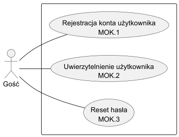
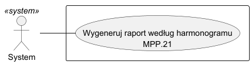
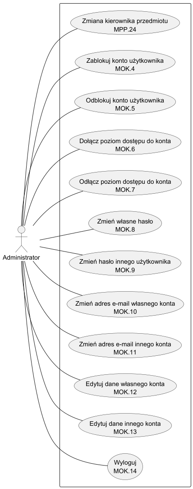
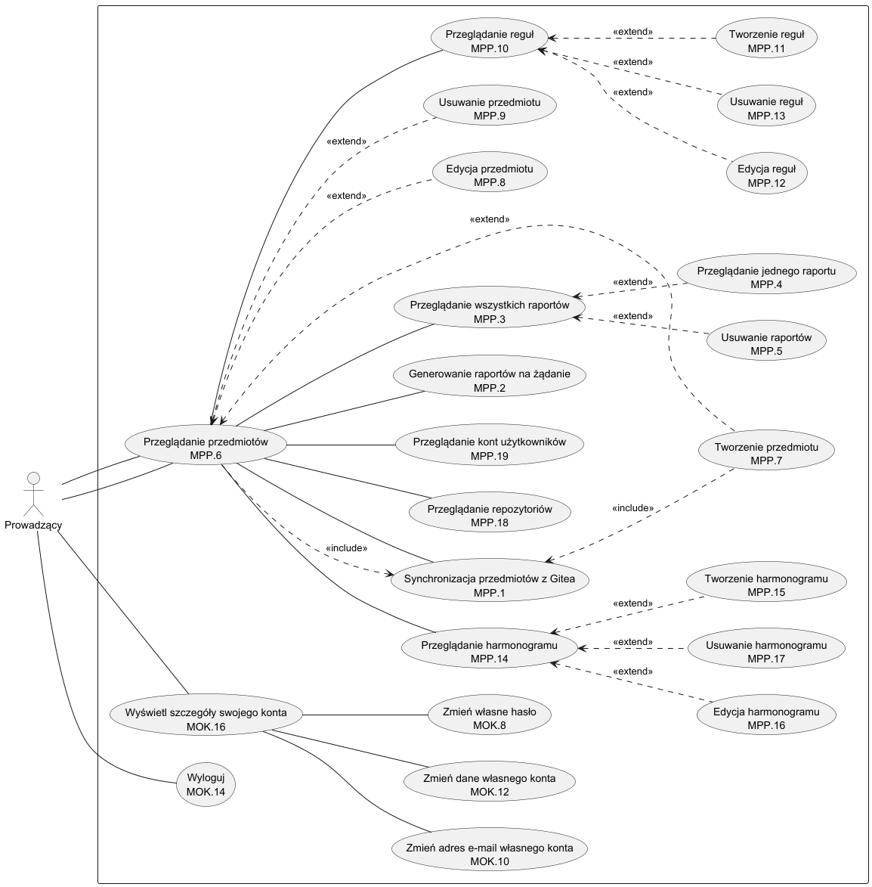
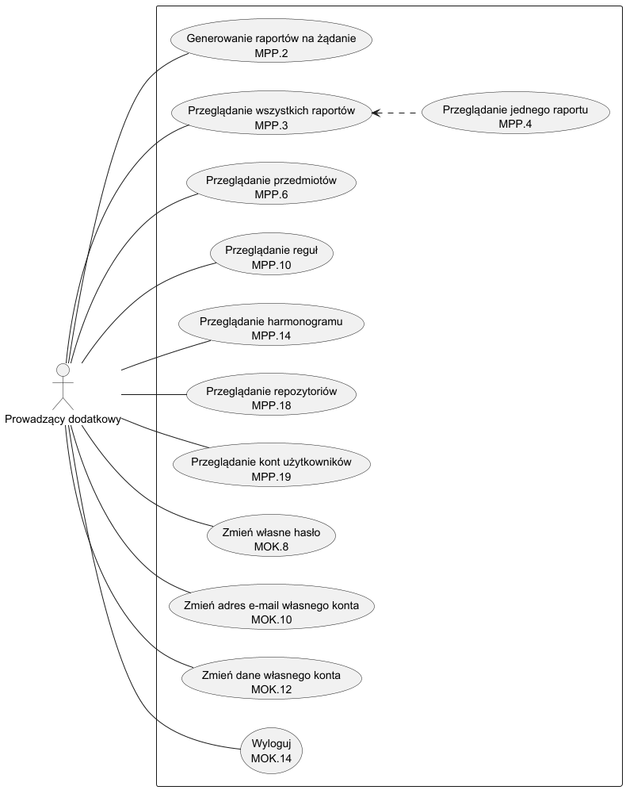
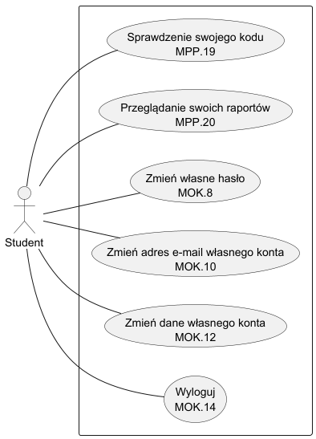

## 2 Moduły funkcjonalne, aktorzy, przypadki użycia 3 pkt

**Lista modułów funkcjonalnych**
- MOK - Moduł Obsługi Kont
- MPP - Moduł Poszukiwania Plagiatu

**Lista poziomów dostępu (aktorów)**

Tabela 1.2.1 Przedstawienie poziomów dostępu systemu

|Poziom dostępu (Aktor)|Opis danego poziomu dostępu|Sekwencja czynności prowadząca do utworzenia funkcjonującego konta o wskazanym poziomie dostępu|
|-|-|-|
|Gość|Użytkownik nieuwierzytelniony, aby skorzystać z funkcjonalnośći aplikacji należy zarejestrować się lub zalogować się na obecnie istniejące konto z innym poziomem dostępu.|Nie dotyczy|
|System|System to aktor w systemie odpowiadający za automatyczne wykonywanie zaplanowanych akcji bez dodatkowego działania Prowadzącego.|Nie dotyczy|
|Administrator|Administrator to jedyny aktor posiadający uprawnienia pozwalające na zarządzanie wszystkimi dostępnymi kontami w systemie.|Administrator to domyślnie utworzony użytkownik wraz z  początkiem działania systemu.|
|Prowadzący|Prowadzący to nauczyciel akademicki, który zarządza dostępnymi przedmiotami wraz z ich regułami oraz harmonogramami i monitoruje wyniki Studentów względem możliwego plagiatu.|Poziom dostępu może zostać nadany przez Administratora systemu, wymagana jest wcześniejsza poprawna rejestracja w systemie (należy utworzyć konto z poziomu Gościa).|
|Prowadzący dodatkowy|Prowadzący dodatkowy to nauczyciel akademicki posiadający jedynie prawo do odczytu w danym przedmiocie.|Poziom dostępu może zostać nadany przez Administratora systemu, wymagana jest wcześniejsza poprawna rejestracja w systemie (należy utworzyć konto z poziomu Gościa).|
|Student|Student to uczeń na danej uczelni wyższej, realizujący dany przedmiot gdzie występują zadania programistyczne, które są weryfikowane względem możliwego plagiatu.|Poziom dostępu może zostać nadany przez Administratora systemu, wymagana jest wcześniejsza poprawna rejestracja w systemie (należy utworzyć konto z poziomu Gościa).|

Uwaga! W jednym przedmiocie dana osoba nie może być jednocześnie Prowadzącym oraz Prowadzącym dodatkowym z uwagi na wzajemne wykluczanie się uprawnień. Jednakże w obrębie systemu, jedna osoba może być Prowadzącym oraz Prowadzącym dodatkowym w wielu różnych przedmiotach.

**Diagramy przypadków użycia**

Rysunek 1.2.1 Diagram przypadków użycia dla aktora Gość

Rysunek 1.2.2 Diagram przypadków użycia dla aktora System

Rysunek 1.2.3 Diagram przypadków użycia dla aktora Administrator

Rysunek 1.2.4 Diagram przypadków użycia dla aktora Prowadzący

Rysunek 1.2.5 Diagram przypadków użycia dla aktora Prowadzący dodatkowy

Rysunek 1.2.6 Diagram przypadków użycia dla aktora Student

Tabela 1.2.2 Scenariusz dla przypadku użycia MOK.1

| Pole                           | Treść                                                                                                                                                                                                                                                                                                                                                                                                                                                                                                                                                                                                                                                                                                                                                                                                                                                                                                                                                                                                                                                                                                                                                                                                                                                                                                                                                                                                                                                                                                                                                                                                  |
|--------------------------------|--------------------------------------------------------------------------------------------------------------------------------------------------------------------------------------------------------------------------------------------------------------------------------------------------------------------------------------------------------------------------------------------------------------------------------------------------------------------------------------------------------------------------------------------------------------------------------------------------------------------------------------------------------------------------------------------------------------------------------------------------------------------------------------------------------------------------------------------------------------------------------------------------------------------------------------------------------------------------------------------------------------------------------------------------------------------------------------------------------------------------------------------------------------------------------------------------------------------------------------------------------------------------------------------------------------------------------------------------------------------------------------------------------------------------------------------------------------------------------------------------------------------------------------------------------------------------------------------------------|
| Oznaczenie                     | MOK.1                                                                                                                                                                                                                                                                                                                                                                                                                                                                                                                                                                                                                                                                                                                                                                                                                                                                                                                                                                                                                                                                                                                                                                                                                                                                                                                                                                                                                                                                                                                                                                                                  |
| Przypadek użycia               | Rejestracja konta użytkownika                                                                                                                                                                                                                                                                                                                                                                                                                                                                                                                                                                                                                                                                                                                                                                                                                                                                                                                                                                                                                                                                                                                                                                                                                                                                                                                                                                                                                                                                                                                                                                          |
| Twórca                         | Karol Dawid                                                                                                                                                                                                                                                                                                                                                                                                                                                                                                                                                                                                                                                                                                                                                                                                                                                                                                                                                                                                                                                                                                                                                                                                                                                                                                                                                                                                                                                                                                                                                                                            |
| Poziom ważności                | Wysoki                                                                                                                                                                                                                                                                                                                                                                                                                                                                                                                                                                                                                                                                                                                                                                                                                                                                                                                                                                                                                                                                                                                                                                                                                                                                                                                                                                                                                                                                                                                                                                                                 |
| Typ przypadku użycia           | Podstawowy                                                                                                                                                                                                                                                                                                                                                                                                                                                                                                                                                                                                                                                                                                                                                                                                                                                                                                                                                                                                                                                                                                                                                                                                                                                                                                                                                                                                                                                                                                                                                                                             |
| Aktorzy                        | Gość, System                                                                                                                                                                                                                                                                                                                                                                                                                                                                                                                                                                                                                                                                                                                                                                                                                                                                                                                                                                                                                                                                                                                                                                                                                                                                                                                                                                                                                                                                                                                                                                                           |
| Krótki opis                    | Przypadek użycia pozwala niezalogowanemu użytkownikowi (Gościowi) na utworzenie nowego konta w systemie. Zgodnie z założeniami biznesowymi, po pomyślnej rejestracji konto automatycznie otrzymuje uprawnienia Studenta, jednak wymaga potwierdzenia tożsamości poprzez e-mail. Brak potwierdzenia skutkuje automatycznym usunięciem konta przez System.                                                                                                                                                                                                                                                                                                                                                                                                                                                                                                                                                                                                                                                                                                                                                                                                                                                                                                                                                                                                                                                                                                                                                                                                                                               |
| Warunki wstępne                | Gość nie jest zalogowany w systemie i posiada dostęp do formularza rejestracyjnego.                                                                                                                                                                                                                                                                                                                                                                                                                                                                                                                                                                                                                                                                                                                                                                                                                                                                                                                                                                                                                                                                                                                                                                                                                                                                                                                                                                                                                                                                                                                    |
| Warunki końcowe                | W bazie danych systemu zostaje utworzone i pomyślnie aktywowane nowe konto użytkownika z domyślnie przypisanym poziomem dostępu Student. (W przypadku braku weryfikacji konto zostaje trwale usunięte z bazy).                                                                                                                                                                                                                                                                                                                                                                                                                                                                                                                                                                                                                                                                                                                                                                                                                                                                                                                                                                                                                                                                                                                                                                                                                                                                                                                                                                                         |
| Główny przepływ zdarzeń        | 1. Gość wybiera opcję "Zarejestruj się" na stronie głównej.   2. System wyświetla formularz rejestracyjny.   3. Gość wprowadza wymagane dane (imię, nazwisko, adres e-mail, login, hasło, powtórzenie hasła). 4. Gość zatwierdza wprowadzony formularz. 5. System waliduje poprawność wprowadzonych danych oraz sprawdza, czy adres e-mail oraz login nie są już zajęte. 6. System tworzy nowe konto w bazie danych ze statusem nieaktywnym i automatycznie przypisuje mu rolę Studenta. 7. System generuje unikalny adres URL (lub kod) ważny przez 24 godziny i wysyła go na podany adres e-mail w celu weryfikacji konta. 8. System wyświetla komunikat o pomyślnej rejestracji, informuje o konieczności aktywacji konta przez e-mail i przekierowuje do ekranu logowania. 9. Gość odbiera wiadomość e-mail i przechodzi pod wskazany unikalny adres URL. 10. System weryfikuje ważność i poprawność adresu URL (oraz fakt, czy nie został już wykorzystany). 11. System zmienia status konta na aktywne. 12. System wyświetla komunikat o pomyślnej aktywacji konta i możliwości zalogowania się.                                                                                                                                                                                                                                                                                                                                                                                                                                                                |
| Alternatywne przepływy zdarzeń | 5a. Błąd walidacji danych: 1. System wykrywa nieprawidłowości w danych (np. zbyt krótkie hasło, niepoprawny format e-maila, puste pola). 2. System wyświetla odpowiedni komunikat błędu przy błędnych polach. 3. Powrót do kroku 3 głównego przepływu. 5b. Użytkownik o podanym adresie e-mail/loginie już istnieje: 1. System wykrywa duplikat w bazie danych. 2. System wyświetla komunikat, że konto z takimi danymi już istnieje. 3. Powrót do kroku 3 głównego przepływu. 8a. Ponowne wysłanie wiadomości e-mail weryfikacyjnej (Zdarzenie systemowe): 1. System odnotowuje upływ połowy wyznaczonego czasu (12 godzin) bez aktywacji konta przez użytkownika. 2. System automatycznie wysyła ponowną wiadomość e-mail z adresem URL przypominającą o konieczności aktywacji konta. 3. Oczekiwanie na wykonanie kroku 9 głównego przepływu. 8b. Brak weryfikacji w wyznaczonym czasie (Zdarzenie systemowe): 1. System odnotowuje upływ 24 godzin od momentu rejestracji, a konto nadal posiada status nieaktywnego. 2. System automatycznie usuwa utworzone konto z bazy danych. 3. System wysyła na podany adres e-mail powiadomienie o usunięciu konta z powodu braku weryfikacji. 4. Przypadek użycia kończy się niepowodzeniem. 10a. Nieprawidłowy lub wykorzystany link weryfikacyjny: 1. System wykrywa, że użyty adres URL jest niepoprawny, wygasł lub akcja z nim związana została już jednokrotnie wykonana. 2. System wyświetla komunikat o błędzie autoryzacji linku. 3. Przypadek użycia kończy się niepowodzeniem.  |
| Specjalne wymagania            | Hasło musi spełniać politykę bezpieczeństwa (np. minimum 8 znaków, wielka litera, znak specjalny). Zastosowany w weryfikacji adres URL musi zapewniać tylko jednokrotne wykonanie akcji.                                                                                                                                                                                                                                                                                                                                                                                                                                                                                                                                                                                                                                                                                                                                                                                                                                                                                                                                                                                                                                                                                                                                                                                                                                                                                                                                                                                                               |
| Notatki i kwestie              | Role wyższe (Prowadzący, Administrator) są nadawane ręcznie przez Administratora po założeniu konta ze statusem Studenta. Limit czasu na weryfikację (24h) oraz limit ponowienia wiadomości (12h) mogą być modyfikowane w parametrach startowych aplikacji.                                                                                                                                                                                                                                                                                                                                                                                                                                                                                                                                                                                                                                                                                                                                                                                                                                                                                                                                                                                                                                                                                                                                                                                                                                                                                                                                            |

Tabela 1.2.3 Scenariusz dla przypadku użycia MOK.2

| Pole                           | Treść                                                                                                                                                                                                                                                                                                                                                                                                                                                                                                                                                                                                                                                                                                                                                                                                                                 |
|--------------------------------|---------------------------------------------------------------------------------------------------------------------------------------------------------------------------------------------------------------------------------------------------------------------------------------------------------------------------------------------------------------------------------------------------------------------------------------------------------------------------------------------------------------------------------------------------------------------------------------------------------------------------------------------------------------------------------------------------------------------------------------------------------------------------------------------------------------------------------------|
| Oznaczenie                     | MOK.2                                                                                                                                                                                                                                                                                                                                                                                                                                                                                                                                                                                                                                                                                                                                                                                                                                 |
| Przypadek użycia               | Uwierzytelnienie użytkownika                                                                                                                                                                                                                                                                                                                                                                                                                                                                                                                                                                                                                                                                                                                                                                                                          |
| Twórca                         | Karol Dawid                                                                                                                                                                                                                                                                                                                                                                                                                                                                                                                                                                                                                                                                                                                                                                                                                           |
| Poziom ważności                | Krytyczny                                                                                                                                                                                                                                                                                                                                                                                                                                                                                                                                                                                                                                                                                                                                                                                                                             |
| Typ przypadku użycia           | Podstawowy                                                                                                                                                                                                                                                                                                                                                                                                                                                                                                                                                                                                                                                                                                                                                                                                                            |
| Aktorzy                        | Gość                                                                                                                                                                                                                                                                                                                                                                                                                                                                                                                                                                                                                                                                                                                                                                                                                                  |
| Krótki opis                    | Przypadek użycia pozwala niezalogowanemu użytkownikowi (Gościowi) na weryfikację swojej tożsamości w celu uzyskania dostępu do chronionych zasobów systemu. Po zalogowaniu system wczytuje przypisane role (np. domyślną rolę Studenta).                                                                                                                                                                                                                                                                                                                                                                                                                                                                                                                                                                                              |
| Warunki wstępne                | Gość nie jest zalogowany w systemie, ale posiada wcześniej utworzone, aktywne (zweryfikowane) i niezablokowane konto.                                                                                                                                                                                                                                                                                                                                                                                                                                                                                                                                                                                                                                                                                                                 |
| Warunki końcowe                | Gość staje się uwierzytelnionym użytkownikiem. System nadaje mu bezpieczną sesję, a interfejs dostosowuje się do posiadanego przez niego poziomu dostępu (AccessLevel).                                                                                                                                                                                                                                                                                                                                                                                                                                                                                                                                                                                                                                                               |
| Główny przepływ zdarzeń        | 1. Gość przechodzi na stronę logowania. 2. System wyświetla formularz logowania. 3. Gość wprowadza swój login oraz hasło. 4. Gość zatwierdza chęć zalogowania (klika "Zaloguj") 5. System weryfikuje zgodność podanych danych z informacjami w bazie (sprawdza hash hasła). 6. System sprawdza status konta (czy nie jest zablokowane - powiązanie z MOK.4). 7. System uwierzytelnia użytkownika, tworzy sesję i przekierowuje go na odpowiedni widok dla zalogowanych w zależności od jego roli. 8. Jeżeli uwierzytelniony użytkownik posiada poziom dostępu Administratora, system automatycznie wysyła powiadomienie e-mail z informacją o nowej sesji i adresem IP na jego adres pocztowy.                                                                                                                   |
| Alternatywne przepływy zdarzeń | 5a. Błędne dane logowania (niewłaściwy login lub hasło): 1. System wykrywa brak zgodności danych. 2. System wyświetla ogólny komunikat błędu (np. "Nieprawidłowy login lub hasło"). 3. Powrót do kroku 3 głównego przepływu. 5b. Przekroczenie limitu błędnych logowań (Auto-blokada): 1. System odnotowuje 3. z rzędu nieudaną próbę logowania na dane konto.  2. System automatycznie blokuje konto na 24 godziny i wysyła powiadomienie e-mail o zablokowaniu na adres użytkownika. 3. Przypadek użycia kończy się niepowodzeniem. 6a. Konto użytkownika jest zablokowane: 1. System wykrywa, że nałożono blokadę na to konto. 2. System odrzuca próbę logowania i wyświetla komunikat "Twoje konto zostało zablokowane. Skontaktuj się z administratorem". 3. Przypadek użycia kończy się niepowodzeniem. |
| Specjalne wymagania            | Transmisja danych z formularza musi odbywać się przez szyfrowane połączenie (HTTPS). Hasło nie może być zapisywane w systemie otwartym tekstem.                                                                                                                                                                                                                    |
| Notatki i kwestie              | System powienien opóźniać kolejne próby logowania po kilku błędach, aby zapobiec atakom brute-force.                                                                                                                                                                                                                                                                                                                                                                                                                                                                                                                                                                                                                                                                                                                                  |

Tabela 1.2.4 Scenariusz dla przypadku użycia MOK.3

| Pole                           | Treść                                                                                                                                                                                                                                                                                                                                                                                                                                                                                                                                                                                                                                                                                                                                                                       |
| ------------------------------ | --------------------------------------------------------------------------------------------------------------------------------------------------------------------------------------------------------------------------------------------------------------------------------------------------------------------------------------------------------------------------------------------------------------------------------------------------------------------------------------------------------------------------------------------------------------------------------------------------------------------------------------------------------------------------------------------------------------------------------------------------------------------------- |
| Oznaczenie                     | MOK.3                                                                                                                                                                                                                                                                                                                                                                                                                                                                                                                                                                                                                                                                                                                                                                       |
| Przypadek użycia               | Reset hasła                                                                                                                                                                                                                                                                                                                                                                                                                                                                                                                                                                                                                                                                                                                                                                 |
| Twórca                         | Danylo Dobrianskyi                                                                                                                                                                                                                                                                                                                                                                                                                                                                                                                                                                                                                                                                                                                                                          |
| Poziom ważności                | Wysoki                                                                                                                                                                                                                                                                                                                                                                                                                                                                                                                                                                                                                                                                                                                                                                      |
| Typ przypadku użycia           | Istotny                                                                                                                                                                                                                                                                                                                                                                                                                                                                                                                                                                                                                                                                                                                                                                     |
| Aktorzy                        | Gość                                                                                                                                                                                                                                                                                                                                                                                                                                                                                                                                                                                                                                                                                                                                                                        |
| Krótki opis                    | Przypadek użycia pozwala na reset i zmianę hasła niezalogowanego użytkownika poprzez wysyłanie mu na adres email jednorazowego adresu URL którego czas ważności nie przekraca 30 minut.                                                                                                                                                                                                                                                                                                                                                                                                                                                                                                                                                                                     |
| Warunki wstępne                | 1. Gość nie jest zalogowany w systemie 2. Gość posiada wcześniej utworzone, aktywne (zweryfikowane) i niezablokowane konto.                                                                                                                                                                                                                                                                                                                                                                                                                                                                                                                                                                                                                                              |
| Warunki końcowe                | Gość może uwierzytelnić się w systemie za pomocą nowego hasła.                                                                                                                                                                                                                                                                                                                                                                                                                                                                                                                                                                                                                                                                                                              |
| Główny przepływ zdarzeń        | 1. Gość przechodzi na stronę logowania. 2. System wyświetla formularz logowania. 3. Gość naciska na przycisk "zmień hasło". 4. System wyświetla formularz z jednym polem "email". 5. Gość wprowadza adres email przypisany do jego konta i naciska przycisk "dalej". 6. System weryfikuje czy taki adres email istnieje w systemie. 7. System wysyła list na podany email z jednorazowym adresem URL do resetowania hasła i wyświetla dla gościa komunikat o takim liście. 8. Gość przechodzi za adresem URL na stronę z resetem hasła. 9. Gość wprowadza nowe, silne hasło. 10. System sprawdza czy hasło odpowiada wymogom 11. System wylicza skrót hasła i zapisuje go do bazy danych. Po tym usuwa tymczasowy adres URL.                  |
| Alternatywne przepływy zdarzeń | 7a. Błędny adres email (nie występuje w bazie danych): 1. System wyświetla komunikat o tym że adres nie został znaleziony i wyczyszcza pole "email". 8a. List nie dotarł do użytkownika. 1. Gość naciska przycisk "wyślij list ponownie". 2. System podejmuje ponowną próbę wysłania lista i blokuje przycisk "wyślij list ponownie" na minutę. 3. Gość kontynuuje proces resetu hasła. 8b. Gość przeszedł za adresem URL na stronę resetowania po okresie ważności tego adresu. 1. System wyświetla komunikat o zakończeniu okresu ważności adresu URL. 2. System usuwa tymczasowy adres URL. 11a. Hasło nie odpowiada wymogom systemu. 1. System wyświetla komunikat o konieczności zmiany hasła na takie, które będzie odpowiadać wymogom. |
| Specjalne wymagania            | Transmisja danych z formularza musi odbywać się przez szyfrowane połączenie (HTTPS).                                                                                                                                                                                                                                                                                                                                                                                                                                                                                                                                                                                                                                                                                        |
| Notatki i kwestie              | Tymczasowy adres URL musi być przechowywany w bazie danych.                                                                                                                                                                                                                                                                                                                                                                                                                                                                                                                                                                                                                                                                                                                 |

Tabela 1.2.5 Scenariusz dla przypadku użycia MOK.4

|Pole|Treść|
|--|--|
|Oznaczenie|MOK.4|
|Przypadek użycia|Zablokuj konto użytkownika|
|Twórca|Paweł Rajnert|
|Poziom ważności|Wysoki|
|Typ przypadku użycia|Istotny|
|Aktorzy|Administrator|
|Krótki opis|Przypadek użycia pozwala na zablokowanie obecnie dostępnego konta danego użytkownika w systemie.|
|Warunki wstępne|Istnienie niezablokowanego, aktywnego konta użytkownika którego będzie dotyczył przypadek użycia.|
|Warunki końcowe|Dostęp do systemu z poziomu wybranego konta użytkownika zostanie zablokowany. Wszystkie aktywne sesje użytkownika zostaną unieważnione.|
|Główny przepływ zdarzeń|1. Administrator przechodzi do odpowiedniego formularza w systemie. 2. Administrator znajduje odpowiednie konto użytkownika. 3. Administrator wybiera opcję "Zablokuj" w ramach konta danego użytkownika. 4. Administrator potwierdza chęć zablokowania konta użytkownika. 5. Pojawia się okno z potwierdzeniem poprawnej akcji Administratora, której celem było zablokowanie konta użytkownika w systemie. 6. Konto zostaje zablokowane, a jego status w bazie danych oraz dostępnych formularzach zostaje zaaktualizowane. 7. Wszystkie aktywne sesje użytkownika, którego konto zostało zablokowane zostaną unieważnione.|
|Alternatywne przepływy zdarzeń|2a. Brak kont użytkowników w systemie - nie można wykonać kolejnych akcji. 7b. Użytkownik nie ma aktywnych sesji w systemie.|
|Specjalne wymagania|Zablokowanie każdego konta musi zostać odnotowane poprzez wpis w dzienniku zdarzeń.|
|Notatki i kwestie|Uprzednio zablokowane konto użytkownika może zostać odblokowane (MOK.5).|

Tabela 1.2.6 Scenariusz dla przypadku użycia MOK.5

|Pole|Treść|
|--|--|
|Oznaczenie|MOK.5|
|Przypadek użycia|Odblokuj konto użytkownika|
|Twórca|Paweł Rajnert|
|Poziom ważności|Wysoki|
|Typ przypadku użycia|Istotny|
|Aktorzy|Administrator|
|Krótki opis|Przypadek użycia pozwala na odblokowanie obecnie dostępnego w systemie zablokowanego konta danego użytkownika.|
|Warunki wstępne|Istnienie zablokowanego konta użytkownika w systemie.|
|Warunki końcowe|Dostęp do systemu dla danego użytkownika zostanie odblokowany.|
|Główny przepływ zdarzeń|1. Administrator przechodzi do odpowiedniego formularza w systemie. 2. Administrator znajduje odpowiednie konto użytkownika. 3. Administrator wybiera opcję "Odblokuj" w ramach konta danego użytkownika. 4. Administrator potwierdza chęć odblokowania konta użytkownika. 5. Pojawia się okno z potwierdzeniem poprawnej akcji Administratora, której celem było odblokowanie konta użytkownika w systemie. 6. Konto zostaje odblokowane, a jego status w bazie danych oraz dostępnych formularzach zostaje zaaktualizowane.|
|Alternatywne przepływy zdarzeń|2a. Brak kont użytkowników w systemie - nie można wykonać kolejnych akcji.|
|Specjalne wymagania|Odblokowanie każdego konta musi zostać odnotowane poprzez wpis w dzienniku zdarzeń.|
|Notatki i kwestie|Po odblokowaniu konta użytkownika, możliwe jest wykonywanie dowolnych akcji z uprzednio nadanym poziomem dostępu przed zablokowaniem konta.|

Tabela 1.2.7 Scenariusz dla przypadku użycia MOK.6

| Pole | Treść                                                                                                                                                                                                                                                                                                                                                                                                                                                                                                                                                                                                                                                                                                                                                                                                                                                     |
| :--- |:----------------------------------------------------------------------------------------------------------------------------------------------------------------------------------------------------------------------------------------------------------------------------------------------------------------------------------------------------------------------------------------------------------------------------------------------------------------------------------------------------------------------------------------------------------------------------------------------------------------------------------------------------------------------------------------------------------------------------------------------------------------------------------------------------------------------------------------------------------|
| Oznaczenie | MOK.6                                                                                                                                                                                                                                                                                                                                                                                                                                                                                                                                                                                                                                                                                                                                                                                                                                                     |
| Przypadek użycia | Dołącz poziom dostępu do konta                                                                                                                                                                                                                                                                                                                                                                                                                                                                                                                                                                                                                                                                                                                                                                                                                            |
| Twórca | Remigiusz Bartczak                                                                                                                                                                                                                                                                                                                                                                                                                                                                                                                                                                                                                                                                                                                                                                                                                                        |
| Poziom ważności | Wysoki                                                                                                                                                                                                                                                                                                                                                                                                                                                                                                                                                                                                                                                                                                                                                                                                                                                    |
| Typ przypadku użycia | Istotny                                                                                                                                                                                                                                                                                                                                                                                                                                                                                                                                                                                                                                                                                                                                                                                                                                                   |
| Aktorzy | Administrator                                                                                                                                                                                                                                                                                                                                                                                                                                                                                                                                                                                                                                                                                                                                                                                                                                             |
| Krótki opis | Przypadek użycia pozwala Administratorowi na nadanie nowej roli (poziomu dostępu) istniejącemu i aktywnemu kontu użytkownika wyłącznie w kontekście konkretnego przedmiotu.                                                                                                                                                                                                                                                                                                                                                                                                                                                                                                                                                                                                                                                                               |
| Warunki wstępne | Administrator jest pomyślnie uwierzytelniony w systemie. Istnieje docelowe konto użytkownika, które nie jest zablokowane, oraz istnieje w systemie przynajmniej jeden przedmiot.                                                                                                                                                                                                                                                                                                                                                                                                                                                                                                                                                                                                                                                                          |
| Warunki końcowe | Konto użytkownika otrzymuje nowy poziom dostępu powiązany ze wskazanym przedmiotem, co zostaje zaktualizowane w bazie danych. Na adres e-mail użytkownika zostaje wysłane powiadomienie. Akcja zostaje odnotowana w dzienniku zdarzeń.                                                                                                                                                                                                                                                                                                                                                                                                                                                                                                                                                                                                                    |
| Główny przepływ zdarzeń | 1. Administrator przechodzi do widoku szczegółów wybranego konta użytkownika w formularzu zarządzania kontami.   2. Administrator wybiera opcję "Dołącz poziom dostępu".   3. System prosi o wskazanie przedmiotu z listy dostępnych w systemie.   4. Po wybraniu przedmiotu, system wyświetla listę dostępnych ról (Student, Prowadzący, Prowadzący dodatkowy).   5. Administrator wybiera odpowiednią rolę i zatwierdza decyzję.   6. System waliduje poprawność żądania.   7. System aktualizuje uprawnienia konta w bazie danych, tworząc powiązanie między użytkownikiem, rolą a przedmiotem.   8. System wysyła powiadomienie o przyznaniu poziomu dostępu w wiadomości e-mail niezwłocznie na adres przypisany do konta użytkownika.   9. System wyświetla Administratorowi komunikat o pomyślnym dodaniu poziomu dostępu. |
| Alternatywne przepływy zdarzeń | 5a. Próba nadania wykluczających się uprawnień w tym samym przedmiocie:   <ol><li>System wykrywa, że użytkownik posiada już rolę wykluczającą się w wybranym przedmiocie (np. jest już Prowadzącym, a Administrator próbuje nadać mu rolę Prowadzącego dodatkowego).</li><li>System odrzuca żądanie zapisu.</li><li>System wyświetla komunikat o konflikcie ról w obrębie danego przedmiotu.</li><li>Powrót do kroku 3 głównego przepływu.</li></ol> 6a. Błąd spójności danych:   <ol><li>System wykrywa, że encja konta została zmodyfikowana w międzyczasie przez inną transakcję (np. przez innego administratora).</li><li>System odrzuca żądanie zapisu.</li><li>System wyświetla komunikat błędu informujący o dezaktualizacji danych i odświeża widok.</li></ol>                                                                             |
| Specjalne wymagania | Każda zmiana poziomu dostępu musi zostać zapisana w logach audytowych (kto, komu, kiedy, w jakim przedmiocie i jaką rolę nadał).                                                                                                                                                                                                                                                                                                                                                                                                                                                                                                                                                                                                                                                                                                                          |
| Notatki i kwestie | Poziom dostępu nadawany jest zawsze do konkretnego przedmiotu. Użytkownik może być Prowadzącym głównym w przedmiocie X, Prowadzącym dodatkowym w przedmiocie Y i Studentem w przedmiocie Z.                                                                                                                                                                                                                                                                                                                                                                                                                                                                                                                                                                                                                                                               |

Tabela 1.2.8 Scenariusz dla przypadku użycia MOK.7

| Pole | Treść                                                                                                                                                                                                                                                                                                                                                                                                                                                                                                                                                                                                                                                                                                                                                                                      |
| :--- |:-------------------------------------------------------------------------------------------------------------------------------------------------------------------------------------------------------------------------------------------------------------------------------------------------------------------------------------------------------------------------------------------------------------------------------------------------------------------------------------------------------------------------------------------------------------------------------------------------------------------------------------------------------------------------------------------------------------------------------------------------------------------------------------------|
| Oznaczenie | MOK.7                                                                                                                                                                                                                                                                                                                                                                                                                                                                                                                                                                                                                                                                                                                                                                                      |
| Przypadek użycia | Odłącz poziom dostępu od konta                                                                                                                                                                                                                                                                                                                                                                                                                                                                                                                                                                                                                                                                                                                                                             |
| Twórca | Remigiusz Bartczak                                                                                                                                                                                                                                                                                                                                                                                                                                                                                                                                                                                                                                                                                                                                                                         |
| Poziom ważności | Wysoki                                                                                                                                                                                                                                                                                                                                                                                                                                                                                                                                                                                                                                                                                                                                                                                     |
| Typ przypadku użycia | Istotny                                                                                                                                                                                                                                                                                                                                                                                                                                                                                                                                                                                                                                                                                                                                                                                    |
| Aktorzy | Administrator                                                                                                                                                                                                                                                                                                                                                                                                                                                                                                                                                                                                                                                                                                                                                                              |
| Krótki opis | Przypadek użycia pozwala Administratorowi na odebranie wybranemu kontu użytkownika poziomu dostępu przypisanego do konkretnego przedmiotu.                                                                                                                                                                                                                                                                                                                                                                                                                                                                                                                                                                                                                                                 |
| Warunki wstępne | Administrator jest pomyślnie uwierzytelniony w systemie. Istnieje docelowe konto użytkownika, które posiada przynajmniej jeden przypisany poziom dostępu w dowolnym przedmiocie.                                                                                                                                                                                                                                                                                                                                                                                                                                                                                                                                                                                                           |
| Warunki końcowe | Wybrany poziom dostępu dla danego przedmiotu zostaje odłączony od konta użytkownika. Zmiana jest natychmiast odzwierciedlana w bazie danych, na adres e-mail wysyłane jest powiadomienie, a ewentualne aktywne sesje użytkownika powiązane z uprawnieniami w tym przedmiocie mogą zostać unieważnione. Akcja zostaje zapisana w logach audytowych.                                                                                                                                                                                                                                                                                                                                                                                                                                         |
| Główny przepływ zdarzeń | 1. Administrator przechodzi do widoku edycji wybranego konta użytkownika.   2. W sekcji uprawnień Administrator lokalizuje na liście rolę powiązaną z konkretnym przedmiotem i wybiera przy niej opcję "Odłącz".   3. System wyświetla okno z prośbą o potwierdzenie chęci odebrania uprawnień we wskazanym przedmiocie.   4. Administrator potwierdza operację.   5. System waliduje żądanie.   6. System aktualizuje rekord użytkownika w bazie danych.   7. System wysyła powiadomienie o odebraniu poziomu dostępu w wiadomości e-mail niezwłocznie na adres przypisany do konta użytkownika.   8. System wyświetla komunikat o pomyślnym odłączeniu poziomu dostępu i odświeża widok konta.                                                                      |
| Alternatywne przepływy zdarzeń | 4a. Administrator anuluje operację:   <ol><li>System przerywa akcję i zamyka okno potwierdzenia.</li><li>Brak zmian w bazie danych.</li></ol> 5a. Błąd spójności danych:   <ol><li>System wykrywa, że encja konta została zmodyfikowana w międzyczasie przez inną transakcję (np. przez innego administratora).</li><li>System odrzuca żądanie zapisu.</li><li>System wyświetla komunikat błędu informujący o dezaktualizacji danych i odświeża widok.</li></ol>                                                                                                                                                                                                                                                                                                                     |
| Specjalne wymagania | Transakcja bazy danych musi gwarantować, że usunięcie powiązania z przedmiotem powiedzie się zanim zostanie wysłany e-mail do użytkownika.                                                                                                                                                                                                                                                                                                                                                                                                                                                                                                                                                                                                                                                 |
| Notatki i kwestie | Usunięcie wszystkich powiązań z przedmiotami nie blokuje konta użytkownika – po zalogowaniu zobaczy on pusty panel roboczy, dopóki nie zostanie przypisany do nowego przedmiotu.                                                                                                                                                                                                                                                                                                                                                                                                                                                                                                                                                                                                           |

Tabela 1.2.9 Scenariusz dla przypadku użycia MOK.8

|Pole| Treść                                                                                                                                                                                                                                                                                                                                                                                                                                                                                                                                                                                                                                                                                             |
|--|---------------------------------------------------------------------------------------------------------------------------------------------------------------------------------------------------------------------------------------------------------------------------------------------------------------------------------------------------------------------------------------------------------------------------------------------------------------------------------------------------------------------------------------------------------------------------------------------------------------------------------------------------------------------------------------------------|
|Oznaczenie| MOK.8                                                                                                                                                                                                                                                                                                                                                                                                                                                                                                                                                                                                                                                                                             |
|Przypadek użycia| Zmień własne hasło                                                                                                                                                                                                                                                                                                                                                                                                                                                                                                                                                                                                                                                                                |
|Twórca| Mateusz Chodulski                                                                                                                                                                                                                                                                                                                                                                                                                                                                                                                                                                                                                                                                                 |
|Poziom ważności| Wysoki                                                                                                                                                                                                                                                                                                                                                                                                                                                                                                                                                                                                                                                                                            |
|Typ przypadku użycia| Istotny                                                                                                                                                                                                                                                                                                                                                                                                                                                                                                                                                                                                                                                                                           |
|Aktorzy| Administrator, Prowadzący, Prowadzący dodatkowy, Student                                                                                                                                                                                                                                                                                                                                                                                                                                                                                                                                                                                                                                          |
|Krótki opis| Przypadek użycia pozwala uwierzytelnionemu użytkownikowi na zmianę własnego hasła w systemie. Wymaga potwierdzenia tożsamości poprzez podanie starego hasła.                                                                                                                                                                                                                                                                                                                                                                                                                                                                                                                                      |
|Warunki wstępne| Użytkownik jest poprawnie uwierzytelniony w systemie (posiada aktywną i ważną sesję)                                                                                                                                                                                                                                                                                                                                                                                                                                                                                                                                                                                                              |
|Warunki końcowe| Hasło użytkownika w bazie danych (hash) zostaje zaktualizowane. Aktywna sesja użytkownika oraz jego inne aktywne sesje natychmiastowo zostają unieważnione, a użytkownik musi się ponownie zalogować w systemie jeżeli chce wykonywać kolejne akcje ze swojego konta.                                                                                                                                                                                                                                                                                                                                                                                                                             |
|Główny przepływ zdarzeń| 1. Użytkownik klika opcję zmiany hasła dostępną w interfejsie.   2. System wyświetla formularz zawierający pola "Stare hasło" oraz "Nowe Hasło"   3. Użytkownik podaje odpowiednie dane i zatwierdza zmianę.   4. System waliduje czy hash "Stare hasło" podane przez użytkownika pokrywa się ze stanem obecnie znajdującym się w bazie.   5. System sprawdza czy "Nowe Hasło" spełnia warunki polityki bezpieczeństwa.   6. System hashuje "Nowe Hasło" i zapisuje je w bazie danych.   7. System unieważnia obecny token użytkownika.  8. System przekierowuje użytkownika na ekran logowania z komunikatem poprawnej zmiany hasła i koniecznością ponownego zalogowania. |
|Alternatywne przepływy zdarzeń| 4a. Użytkownik wprowadza błędne hasło: <ol><li> System wykrywa niezgodność podanego starego hasła z hashem w bazie danych. </li> <li> System odrzuca żądanie i wyświetla błąd auoryzacji. </li> <li> Przepływ wraca do kroku 2. </li> </ol> 5b. Nowe hasło nie spełnia polityki bezpieczeństwa: <ol><li>  System wyświetla komunikat z niespełnionymi wymaganiami (za krótkie, brak znaku specjalnego itp.) </li><li> Przepływ wraca do kroku 2. </li></ol>                                                                                                                                                                                                                                       |
|Specjalne wymagania| Fakt udanej operacji zmiany hasła musi zostać odnotowany w systemowym dzienniku zdarzeń.                                                                                                                                                                                                                                                                                                                                                                                                                                                                                                                                                                                                          |
|Notatki i kwestie| brak                                                                                                                                                                                                                                                                                                                                                                                                                                                                                                                                                                                                                                                                                              |

Tabela 1.2.10 Scenariusz dla przypadku użycia MOK.9

|Pole| Treść                                                                                                                                                                                                                                                                                                                                                                                                                                                                                                                                                                                                                                                                                                                                                                 |
|--|-----------------------------------------------------------------------------------------------------------------------------------------------------------------------------------------------------------------------------------------------------------------------------------------------------------------------------------------------------------------------------------------------------------------------------------------------------------------------------------------------------------------------------------------------------------------------------------------------------------------------------------------------------------------------------------------------------------------------------------------------------------------------|
|Oznaczenie| MOK.9                                                                                                                                                                                                                                                                                                                                                                                                                                                                                                                                                                                                                                                                                                                                                                 |
|Przypadek użycia| Zmiana hasła innego użytkownika                                                                                                                                                                                                                                                                                                                                                                                                                                                                                                                                                                                                                                                                                                                                       |
|Twórca| Mateusz Chodulski                                                                                                                                                                                                                                                                                                                                                                                                                                                                                                                                                                                                                                                                                                                                                     |
|Poziom ważności| Wysoki                                                                                                                                                                                                                                                                                                                                                                                                                                                                                                                                                                                                                                                                                                                                                                |
|Typ przypadku użycia| Istotny                                                                                                                                                                                                                                                                                                                                                                                                                                                                                                                                                                                                                                                                                                                                                               |
|Aktorzy| Administrator                                                                                                                                                                                                                                                                                                                                                                                                                                                                                                                                                                                                                                                                                                                                                         |
|Krótki opis| Przypadek pozwala Administratorowi na zmianę hasła przypisanego do kont innych użytkowników w systemie                                                                                                                                                                                                                                                                                                                                                                                                                                                                                                                                                                                                                                                                |
|Warunki wstępne| Administrator jest poprawnie uwierzytelniony i posiada aktywną sesję. W systemie istnieje konto docelowego użytkownika.                                                                                                                                                                                                                                                                                                                                                                                                                                                                                                                                                                                                                                               |
|Warunki końcowe| Hash hasła docelowego użytkownika w systemie zostaje zaktualizowany w bazie danych. Wszystkie ewentualne sesje danego użytkownika zostają natychmiast unieważnione. Operacja wykonania zmiany hasła przez administratora zostaje zapisana w dzienniku zdarzeń.                                                                                                                                                                                                                                                                                                                                                                                                                                                                                                        |
|Główny przepływ zdarzeń| 1. Administrator przechodzi do widoku szczegółów danego użytkownika.   2. Administrator wybiera opcję "Zmień hasło".   3. System wyświetla formularz z polem na nowe hasło.   4. Administrator wprowadza nowe hasło i zatwierdza operację.   5. System waliduje, czy wprowadzone nowe hasło spełnia politykę bezpieczeństwa aplikacji.   6. System hashuje i zapisuje nowe hasło w rekordzie danego użytkownika.   7. System unieważnia wszystkie aktywne tokeny sesyjne danego użytkownika.   8. System wyświetla komunikat o pomyślnej zmianie hasła.                                                                                                                                                                                          |
|Alternatywne przepływy zdarzeń| 4a. Administrator anuluje operację zmiany: <ol><li>Administrator klika przycisk anulowania lub zamyka formularz.</li><li>System przerywa operację bez jakichkolwiek zmian w bazie danych.</li></ol> 5a. Nowe hasło nie spełnia polityki bezpieczeństwa: <ol><li>System wykrywa, że hasło jest zbyt słabe.</li><li>System odrzuca żądanie i wyświetla Administratorowi komunikat błędu z listą niespełnionych wymagań.</li><li>Przepływ wraca do kroku 3.</li></ol> 6a. Wystąpił błąd blokady optymistycznej: <ol><li>System odrzuca żądanie zapisu.</li><li>System wymusza odświeżenie danych konta z bazy.</li><li>System wyświetla komunikat błędu informujący o dezaktualizacji danych.</li><li>Przepływ powraca do kroku 2 głównego przepływu.</li></ol> |
|Specjalne wymagania| Przeprowadzenie tej operacji musi zostać odnotowane w dzienniku zdarzeń z adnotacją, który Administrator dokonał zmiany i jakiego użytkownika ona dotyczyła.                                                                                                                                                                                                                                                                                                                                                                                                                                                                                                                                                                                                          |
|Notatki i kwestie| Dobrze by było dodać automatyczną wysyłkę wiadomości email do danego użytkownika o zmianie jego hasła przez Administratora.                                                                                                                                                                                                                                                                                                                                                                                                                                                                                                                                                                                                                                           |

Tabela 1.2.11 Scenariusz dla przypadku użycia MOK.10

|Pole|Treść|
|--|--|
|Oznaczenie|MOK.10|
|Przypadek użycia|Zmień adres e-mail własnego konta|
|Twórca|Paweł Rajnert|
|Poziom ważności|Wysoki|
|Typ przypadku użycia|Istotny|
|Aktorzy|Administrator, Prowadzący, Prowadzący dodatkowy, Student|
|Krótki opis|Przypadek użycia pozwala na zmianę adresu e-mail dla wybranego z aktorów - są to użytkownicy uwierzytelnieni w systemie.|
|Warunki wstępne|Użytkownik uwierzytelnił się w systemie i jego konto jest aktywne.|
|Warunki końcowe|Adres e-mail danego użytkownika został zmieniony. Wszystkie aktywne sesje użytkownika zostaną unieważnione, kolejne uwierzytelnienie będzie wymagało nowego adresu e-mail.|
|Główny przepływ zdarzeń|1. Wybrany użytkownik uwierzytelniony przechodzi do formularza zawierającego dane o swoim koncie. 2. Użytkownik wybiera opcję "Zmień adres e-mail". 3. W nowootwartym oknie użytkownik wprowadza nowy adres e-mail. 4. Użytkownik potwierdza chęć zmiany adresu e-mail. 5. Użytkownik potwierdza swoją tożsamość poświadczeniem w postaci hasła. 6. Pojawia się okno z potwierdzeniem poprawnej zmiany adresu e-mail. 7. Adres e-mail w formularzu zawierającym dane o swoim koncie został zaaktualizowany. 7. Wszystkie aktywne sesje użytkownika zostaną unieważnione.|
|Alternatywne przepływy zdarzeń|4a. Wprowadzony adres e-mail już istnieje w systemie - walidacja została przeprowadzona i zmiana nie jest możliwa. 5b. Użytkownik wprowadził niepoprawne hasło i należy ponowić akcję.|
|Specjalne wymagania|Nowy adres e-mail musi być unikalny.|
|Notatki i kwestie|W przypadku zmiany adresu e-mail na inny unikalny, użytkownik ma możliwość do późniejszego powrótu do poprzedniego adresu e-mail po ponownym wykonaniu akcji zmiany własnego adresu e-mail.|

Tabela 1.2.12 Scenariusz dla przypadku użycia MOK.11

| Pole                           | Treść                                                                                                                                                                                                                                                                                                                                                                                                                                                                                                                                                                                                                                                                                                                       |
|--------------------------------|-----------------------------------------------------------------------------------------------------------------------------------------------------------------------------------------------------------------------------------------------------------------------------------------------------------------------------------------------------------------------------------------------------------------------------------------------------------------------------------------------------------------------------------------------------------------------------------------------------------------------------------------------------------------------------------------------------------------------------|
| Oznaczenie                     | MOK.11                                                                                                                                                                                                                                                                                                                                                                                                                                                                                                                                                                                                                                                                                                                      |
| Przypadek użycia               | Zmień adres e-mail innego konta.                                                                                                                                                                                                                                                                                                                                                                                                                                                                                                                                                                                                                                                                                            |
| Twórca                         | Jan Kozłowski                                                                                                                                                                                                                                                                                                                                                                                                                                                                                                                                                                                                                                                                                                               |
| Poziom ważności                | Wysoki                                                                                                                                                                                                                                                                                                                                                                                                                                                                                                                                                                                                                                                                                                                      |
| Typ przypadku użycia           | Istotny                                                                                                                                                                                                                                                                                                                                                                                                                                                                                                                                                                                                                                                                                                                     |
| Aktorzy                        | Administrator                                                                                                                                                                                                                                                                                                                                                                                                                                                                                                                                                                                                                                                                                                               |
| Krótki opis                    | Przypadek użycia pozwala Administratorowi na modyfikację adresu e-mail przypisanego do konta innego użytownika systemu, posiadającego konto.                                                                                                                                                                                                                                                                                                                                                                                                                                                                                                                                                                                |
| Warunki wstępne                | 1. Administartor musi być uwierzytelniony w systemie i posiadać przypisany i aktywny poziom dostępu Admin.   2. W systemie musi istnieć konto użytkownika podlegające edycji.                                                                                                                                                                                                                                                                                                                                                                                                                                                                                                                                            |
| Warunki końcowe                | Adres e-mail przypisany do edytowanego konta użytkownika został zaktualizowany w bazie danych oraz wersja encji uległa zmianie (inkrementacja numeru wersji).                                                                                                                                                                                                                                                                                                                                                                                                                                                                                                                                                               |
| Główny przepływ zdarzeń        | 1. Administartor żąda edycji danych wybranego konta.   2. System prezentuje Administratorowi formularz edycji konta wybranego użytkonika.   3. Administrator wprowadza nowy e-mail i zatwierdza formularz.   4. System waliduje dane pod względem unikalności i formatu.   5. System aktualizuje e-mail w bazie danych dla wybranego konta.   6. System wysyła powiadomienie o zmianie na nowy oraz stary adres e-mail użytkownika.   7. System informuje Administratora o pomyślnym wprowadzeniu zmiany.                                                                                                                                                                                                 |
| Alternatywne przepływy zdarzeń | 3a. Administrator anuluje operację edycji. <ol> <li>System przerywa operację.</li> <li>System przekierowuje Administartora do widoku szczegółów konta. </li> </ol> 4a. Nowy e-mail nie spełnia wymogów walidacji. <ol> <li>System wyświetla komunikat błędu.</li> <li>Następuje powrót do kroku nr 2 głównego przepływu zdarzeń.</li> </ol> 5a. Wystąpił błąd blokady optymistycznej (dane konta zostały zmodyfikowane w tzw. międzyczasie przez inną transakcję). <ol> <li>System odrzuca żądanie zapisu.</li> <li>System synchronizuje dane konta z bazą. </li> <li>System wyświetla komunikat błędu informujący o dezaktualizacji danych.</li> <li>Przepływ powraca do kroku nr 2 głównego przepływu zdarzeń.</li> </ol> |
| Specjalne wymagania            | Nowy adres e-mail musi posiadać odpowiedni format oraz być unikalny w skali całego systemu.                                                                                                                                                                                                                                                                                                                                                                                                                                                                                                                                                                                                                                 |
| Notatki i kwestie              | Operacja zapisu jest chroniona mechanizmem blokady optymistycznej.                                                                                                                                                                                                                                                                                                                                                                                                                                                                                                                                                                                                                                                          |

Tabela 1.2.13 Scenariusz dla przypadku użycia MOK.12

| Pole                           | Treść                                                                                                                                                                                                                                                                                                                                                                                                                                                          |
| ------------------------------ | -------------------------------------------------------------------------------------------------------------------------------------------------------------------------------------------------------------------------------------------------------------------------------------------------------------------------------------------------------------------------------------------------------------------------------------------------------------- |
| Oznaczenie                     | MOK.12                                                                                                                                                                                                                                                                                                                                                                                                                                                         |
| Przypadek użycia               | Edytuj dane własnego konta                                                                                                                                                                                                                                                                                                                                                                                                                                     |
| Twórca                         | Danylo Dobrianskyi                                                                                                                                                                                                                                                                                                                                                                                                                                             |
| Poziom ważności                | Wysoki                                                                                                                                                                                                                                                                                                                                                                                                                                                         |
| Typ przypadku użycia           | Podstawowy                                                                                                                                                                                                                                                                                                                                                                                                                                                     |
| Aktorzy                        | Administrator, Student, Prowadzący                                                                                                                                                                                                                                                                                                                                                                                                                             |
| Krótki opis                    | Przypadek użycia pozwala na zmianę danych o sobie takich jak imię lub nazwisko.                                                                                                                                                                                                                                                                                                                                                                                |
| Warunki wstępne                | 1. Użytkownik jest zalogowany w systemie.                                                                                                                                                                                                                                                                                                                                                                                                                      |
| Warunki końcowe                | Zmodyfikowane dane użytkownika są wprowadzone do bazy danych.                                                                                                                                                                                                                                                                                                                                                                                                  |
| Główny przepływ zdarzeń        | 1. Użytkownik przechodzi na stronę własnego konta i naciska przycisk "edytuj". 2. System wyświetla formularz edycji konta. 3. Użytkownik wprowadza zmiany i naciska na przycisk "zatwierdż". 4. System waliduje wprowadzone dane. 5. System zapisuje zwalidowane dane do bazy danych.                                                                                                                                                              |
| Alternatywne przepływy zdarzeń | 5a. Dane nie odpowiadają założeniam systemu. 1. System wyświetla komunikat który określa jaką regułę narusza użytkownik. 2. Użytkownik może ponownie wprowadzić nowe dane. 5b. Dane już zostały zmodyfikowane przed zatwierdzeniem nowych zmian w wyniku czego powstaje wyścig. 1. System wyświetla komunikat o konieczności odświeżenia strony i aktualizacji danych. 2. Użytkownik aktualizuje stronę i może ponownie modyfikować zwoje dane. |
| Specjalne wymagania            | Transmisja danych z formularza musi odbywać się przez szyfrowane połączenie (HTTPS). Operacja zapisu powinna być chroniona mechanizmem blokady optymistycznej.                                                                                                                                                                                                                                                                                                 |
| Notatki i kwestie              | Każda modyfikacja danych powinna być zapisana w dzienniku zdarzeń.                                                                                                                                                                                                                                                                                                                                                                                             |

Tabela 1.2.14 Scenariusz dla przypadku użycia MOK.13

| Pole                           | Treść                                                                                                                                                                                                                                                                                                                                                                                                                                                          |
| ------------------------------ | -------------------------------------------------------------------------------------------------------------------------------------------------------------------------------------------------------------------------------------------------------------------------------------------------------------------------------------------------------------------------------------------------------------------------------------------------------------- |
| Oznaczenie                     | MOK.13                                                                                                                                                                                                                                                                                                                                                                                                                                                         |
| Przypadek użycia               | Edytuj dane innego użytkownika                                                                                                                                                                                                                                                                                                                                                                                                                                 |
| Twórca                         | Danylo Dobrianskyi                                                                                                                                                                                                                                                                                                                                                                                                                                             |
| Poziom ważności                | Wysoki                                                                                                                                                                                                                                                                                                                                                                                                                                                         |
| Typ przypadku użycia           | Podstawowy                                                                                                                                                                                                                                                                                                                                                                                                                                                     |
| Aktorzy                        | Administrator                                                                                                                                                                                                                                                                                                                                                                                                                                                  |
| Krótki opis                    | Przypadek użycia pozwala na modyfikację danych  takich jak imię lub nazwisko innych użytkowników przez administratora.                                                                                                                                                                                                                                                                                                                                         |
| Warunki wstępne                | 1. Administrator jest zalogowany w systemie.                                                                                                                                                                                                                                                                                                                                                                                                                   |
| Warunki końcowe                | Zmodyfikowane dane użytkownika są wprowadzone do bazy danych.                                                                                                                                                                                                                                                                                                                                                                                                  |
| Główny przepływ zdarzeń        | 1. Administrator przechodzi na stronę wybranego konta innego niż swoje i naciska przycisk "edytuj". 2. System wyświetla formularz edycji konta. 3. Użytkownik wprowadza zmiany i naciska na przycisk "zatwierdż". 4. System waliduje wprowadzone dane. 5. System zapisuje zwalidowane dane do bazy danych.                                                                                                                                         |
| Alternatywne przepływy zdarzeń | 5a. Dane nie odpowiadają założeniam systemu. 1. System wyświetla komunikat który określa jaką regułę narusza użytkownik. 2. Użytkownik może ponownie wprowadzić nowe dane. 5b. Dane już zostały zmodyfikowane przed zatwierdzeniem nowych zmian w wyniku czego powstaje wyścig. 1. System wyświetla komunikat o konieczności odświeżenia strony i aktualizacji danych. 2. Użytkownik aktualizuje stronę i może ponownie modyfikować zwoje dane. |
| Specjalne wymagania            | Transmisja danych z formularza musi odbywać się przez szyfrowane połączenie (HTTPS). Operacja zapisu powinna być chroniona mechanizmem blokady optymistycznej.                                                                                                                                                                                                                                                                                                 |
| Notatki i kwestie              | Każda modyfikacja danych powinna być zapisana w dzienniku zdarzeń.                                                                                                                                                                                                                                                                                                                                                                                             |

Tabela 1.2.15 Scenariusz dla przypadku użycia MOK.14

| Pole                           | Treść                                                                                                                                                                                                                                                                                                        |
|--------------------------------|--------------------------------------------------------------------------------------------------------------------------------------------------------------------------------------------------------------------------------------------------------------------------------------------------------------|
| Oznaczenie                     | MOK.14                                                                                                                                                                                                                                                                                                       |
| Przypadek użycia               | Wyloguj                                                                                                                                                                                                                                                                                                      |
| Twórca                         | Jan Kozłowski                                                                                                                                                                                                                                                                                                |
| Poziom ważności                | Wysoki                                                                                                                                                                                                                                                                                                       |
| Typ przypadku użycia           | Istotny                                                                                                                                                                                                                                                                                                      |
| Aktorzy                        | Administrator, Prowadzący, Prowadzący dodatkowy, Student                                                                                                                                                                                                                                                     |
| Krótki opis                    | Przypadek użycia pozwala zalogowanemu użytkownikowi na bezpieczne zakończenie pracy z aplikacją i zakończenie sesji poprzez porzucenie tokena.                                                                                                                                                               |
| Warunki wstępne                | Użytkownik musi posiadać konto w systemie i mieć aktywną sesję (poprawny token).                                                                                                                                                                                                                             |
| Warunki końcowe                | Token zostaje unieważniony oraz użytkownik traci dostęp do widoków i zasobów wymagających autoryzacji.                                                                                                                                                                                                       |
| Główny przepływ zdarzeń        | 1. Użytkownik żąda wylogowania z systemu poprzez kliknięcie odpowiedniej opcji w interfejsie.   2. System unieważnia aktywny token uwierzytelniający użytkownika.   3. System przekierowuje użytkownika na stronę logowania.                                                                           |
| Alternatywne przepływy zdarzeń | 1a. Token uwierzytelniający użytkownika wygasł przed świadomym wywołaniem akcji wylogowania.  <ol> <li>System odmawia wykonania akcji żądanej przez użytkownika</li> <li>System informuje użytkownika o wygaśnięciu sesji.</li> <li> Przepływ przechodzi do kroku nr 3 Głównego przepływu zdarzeń.</li></ol> |
| Specjalne wymagania            | System musi zapobiec użyciu starego tokena po wylogowaniu.                                                                                                                                                                                                                                                   |
| Notatki i kwestie              | Brak.                                                                                                                                                                                                                                                                                                        |

Tabela 1.2.16 Scenariusz dla przypadku użycia MPP.1

| Pole                           | Treść                                                                                                                                                                                                                                                                                                                                                                                                                                                                                                                              |
| ------------------------------ |------------------------------------------------------------------------------------------------------------------------------------------------------------------------------------------------------------------------------------------------------------------------------------------------------------------------------------------------------------------------------------------------------------------------------------------------------------------------------------------------------------------------------------|
| Oznaczenie                     | MPP.1                                                                                                                                                                                                                                                                                                                                                                                                                                                                                                                              |
| Przypadek użycia               | Synchronizacja przedmiotu z gitea                                                                                                                                                                                                                                                                                                                                                                                                                                                                                                  |
| Twórca                         | Mateusz Chodulski                                                                                                                                                                                                                                                                                                                                                                                                                                                                                                                  |
| Poziom ważności                | Wysoki                                                                                                                                                                                                                                                                                                                                                                                                                                                                                                                             |
| Typ przypadku użycia           | Podstawowy                                                                                                                                                                                                                                                                                                                                                                                                                                                                                                                         |
| Aktorzy                        | Prowadzący                                                                                                                                                                                                                                                                                                                                                                                                                                                                                                                         |
| Krótki opis                    | Przypadek użycia pozwala Prowadzącemu na odświeżenie i zsynchronizowanie listy repozytoriów studenckich powiązanych z przedmiotem na podstawie aktualnego stanu w organizacji/grupie na platformie Gitea.                                                                                                                                                                                                                                                                                                                          |
| Warunki wstępne                | Użytkownik jest poprawnie uwierzytelniony w systemie jako Teacher i posiada prawa do edycji przedmiotu. Przedmiot posiada już skonfigurowany adres URL do platformy Gitea.                                                                                                                                                                                                                                                                                                                                                         |
| Warunki końcowe                | Baza danych zostaje zaktualizowana o nowe repozytoria studenckie pobrane z platformy Gitea. Repozytoria, które nie istniały wcześniej w systemie, zostają dodane. Numer wersji obiektu ulega inkrementacji.                                                                                                                                                                                                                                                                                                                        |
| Główny przepływ zdarzeń        | 1. Prowadzący przechodzi do widoku wybranego przedmiotu.   2. Prowadzący wybiera opcję "Synchronizuj Gitea".   3. System wysyła żądanie do API Gitea, wykorzystując zapisany w bazie adres URL przedmiotu.   4. System pobiera aktualną listę repozytoriów znajdujących się pod wskazanym adresem.   5. System porównuje pobrane dane ze stanem bazy danych i zapisuje nowe obiekty repozytoriów oraz powiązania studentów.   6. System wyświetla komunikat o pomyślnym zakończeniu synchronizacji i odświeża widok. |
| Alternatywne przepływy zdarzeń | 3a. Błąd komunikacji z platformą Gitea:   <ol><li>System przerywa proces łączenia z zewnętrznym API.</li><li>System wyświetla Prowadzącemu komunikat o błędzie.</li><li>Przepływ kończy się bez wprowadzania jakichkolwiek zmian w bazie danych.</li></ol> 5a. Wystąpił błąd blokady optymistycznej:   <ol><li>System odrzuca żądanie zapisu.</li><li>System wymusza odświeżenie danych z bazy.</li><li>System wyświetla błąd dezaktualizacji danych.</li><li>Przepływ powraca do kroku 2.</li></ol>                         |
| Specjalne wymagania            | Pzebieg operacji oraz jej wynik jest zapisywany w dzienniku zdarzeń.                                                                                                                                                                                                                                                                                                                                                                                                                                                               |
| Notatki i kwestie              | Jeśli po stronie platformy Gitea nie ma żadnych nowych repozytoriów, system po prostu wyświetla komunikat, że wszystko jest aktualne nie modyfikując rekordów.                                                                                                                                                                                                                                                                                                                                                                     |

Tabela 1.2.17 Scenariusz dla przypadku użycia MPP.2

| Pole                           | Treść                                                                                                                                                                                                                                                                                                                                                                                                                                                                                                                                                                                                                                   |
| ------------------------------ | --------------------------------------------------------------------------------------------------------------------------------------------------------------------------------------------------------------------------------------------------------------------------------------------------------------------------------------------------------------------------------------------------------------------------------------------------------------------------------------------------------------------------------------------------------------------------------------------------------------------------------------- |
| Oznaczenie                     | MPP.2                                                                                                                                                                                                                                                                                                                                                                                                                                                                                                                                                                                                                                   |
| Przypadek użycia               | Generowanie raportu na żądanie                                                                                                                                                                                                                                                                                                                                                                                                                                                                                                                                                                                                          |
| Twórca                         | Danylo Dobrianskyi                                                                                                                                                                                                                                                                                                                                                                                                                                                                                                                                                                                                                      |
| Poziom ważności                | Wysoki                                                                                                                                                                                                                                                                                                                                                                                                                                                                                                                                                                                                                                  |
| Typ przypadku użycia           | Istotny                                                                                                                                                                                                                                                                                                                                                                                                                                                                                                                                                                                                                                 |
| Aktorzy                        | Prowadzący, Prowadzący dodatkowy                                                                                                                                                                                                                                                                                                                                                                                                                                                                                                                                                                                                        |
| Krótki opis                    | Przypadek użycia pozwala zalogowanemu użytkownikowi posiadającemu rolę prowadzący lub prowadzący dodatkowy na uruchomienie skanowania repozytoriów z wybranego przedmiotu na rzecz plagiatu.                                                                                                                                                                                                                                                                                                                                                                                                                                            |
| Warunki wstępne                | 1. Użytkownik musi posiadać konto w systemie i mieć aktywną sesję (poprawny token). 2. Użytkownik posiada rolę prowadzący lub prowadzący dodatkowy. 3. Użytkownik ma dostęp do danego przedmiotu.                                                                                                                                                                                                                                                                                                                                                                                                                                 |
| Warunki końcowe                | Wygenerowany raport plagiatu do obejrzenia.                                                                                                                                                                                                                                                                                                                                                                                                                                                                                                                                                                                             |
| Główny przepływ zdarzeń        | 1. Prowadzący naciska na przycisk "uruchom nowe skanowanie" będąc na stronie wybranego przedmiotu. 2. System wyświetla formularz parametrów skanowania wśród których jest tag. 3. Prowadzący wprowadza tag, po którym ma być przeprowadzone skanowanie i naciska "zatwierdż". 4. System ściąga ostatnie wersje repozytoriów i weryfikuję czy co najmniej dwa repozytoria posiadają commit z podanym tagiem. 5. Uruchamiany jest proces skanowania. 6. Po zakończeniu skanowania, System wysyła komunikat do Prowadzącego który rozpoczął dane skanowanie o jego zakończeniu i tworzy w systemie serwera plik z wynikami. |
| Alternatywne przepływy zdarzeń | 5a. Wśród repozytoriów nie ma dwóch lub więcej z wybranym tagiem. 1. System wyświetla komunikat z opisem błądu. 2. Prowadzący może ponownie wpisać inny tag.                                                                                                                                                                                                                                                                                                                                                                                                                                                                      |
| Specjalne wymagania            | brak.                                                                                                                                                                                                                                                                                                                                                                                                                                                                                                                                                                                                                                   |
| Notatki i kwestie              | Każda generacja raportu powinna być zapisana do dziennika zdarzeń.                                                                                                                                                                                                                                                                                                                                                                                                                                                                                                                                                                      |

Tabela 1.2.18 Scenariusz dla przypadku użycia MPP.3

| Pole                           | Treść                                                                                                                                                                                                                                                                                                                                                                                |
| ------------------------------ | ------------------------------------------------------------------------------------------------------------------------------------------------------------------------------------------------------------------------------------------------------------------------------------------------------------------------------------------------------------------------------------ |
| Oznaczenie                     | MPP.3                                                                                                                                                                                                                                                                                                                                                                                |
| Przypadek użycia               | Przeglądanie wszystkich raportów                                                                                                                                                                                                                                                                                                                                                     |
| Twórca                         | Danylo Dobrianskyi                                                                                                                                                                                                                                                                                                                                                                   |
| Poziom ważności                | Niski                                                                                                                                                                                                                                                                                                                                                                                |
| Typ przypadku użycia           | Zwykły                                                                                                                                                                                                                                                                                                                                                                               |
| Aktorzy                        | Prowadzący, Prowadzący dodatkowy                                                                                                                                                                                                                                                                                                                                                     |
| Krótki opis                    | Przypadek użycia pozwala zalogowanemu użytkownikowi posiadającemu rolę prowadzący lub prowadzący dodatkowy na wyświetlenie listy poprzednich raportów z wybranego przedmiotu.                                                                                                                                                                                                        |
| Warunki wstępne                | 1. Użytkownik musi posiadać konto w systemie i mieć aktywną sesję (poprawny token). 2. Użytkownik posiada rolę prowadzący lub prowadzący dodatkowy. 3. Użytkownik ma dostęp do danego przedmiotu.                                                                                                                                                                              |
| Warunki końcowe                | Wyświetlona lista raportów.                                                                                                                                                                                                                                                                                                                                                          |
| Główny przepływ zdarzeń        | 1. Prowadzący naciska na przycisk "raporty" będąc na stronie wybranego przedmiotu. 2. System weryfikuje uprawnienia dostępu do zasobów tego przedmiotu.   3. System pobiera z bazy danych listę raportów powiązanych z przedmiotem.   4. System wyświetla tabelę raportów zawierającą nazwy przedmiotów, tagi skanowania, średnie procenty podobieństwa i daty generowania. |
| Alternatywne przepływy zdarzeń | 3a. Prowadzący nie ma dostępu do danego przedmiotu. 1. System wyświetla komunikat o braku dostępu do danego przedmiotu. 4a. Przedmiot nie posiada jeszcze żadnego raportu. 1. System wyświetla informację o braku poprzednich skanów i przycisk "uruchom skanowanie".                                                                                                       |
| Specjalne wymagania            | Powinna występować możliwość filtrowania lub sortowania raportów na według daty lub tagu.                                                                                                                                                                                                                                                                                            |
| Notatki i kwestie              | Wyświetlać się powinni również raporty w trakcie generowania ze statusem "w trakcie". Powinna występować możliwość odświeżenia listy.                                                                                                                                                                                                                                                |

Tabela 1.2.19 Scenariusz dla przypadku użycia MPP.4

| Pole                           | Treść                                                                                                                                                                                                                                                                                                                                                                                                                                                                                                                                                       |
|--------------------------------|-------------------------------------------------------------------------------------------------------------------------------------------------------------------------------------------------------------------------------------------------------------------------------------------------------------------------------------------------------------------------------------------------------------------------------------------------------------------------------------------------------------------------------------------------------------|
| Oznaczenie                     | MPP.4                                                                                                                                                                                                                                                                                                                                                                                                                                                                                                                                                       |
| Przypadek użycia               | Przeglądanie jednego raportu                                                                                                                                                                                                                                                                                                                                                                                                                                                                                                                                |
| Twórca                         | Karol Dawid                                                                                                                                                                                                                                                                                                                                                                                                                                                                                                                                                 |
| Poziom ważności                | Średni                                                                                                                                                                                                                                                                                                                                                                                                                                                                                                                                                      |
| Typ przypadku użycia           | Rozszerzający (względem MPP.3)                                                                                                                                                                                                                                                                                                                                                                                                                                                                                                                              |
| Aktorzy                        | Prowadzący, Prowadzący dodatkowy                                                                                                                                                                                                                                                                                                                                                                                                                                                                                                                            |
| Krótki opis                    | Przypadek użycia pozwala uprawnionemu pracownikowi naukowemu na wyświetlenie szczegółowych wyników i analizy konkretnego raportu antyplagiatowego wybranego z listy.                                                                                                                                                                                                                                                                                                                                                                                        |
| Warunki wstępne                | Użytkownik jest zalogowany jako Prowadzący lub Prowadzący dodatkowy. Użytkownik znajduje się w widoku listy raportów (wywołał przypadek użycia MPP.3).                                                                                                                                                                                                                                                                                                                                                                                                      |
| Warunki końcowe                | System prezentuje szczegółowe widoki i metryki zawarte w wybranym raporcie.                                                                                                                                                                                                                                                                                                                                                                                                                                                                                 |
| Główny przepływ zdarzeń        | 1. Użytkownik przegląda listę dostępnych raportów. 2. Użytkownik wybiera z listy konkretny raport i klika opcję "Pokaż szczegóły". 3. System lokalizuje i odczytuje fizyczny plik raportu z serwera (na podstawie ścieżki zapisanej w bazie danych). 4. System przetwarza zawartość pliku i weryfikuje uprawnienia użytkownika do przeglądania poszczególnych danych. 5. System prezentuje użytkownikowi przetworzony, czytelny raport, zawierający m.in. wskazane fragmenty kodu, wskaźniki podobieństwa oraz listę podejrzanych repozytoriów. |
| Alternatywne przepływy zdarzeń | 3a. Raport nie istnieje lub plik raportu został usunięty: 1. System nie może zlokalizować danych raportu pod wskazanym adresem. 2. System wyświetla komunikat błędu "Nie można załadować szczegółów raportu. Plik może być uszkodzony lub usunięty". 3. Użytkownik zostaje cofnięty do widoku listy raportów.                                                                                                                                                                                                                                      |
| Specjalne wymagania            | Raport musi czytelnie prezentować stopień podobieństwa w procentach oraz pozwalać na identyfikację konkretnych repozytoriów (Studentów) biorących udział w porównaniu.                                                                                                                                                                                                                                                                                                                                                                                      |
| Notatki i kwestie              | Prowadzący dodatkowy ma do tego widoku wyłącznie prawa do odczytu (nie może edytować ani usuwać wyników).                                                                                                                                                                                                                                                                                                                                                                                                                                                   |

Tabela 1.2.20 Scenariusz dla przypadku użycia MPP.5

| Pole                           | Treść                                                                                                                                                                                                                                                                                                                                                                                                                                                            |
| ------------------------------ | ---------------------------------------------------------------------------------------------------------------------------------------------------------------------------------------------------------------------------------------------------------------------------------------------------------------------------------------------------------------------------------------------------------------------------------------------------------------- |
| Oznaczenie                     | MPP.5                                                                                                                                                                                                                                                                                                                                                                                                                                                            |
| Przypadek użycia               | Usuwanie raportów                                                                                                                                                                                                                                                                                                                                                                                                                                                |
| Twórca                         | Danylo Dobrianskyi                                                                                                                                                                                                                                                                                                                                                                                                                                               |
| Poziom ważności                | Średni                                                                                                                                                                                                                                                                                                                                                                                                                                                           |
| Typ przypadku użycia           | Zwykły                                                                                                                                                                                                                                                                                                                                                                                                                                                           |
| Aktorzy                        | Prowadzący, Prowadzący dodatkowy                                                                                                                                                                                                                                                                                                                                                                                                                                 |
| Krótki opis                    | Przypadek użycia pozwala zalogowanemu użytkownikowi posiadającemu rolę prowadzący lub prowadzący dodatkowy na usuwanie wybranego raportu.                                                                                                                                                                                                                                                                                                                        |
| Warunki wstępne                | 1. Użytkownik musi posiadać konto w systemie i mieć aktywną sesję (poprawny token). 2. Użytkownik posiada rolę prowadzący lub prowadzący dodatkowy. 3. Użytkownik ma dostęp do danego przedmiotu. 4. Istnieje przynajmniej jeden zakończony raport.                                                                                                                                                                                                     |
| Warunki końcowe                | Usunięto plik raportu z fizycznej maszyny serweru a także jego wpis w bazie danych.                                                                                                                                                                                                                                                                                                                                                                              |
| Główny przepływ zdarzeń        | 1. Prowadzący naciska na przycisk "usuń raport" będąc na stronie z listą raportów. 2. System wyświetla zapytanie o potwierdzeniu chęci wykonania takiej czynności. 3. Użytkownik potwierdza chęć. 4. System weryfikuje uprawnienia dostępu do zasobów tego przedmiotu.  5. System usuwa z bazy danych wybrany raport.  6. System usuwa plik raportu z maszyny serwera. 7. System wyświetla listę raportów bez tego usuniętego dla użytkownika. |
| Alternatywne przepływy zdarzeń | 3a. Użytkownik rezygnuje z tej czynności. 1. System nie dokonuje akcji usuwania i wyświetla ponownie listę raportów. 5a. Dany raport już usunięto z systemu. 1. System wyświetla komunikat o takim zdarzeniu i odświeża listę.                                                                                                                                                                                                                          |
| Specjalne wymagania            | brak.                                                                                                                                                                                                                                                                                                                                                                                                                                                            |
| Notatki i kwestie              | brak.                                                                                                                                                                                                                                                                                                                                                                                                                                                            |

Tabela 1.2.21 Scenariusz dla przypadku użycia MPP.6

|Pole| Treść                                                                                                                                                                                                                                                                                                                                                                                                                                                                                                                                |
|--|--------------------------------------------------------------------------------------------------------------------------------------------------------------------------------------------------------------------------------------------------------------------------------------------------------------------------------------------------------------------------------------------------------------------------------------------------------------------------------------------------------------------------------------|
|Oznaczenie| MPP.6                                                                                                                                                                                                                                                                                                                                                                                                                                                                                                                                |
|Przypadek użycia| Przeglądanie przedmiotów                                                                                                                                                                                                                                                                                                                                                                                                                                                                                                             |
|Twórca| Mateusz Chodulski                                                                                                                                                                                                                                                                                                                                                                                                                                                                                                                    |
|Poziom ważności| Wysoki                                                                                                                                                                                                                                                                                                                                                                                                                                                                                                                               |
|Typ przypadku użycia| Podstawowy                                                                                                                                                                                                                                                                                                                                                                                                                                                                                                                           |
|Aktorzy| Prowadzący, Prowadzący dodatkowy                                                                                                                                                                                                                                                                                                                                                                                                                                                                                                     |
|Krótki opis| Przypadek użycia pozwala prowadzącym na wyświetlanie listy przypisanych do niego przedmiotów oraz przejście do ich szczegółów, co automatycznie wyzwala obliczanie i prezentowanie statystyk dla danego przedmiotu                                                                                                                                                                                                                                                                                                                   |
|Warunki wstępne| Użytkownik jest poprawnie uwierzytelniony w systemie i posiada aktywny poziom dostępu Teacher                                                                                                                                                                                                                                                                                                                                                                                                                                        |
|Warunki końcowe| Użytkownikowi zostaje zaprezentowana lista przedmiotów lub szczegółowy widok wybranego przedmiotu wraz z zagregowanymi statystykami. System nie dokonuje modyfikacji w bazie danych.                                                                                                                                                                                                                                                                                                                                                 |
|Główny przepływ zdarzeń| 1. Użytkownik wybiera z menu nawigacyjnego opcję przeglądania przedmiotów.   2. System weryfikuje tożsamość i wyszukuje w bazie przypisania użytkownika do przedmiotów.   3. System wyświetla sformatowaną listę dostępnych przedmiotów.   4. Użytkownik klika w wybrany przedmiot z listy, żądając wyświetlenia jego szczegółów.   5. System wywołuje przypadek użycia MPP.23 w celu wygenerowania w tle statystyk dla danego przedmiotu.   6. System prezentuje użytkownikowi szczegółowy widok przedmiotu.         |
|Alternatywne przepływy zdarzeń| 3a. Brak przypisanych przedmiotów: <ol><li>System nie znajduje żadnych rekordów powiązanych z kontem zalogowanego użytkownika.</li><li>System wyświetla pustą listę oraz komunikat informacyjny (np. "Obecnie nie masz przypisanych żadnych przedmiotów").</li><li>Przepływ kończy się.</li></ol> 5a. Brak danych do agregacji: <ol><li>Zgodnie z realizacją MPP.23, agregacja nie jest możliwa.</li><li>System wyświetla w panelu szczegółów przedmiotu komunikat "Brak danych do obliczenia statystyk" zamiast wykresów.</li></ol> |
|Specjalne wymagania| Użytkownik widzi tylko te przedmioty, do których został przypisany                                                                                                                                                                                                                                                                                                                                                                                                                                                                   |
|Notatki i kwestie| brak                                                                                                                                                                                                                                                                                                                                                                                                                                                                                                                                 |                      

Tabela 1.2.22 Scenariusz dla przypadku użycia MPP.7

|Pole| Treść                                                                                                                                                                                                                                                                                                                                                                                                                                                                                                                                                                                                                                                    |
|--|----------------------------------------------------------------------------------------------------------------------------------------------------------------------------------------------------------------------------------------------------------------------------------------------------------------------------------------------------------------------------------------------------------------------------------------------------------------------------------------------------------------------------------------------------------------------------------------------------------------------------------------------------------|
|Oznaczenie| MPP.7                                                                                                                                                                                                                                                                                                                                                                                                                                                                                                                                                                                                                                                    |
|Przypadek użycia| Tworzenie przedmiotu                                                                                                                                                                                                                                                                                                                                                                                                                                                                                                                                                                                                                                     |
|Twórca| Mateusz Chodulski                                                                                                                                                                                                                                                                                                                                                                                                                                                                                                                                                                                                                                        |
|Poziom ważności| Wysoki                                                                                                                                                                                                                                                                                                                                                                                                                                                                                                                                                                                                                                                   |
|Typ przypadku użycia| Podstawowy                                                                                                                                                                                                                                                                                                                                                                                                                                                                                                                                                                                                                                               |
|Aktorzy| Prowadzący                                                                                                                                                                                                                                                                                                                                                                                                                                                                                                                                                                                                                                               |
|Krótki opis| Przypadek użycia pozwala Prowadzącemu na utworzenie w systemie nowej jednostki przedmiotu. Osoba tworząca przedmiot automatycznie otrzymuje do niego pełne uprawnienia zarządzające (kierownik przedmiotu).                                                                                                                                                                                                                                                                                                                                                                                                                                              |
|Warunki wstępne| Użytkownik jest poprawnie uwierzytelniony w systemie i posiada rolę Teacher.                                                                                                                                                                                                                                                                                                                                                                                                                                                                                                                                                                             |
|Warunki końcowe| W bazie danych zostaje utworzona nowa encja Subject. System tworzy również encję powiązania, która przypisuje twórcę do przedmiotu i nadaje mu prawa do edycji.                                                                                                                                                                                                                                                                                                                                                                                                                                                                                          |
|Główny przepływ zdarzeń| 1. Prowadzący wybiera opcję "Utwórz przedmiot".   2. System wyświetla formularz tworzenia nowego przedmiotu.   3. Prowadzący wprowadza podstawowe informacje do formularza.   4. Prowadzący zatwierdza formularz kliknięciem przycisku.   5. System waliduje poprawność wprowadzonych danych.   6. System zapisuje nowy przedmiot w bazie danych oraz przypisuje do niego twórcę jako nowego prowadzącego.   7. System wyświetla komunikat o sukcesie i przekierowuje użytkownika do widoku nowo utworzonego przedmiotu.                                                                                                         |
|Alternatywne przepływy zdarzeń| 5a. Błąd walidacji wprowadzonych danych: <ol><li>System wykrywa brak wymaganych danych (np. pusta nazwa przedmiotu) lub ich niepoprawny format.</li><li>System odrzuca żądanie zapisu.</li><li>System wyświetla komunikaty o błędach bezpośrednio przy odpowiednich polach formularza.</li><li>Przepływ wraca do kroku 3 (Prowadzący może poprawić dane).</li></ol> 4a. Prowadzący anuluje akcję tworzenia: <ol><li>Prowadzący wybiera opcję "Anuluj" w formularzu.</li><li>System przerywa operację bez tworzenia żadnych wpisów w bazie.</li><li>System przekierowuje użytkownika z powrotem do poprzedniego widoku (np. listy przedmiotów).</li></ol> |
|Specjalne wymagania| Walidacja zabezpieczająca przed tworzeniem duplikatów (przedmioty o tej samej nazwie itp.)                                                                                                                                                                                                                                                                                                                                                                                                                                                                                                                                                               |
|Notatki i kwestie| brak                                                                                                                                                                                                                                                                                                                                                                                                                                                                                                                                                                                                                                                     |

Tabela 1.2.23 Scenariusz dla przypadku użycia MPP.8

| Pole                           | Treść                                                                                                                                                                                                                                                                                                                                                                                                                                                                                                                                                                                                                                                                                                                                          |
|--------------------------------|------------------------------------------------------------------------------------------------------------------------------------------------------------------------------------------------------------------------------------------------------------------------------------------------------------------------------------------------------------------------------------------------------------------------------------------------------------------------------------------------------------------------------------------------------------------------------------------------------------------------------------------------------------------------------------------------------------------------------------------------|
| Oznaczenie                     | MPP.8                                                                                                                                                                                                                                                                                                                                                                                                                                                                                                                                                                                                                                                                                                                                          |
| Przypadek użycia               | Edycja Przedmotu                                                                                                                                                                                                                                                                                                                                                                                                                                                                                                                                                                                                                                                                                                                               |
| Twórca                         | Mateusz Chodulski                                                                                                                                                                                                                                                                                                                                                                                                                                                                                                                                                                                                                                                                                                                              |
| Poziom ważności                | Wysoki                                                                                                                                                                                                                                                                                                                                                                                                                                                                                                                                                                                                                                                                                                                                         |
| Typ przypadku użycia           | Podstawowy                                                                                                                                                                                                                                                                                                                                                                                                                                                                                                                                                                                                                                                                                                                                     |
| Aktorzy                        | Prowadzący                                                                                                                                                                                                                                                                                                                                                                                                                                                                                                                                                                                                                                                                                                                                     |
| Krótki opis                    | Przypadek użycia pozwala głównemu prowadzącemu na modyfikację danych przedmiotu, w tym zmianę jego parametrów podstawowych, konfigurowanie linków do repozytoriów w systemie Gitea oraz dodawanie innych użytkowników jako Prowadzących dodatkowych                                                                                                                                                                                                                                                                                                                                                                                                                                                                                            |
| Warunki wstępne                | Użytkownik jest poprawnie uwierzytelniony z poziomem dostępu Teacher. Przedmiot istnieje w bazie danych a użytkownik posiada w nim prawa do edycji.                                                                                                                                                                                                                                                                                                                                                                                                                                                                                                                                                                                            |
| Warunki końcowe                | Zmodyfikowane dane zostają pomyślnie zaktualizowane w bazie danych. Numer wersji obiektu ulega inkrementacji. Dodanie wymaganych linków do repozytoriów zmienia wewnętrzny stan przemotu na "Skonfigurowany".                                                                                                                                                                                                                                                                                                                                                                                                                                                                                                                                  |
| Główny przepływ zdarzeń        | 1. Prowadzący przebywając w widoku szczegółów przedmiotu wybiera opcję "Edytuj".   2. System weryfikuje uprawnienia użytkownika.   3. System pobiera z bazy aktualne dane przedmiotu i wypełnia nimi formularz edycji.   4. Prowadzący wprowadza żądane zmiany.   5. Prowadzący zatwierdza operację kliknięciem przycisku potwierdzenia zapisania zmian.   6. System poddaje walidacji wprowadzone informacje.   7. System weryfikuje spójność danych (blokada optymistyczna).   8. System zapisuje zaktualizowane dane do bazy i przygotowuje przedmiot do uruchomienia monitorowania.   9. System wyświetla komunikat o sukcesie i odświeża widok przedmiotu.                                                |
| Alternatywne przepływy zdarzeń | 4a. Prowadzący anuluje edycję: <ol><li>System odrzuca niezapisane zmiany w formularzu.</li><li>Przepływ kończy się powrotem do widoku szczegółów przedmiotu bez zmian w bazie.</li></ol> 6a. Błąd walidacji danych: <ol><li>System wykrywa brak wymaganych pól lub niewłaściwy format.</li><li>System wyświetla stosowne komunikaty błędów pod polami formularza.</li><li>Przepływ wraca do kroku 4.</li></ol> 7a. Wystąpił błąd blokady optymistycznej:<ol><li>System wycofuje transakcję (rollback), odrzucając żądanie zapisu.</li><li>System wyświetla komunikat informujący, że dane zostały w międzyczasie zmienione przez innego użytkownika.</li><li>Przepływ wraca do kroku 3, a system pobiera zaktualizowane dane z bazy.</li></ol> |
| Specjalne wymagania            | Operajcja aktualizacji danych przedmiotu musi być zabezpieczona mechanizmem blokady optymistycznej ze względu na ryzyko współbieżnej edycji.                                                                                                                                                                                                                                                                                                                                                                                                                                                                                                                                                                                                   |
| Notatki i kwestie              | brak                                                                                                                                                                                                                                                                                                                                                                                                                                                                                                                                                                                                                                                                                                                                           |  

Tabela 1.2.24 Scenariusz dla przypadku użycia MPP.9

| Pole                           | Treść                                                                                                                                                                                                                                                                                                                                                                                                                                                                                                                                                                                                                                                                                                                                                                                 |
|--------------------------------|---------------------------------------------------------------------------------------------------------------------------------------------------------------------------------------------------------------------------------------------------------------------------------------------------------------------------------------------------------------------------------------------------------------------------------------------------------------------------------------------------------------------------------------------------------------------------------------------------------------------------------------------------------------------------------------------------------------------------------------------------------------------------------------|
| Oznaczenie                     | MPP.9                                                                                                                                                                                                                                                                                                                                                                                                                                                                                                                                                                                                                                                                                                                                                                                 |
| Przypadek użycia               | Usuwanie przedmiotu                                                                                                                                                                                                                                                                                                                                                                                                                                                                                                                                                                                                                                                                                                                                                                   |
| Twórca                         | Karol Dawid                                                                                                                                                                                                                                                                                                                                                                                                                                                                                                                                                                                                                                                                                                                                                                           |
| Poziom ważności                | Wysoki                                                                                                                                                                                                                                                                                                                                                                                                                                                                                                                                                                                                                                                                                                                                                                                |
| Typ przypadku użycia           | Rozszerzający (względem MPP.6)                                                                                                                                                                                                                                                                                                                                                                                                                                                                                                                                                                                                                                                                                                                                                        |
| Aktorzy                        | Prowadzący                                                                                                                                                                                                                                                                                                                                                                                                                                                                                                                                                                                                                                                                                                                                                                            |
| Krótki opis                    | Przypadek użycia umożliwia Prowadzącemu trwałe usunięcie przedmiotu z systemu. Proces obejmuje usunięcie rekordów z bazy danych oraz fizyczne skasowanie wszystkich powiązanych plików raportów z dysku serwera.                                                                                                                                                                                                                                                                                                                                                                                                                                                                                                                                                                      |
| Warunki wstępne                | Użytkownik jest zalogowany jako Prowadzący. Użytkownik posiada uprawnienia do modyfikacji danego przedmiotu (hasEditPermissions). Użytkownik znajduje się w widoku listy przedmiotów (MPP.6).                                                                                                                                                                                                                                                                                                                                                                                                                                                                                                                                                                                         |
| Warunki końcowe                | Przedmiot oraz jego elementy zależne zostają usunięte z bazy danych. Wszystkie pliki raportów skojarzone z przedmiotem zostają trwale usunięte z pamięci masowej serwera. Wykonanie operacji zostaje trwale odnotowane w systemowym dzienniku zdarzeń (logach audytowych) wraz ze szczegółami akcji i loginem Prowadzącego.                                                                                                                                                                                                                                                                                                                                                                                                                                                           |
| Główny przepływ zdarzeń        | 1. Prowadzący wybiera z listy przedmiot, który chce usunąć, i klika przycisk "Usuń". 2. System wyświetla okno z ostrzeżeniem, że operacja jest nieodwracalna, i prosi o potwierdzenie decyzji (pojawienie się przycisków "Potwierdź" oraz "Anuluj"). 3. Prowadzący potwierdza chęć trwałego usunięcia. 4. System weryfikuje uprawnienia Prowadzącego do usunięcia przedmiotu. 5. System usuwa kaskadowo dane z bazy (przedmiot, repozytoria, reguły, harmonogramy) oraz wyszukuje i trwale kasuje fizyczne pliki raportów z serwera (na podstawie ścieżek pathToReport). 6. System odświeża listę przedmiotów i wyświetla komunikat o sukcesie.                                                                                                                        |
| Alternatywne przepływy zdarzeń | 3a. Prowadzący anuluje akcję: 1. Prowadzący klika "Anuluj" w oknie potwierdzenia. 2. System zamyka okno bez wprowadzania jakichkolwiek zmian w bazie. 4a. Brak wystarczających uprawnień: 1. System wykrywa, że Prowadzący nie jest głównym zarządzającym tym przedmiotem. 2. System odrzuca żądanie, blokuje usunięcie i wyświetla stosowny komunikat. 4b. Błąd spójności danych (Blokada optymistyczna): 1. System wykrywa, że pole wersji (version) usuwanego przedmiotu w bazie różni się od wersji przekazanej przez interfejs (dane zmodyfikowane w innej sesji). 2. System odwołuje transakcję (rollback) i odrzuca żądanie. 3. System wyświetla komunikat: "Dane zostały zmodyfikowane przez innego użytkownika. Odśwież widok i spróbuj ponownie." |
| Specjalne wymagania            | System musi zagwarantować spójność: pliki powinny zostać usunięte tylko wtedy, gdy operacja na bazie danych zakończy się sukcesem (transakcja).                                                                                                                                                                                                                                                                                                                                                                                                                                                                                                                                                                                                                                       |
| Notatki i kwestie              | Fizyczne usuwanie plików jest krytyczne dla zachowania wolnego miejsca na serwerze.                                                                                                                                                                                                                                                                                                                                                                                                                                                                                                                                                                                                                                                                                                   |

Tabela 1.2.25 Scenariusz dla przypadku użycia MPP.10

| Pole                           | Treść                                                                                                                                                                                                                                                                                                                                                                |
| :----------------------------- | :------------------------------------------------------------------------------------------------------------------------------------------------------------------------------------------------------------------------------------------------------------------------------------------------------------------------------------------------------------------- |
| Oznaczenie                     | MPP.10                                                                                                                                                                                                                                                                                                                                                               |
| Przypadek użycia               | Przeglądanie reguł                                                                                                                                                                                                                                                                                                                                                   |
| Twórca                         | Remigiusz Bartczak                                                                                                                                                                                                                                                                                                                                                   |
| Poziom ważności                | Średni                                                                                                                                                                                                                                                                                                                                                               |
| Typ przypadku użycia           | Rozszerzający (względem MPP.6)                                                                                                                                                                                                                                                                                                                                       |
| Aktorzy                        | Prowadzący, Prowadzący dodatkowy                                                                                                                                                                                                                                                                                                                                     |
| Krótki opis                    | Przypadek użycia pozwala użytkownikom na wgląd do listy zdefiniowanych zestawów reguł (presetów) konfiguracyjnych, wykorzystywanych przez moduł poszukiwania plagiatu w konkretnym przedmiocie.                                                                                                                                                                      |
| Warunki wstępne                | Użytkownik (Prowadzący lub Prowadzący dodatkowy) jest przypisany do przedmiotu i znajduje się w jego widoku głównym.                                                                                                                                                                                                                                                 |
| Warunki końcowe                | System prezentuje listę wszystkich reguł utworzonych dla wskazanego przedmiotu.                                                                                                                                                                                                                                                                                      |
| Główny przepływ zdarzeń        | 1. Użytkownik wybiera zakładkę "Reguły" w menu bocznym szczegółów przedmiotu.   2. System weryfikuje uprawnienia dostępu do zasobów tego przedmiotu.   3. System pobiera z bazy danych listę presetów reguł powiązanych z przedmiotem.   4. System wyświetla tabelę reguł zawierającą ich nazwy, progi podobieństwa oraz inne główne parametry analityczne. |
| Alternatywne przepływy zdarzeń | 3a. Przedmiot nie posiada jeszcze żadnych reguł:   <ol><li>System identyfikuje brak rekordów w bazie.</li><li>System wyświetla pustą tabelę oraz komunikat "Brak zdefiniowanych reguł dla tego przedmiotu".</li><li>Dla aktora 'Prowadzący' system dodatkowo wyświetla wyróżniony przycisk zachęcający do dodania nowej reguły (przejście do MPP.11).</li></ol>   |
| Specjalne wymagania            | Prowadzący dodatkowy widzi ten sam ekran, ale bez przycisków umożliwiających edycję, dodawanie lub usuwanie reguł (prawa wyłącznie do odczytu).                                                                                                                                                                                                                      |
| Notatki i kwestie              | Zestawy reguł są później wykorzystywane przy tworzeniu harmonogramów sprawdzeń.                                                                                                                                                                                                                                                                                      |

Tabela 1.2.26 Scenariusz dla przypadku użycia MPP.11

| Pole | Treść                                                                                                                                                                                                                                                                                                                                                                                                                                                               |
| :--- |:--------------------------------------------------------------------------------------------------------------------------------------------------------------------------------------------------------------------------------------------------------------------------------------------------------------------------------------------------------------------------------------------------------------------------------------------------------------------|
| Oznaczenie | MPP.11                                                                                                                                                                                                                                                                                                                                                                                                                                                              |
| Przypadek użycia | Tworzenie reguł                                                                                                                                                                                                                                                                                                                                                                                                                                                     |
| Twórca | Remigiusz Bartczak                                                                                                                                                                                                                                                                                                                                                                                                                                                  |
| Poziom ważności | Wysoki                                                                                                                                                                                                                                                                                                                                                                                                                                                              |
| Typ przypadku użycia | Rozszerzający (względem MPP.10)                                                                                                                                                                                                                                                                                                                                                                                                                                     |
| Aktorzy | Prowadzący                                                                                                                                                                                                                                                                                                                                                                                                                                                          |
| Krótki opis | Przypadek użycia pozwala głównemu Prowadzącemu na zdefiniowanie nowego zestawu zasad (np. ustalenie dopuszczalnego progu podobieństwa, określenie poziomu widoczności dla studentów), który będzie stosowany podczas skanowania kodu.                                                                                                                                                                                                                               |
| Warunki wstępne | Użytkownik jest zalogowany jako Prowadzący w danym przedmiocie i znajduje się w widoku przeglądania reguł (MPP.10).                                                                                                                                                                                                                                                                                                                                                 |
| Warunki końcowe | W systemie zostaje utworzony i zapisany nowy preset reguł skojarzony z konkretnym przedmiotem.                                                                                                                                                                                                                                                                                                                                                                      |
| Główny przepływ zdarzeń | 1. Prowadzący klika przycisk "Zapisz regułę" w widoku listy reguł.   2. System wyświetla formularz konfiguracyjny reguły.   3. Prowadzący wprowadza nazwę presetu.   4. Prowadzący zatwierdza formularz.   5. System waliduje wprowadzone dane.   6. System zapisuje nowy zestaw reguł w bazie danych i wiąże go z obecnym przedmiotem.   7. System wyświetla powiadomienie o sukcesie i przekierowuje z powrotem do zaktualizowanej listy reguł. |
| Alternatywne przepływy zdarzeń | 5a. Wprowadzone dane są niepoprawne:   <ol><li>System wykrywa błędy (np. brak nazwy reguły.</li><li>System oznacza błędne pole i wyświetla stosowny komunikat.</li><li>Przepływ powraca do kroku 3 (Prowadzący poprawia dane).</li></ol>                                                                                                                                                                                                                         |
| Specjalne wymagania | Walidacja po stronie backendu i frontendu. Preset z konketną nazwą po utworzeniu od razu staje się dostępny do wyboru w module harmonogramów.                                                                                                                                                                                                                                                                                                                       |
| Notatki i kwestie | Możliwość tworzenia wielu zestawów reguł pozwala na dostosowywanie ich parametrów do konketnych przedmiotów według prowadzącego.                                                                                                                                                                                                                                                                                                                                    |

Tabela 1.2.27 Scenariusz dla przypadku użycia MPP.12

| Pole | Treść |
| :--- | :--- |
| Oznaczenie | MPP.12 |
| Przypadek użycia | Edycja reguł |
| Twórca | Remigiusz Bartczak |
| Poziom ważności | Średni |
| Typ przypadku użycia | Rozszerzający (względem MPP.10) |
| Aktorzy | Prowadzący |
| Krótki opis | Przypadek użycia umożliwia Prowadzącemu modyfikację parametrów wcześniej zdefiniowanego zestawu reguł dla danego przedmiotu. |
| Warunki wstępne | W systemie istnieje przynajmniej jeden zestaw reguł przypisany do przedmiotu. Prowadzący znajduje się w widoku przeglądania reguł. |
| Warunki końcowe | Wybrany zestaw reguł zostaje zaktualizowany w bazie danych. Modyfikacja wpłynie na kolejne raporty generowane z wykorzystaniem tego presetu. Zwiększa się numer wersji obiektu. |
| Główny przepływ zdarzeń | 1. Prowadzący wybiera z listy konkretny zestaw reguł i klika "Edytuj".   2. System pobiera szczegóły reguły i ładuje je do formularza.   3. Prowadzący wprowadza zmiany w formularzu (np. modyfikuje próg wrażliwości detekcji) i klika "Zapisz zmiany".   4. System waliduje zmodyfikowane dane.   5. System sprawdza spójność wersji obiektu (blokada optymistyczna).   6. System aktualizuje dane w bazie i inkrementuje numer wersji.   7. System wyświetla komunikat o sukcesie i powraca do widoku reguł. |
| Alternatywne przepływy zdarzeń | 5a. Błąd spójności danych (Blokada optymistyczna):   <ol><li>System wykrywa, że encja reguły została zmodyfikowana w międzyczasie przez inną transakcję (np. zmianę wykonał z innego komputera).</li><li>System odrzuca zapis i wyświetla komunikat błędu.</li><li>Prowadzący musi odświeżyć widok i ponowić edycję na zaktualizowanych danych.</li></ol> |
| Specjalne wymagania | Edycja reguł nie powinna wpływać na historyczne (już wygenerowane) raporty, a jedynie na przyszłe skanowania (wywoływane według harmonogramu lub na żądanie). |
| Notatki i kwestie | Jeśli istnieją powiązane aktywne harmonogramy opierające się na edytowanej regule, zmiana konfiguracji reguły automatycznie zostanie zaaplikowana podczas ich najbliższego uruchomienia. |

Tabela 1.2.28 Scenariusz dla przypadku użycia MPP.13

| Pole                           | Treść                                                                                                                                                                                                                                                                                                                                                                                                                                                                                                                                                                                                                                           |
|--------------------------------|-------------------------------------------------------------------------------------------------------------------------------------------------------------------------------------------------------------------------------------------------------------------------------------------------------------------------------------------------------------------------------------------------------------------------------------------------------------------------------------------------------------------------------------------------------------------------------------------------------------------------------------------------|
| Oznaczenie                     | MPP.13                                                                                                                                                                                                                                                                                                                                                                                                                                                                                                                                                                                                                                          |
| Przypadek użycia               | Usuwanie reguł                                                                                                                                                                                                                                                                                                                                                                                                                                                                                                                                                                                                                                  |
| Twórca                         | Karol Dawid                                                                                                                                                                                                                                                                                                                                                                                                                                                                                                                                                                                                                                     |
| Poziom ważności                | Średni                                                                                                                                                                                                                                                                                                                                                                                                                                                                                                                                                                                                                                          |
| Typ przypadku użycia           | Rozszerzający (względem MPP.10)                                                                                                                                                                                                                                                                                                                                                                                                                                                                                                                                                                                                                 |
| Aktorzy                        | Prowadzący                                                                                                                                                                                                                                                                                                                                                                                                                                                                                                                                                                                                                                      |
| Krótki opis                    | Przypadek użycia pozwala Prowadzącemu na usunięcie całego presetu reguł (zestawu zasad antyplagiatowych) powiązanego z przedmiotem. Ponieważ harmonogramy sprawdzania opierają się na danym presecie, zostaną one usunięte wraz z nim.                                                                                                                                                                                                                                                                                                                                                                                                          |
| Warunki wstępne                | Użytkownik jest zalogowany jako Prowadzący z prawami edycji przedmiotu. Użytkownik przegląda listę zdefiniowanych reguł dla przedmiotu (wywołał przypadek użycia MPP.10).                                                                                                                                                                                                                                                                                                                                                                                                                                                                       |
| Warunki końcowe                | Wskazany zestaw reguł oraz wszystkie opierające się na nim zaplanowane harmonogramy (Schedule) zostają trwale usunięte z bazy danych. Wykonanie operacji zostaje trwale odnotowane w systemowym dzienniku zdarzeń wraz ze szczegółami akcji i loginem Prowadzącego.                                                                                                                                                                                                                                                                                                                                                                             |
| Główny przepływ zdarzeń        | 1. Prowadzący klika przycisk usuwania przy wybranym presecie reguł na liście. 2. System weryfikuje, czy z usuwanym zestawem reguł powiązane są aktywne harmonogramy (Schedule). 3. System wyświetla okno z prośbą o potwierdzenie akcji, wyraźnie ostrzegając: "Czy na pewno chcesz usunąć ten zestaw reguł? Spowoduje to anulowanie i usunięcie wszystkich powiązanych zaplanowanych sprawdzeń". 4. Prowadzący potwierdza decyzję o usunięciu. 5. System usuwa kaskadowo z bazy danych rekord presetu reguł oraz przypisaną do niego listę harmonogramów. 6. System wyświetla komunikat o pomyślnym usunięciu i odświeża listę. |
| Alternatywne przepływy zdarzeń | 4a. Prowadzący rezygnuje z usunięcia po zobaczeniu ostrzeżenia: 1. Prowadzący wybiera opcję "Anuluj" w oknie potwierdzenia. 2. System zamyka okno komunikatu i przerywa proces usuwania. 3. Żadne zmiany nie zostają wprowadzone w bazie danych. 4b. Błąd spójności danych (Blokada optymistyczna): 1. System wykrywa, że pole wersji (version) usuwanego zestawu reguł w bazie różni się od wersji przekazanej przez interfejs. 2. System odwołuje transakcję (rollback) i przerywa usuwanie. 3. System wyświetla komunikat: "Dane zostały zmodyfikowane przez innego użytkownika. Odśwież widok i spróbuj ponownie."     |
| Specjalne wymagania            | Baza danych musi zapewniać, że usunięcie obiektu nadrzędnego jakim jest zestaw reguł wymusza kaskadowe usunięcie powiązanych z nim obiektów podrzędnych (Schedule).                                                                                                                                                                                                                                                                                                                                                                                                                                                                             |
| Notatki i kwestie              | Brak.                                                                                                                                                                                                                                                                                                                                                                                                                                                                                                                                                                                                                                           |

Tabela 1.2.29 Scenariusz dla przypadku użycia MPP.14

| Pole                           | Treść                                                                                                                                                                                                                                                                                                                                                                                                                                         |
|--------------------------------|-----------------------------------------------------------------------------------------------------------------------------------------------------------------------------------------------------------------------------------------------------------------------------------------------------------------------------------------------------------------------------------------------------------------------------------------------|
| Oznaczenie                     | MPP.14                                                                                                                                                                                                                                                                                                                                                                                                                                        |
| Przypadek użycia               | Przeglądanie harmonogramu                                                                                                                                                                                                                                                                                                                                                                                                                     |
| Twórca                         | Jan Kozłowski                                                                                                                                                                                                                                                                                                                                                                                                                                 |
| Poziom ważności                | Średni                                                                                                                                                                                                                                                                                                                                                                                                                                        |
| Typ przypadku użycia           | Podstawowy                                                                                                                                                                                                                                                                                                                                                                                                                                    |
| Aktorzy                        | Prowadzący, Prowadzący dodatkowy                                                                                                                                                                                                                                                                                                                                                                                                              |
| Krótki opis                    | Przypadek użycia pozwala uprawnionemu użytkownikowi na wyświetlenie listy zaplanowanych, aktualnie trwających, zrealizowanych oraz anulowanych harmonogramów analiz JPlag dla wybranego przedmiotu.                                                                                                                                                                                                                                           |
| Warunki wstępne                | 1. Użytkownik jest poprawnie uwierzytelniony.   2. Użytkownik to Teacher powiązany z danym przedmiotem poprzez encję SubjectAssignment (niezależnie od wartości flagi hasEditPermissions).   3. W systemie istnieje wybrany przedmiot.                                                                                                                                                                                                  |
| Warunki końcowe                | Użytkownikowi zostaje zaprezentowana lista harmonogramów.                                                                                                                                                                                                                                                                                                                                                                                     |
| Główny przepływ zdarzeń        | 1. Użytkownik żąda wyświetlenia listy harmonogramów dla wybranego przedmiotu.   2. System weryfikuje uprawnienia użytkownika (odczytuje token JWT i sprawdza przypisanie do przedmiotu).   3. System pobiera z bazy danych listę encji Schedule powiązanych z wybranym przedmiotem.   4. System formatuje dane, uwzględniając statusy harmonogramów, daty wykonania i powiązane tagi.   5. System prezentuje listę użytkownikowi. |
| Alternatywne przepływy zdarzeń | 2a. Użytkownik nie posiada uprawnień do przeglądania danego przedmiotu. <ol><li>System blokuje dostęp do zasobu.</li><li>System wyświetla komunikat o braku uprawnień (HTTP 403).</li><li>Przepływ kończy się.</li></ol> 3a. Brak zdefiniowanych harmonogramów dla przedmiotu: <ol><li>System prezentuje pustą listę wraz z adekwatnym komunikatem informacyjnym.</li><li>Przepływ kończy się pomyślnie.</li></ol>                            |
| Specjalne wymagania            | Brak.                                                                                                                                                                                                                                                                                                                                                                                                                                         |
| Notatki i kwestie              | Widok powinien umożliwiać sortowanie i filtrowanie np. po dacie oraz statusie.                                                                                                                                                                                                                                                                                                                                                                |

Tabela 1.2.30 Scenariusz dla przypadku użycia MPP.15

| Pole                           | Treść                                                                                                                                                                                                                                                                                                                                                                                                                                                                                                                                                                           |
|--------------------------------|---------------------------------------------------------------------------------------------------------------------------------------------------------------------------------------------------------------------------------------------------------------------------------------------------------------------------------------------------------------------------------------------------------------------------------------------------------------------------------------------------------------------------------------------------------------------------------|
| Oznaczenie                     | MPP.15                                                                                                                                                                                                                                                                                                                                                                                                                                                                                                                                                                          |
| Przypadek użycia               | Tworzenie harmonogramu                                                                                                                                                                                                                                                                                                                                                                                                                                                                                                                                                          |
| Twórca                         | Jan Kozłowski                                                                                                                                                                                                                                                                                                                                                                                                                                                                                                                                                                   |
| Poziom ważności                | Wysoki                                                                                                                                                                                                                                                                                                                                                                                                                                                                                                                                                                          |
| Typ przypadku użycia           | Istotny                                                                                                                                                                                                                                                                                                                                                                                                                                                                                                                                                                         |
| Aktorzy                        | Prowadzący                                                                                                                                                                                                                                                                                                                                                                                                                                                                                                                                                                      |
| Krótki opis                    | Przypadek użycia pozwala na zdefiniowanie nowego harmonogramu (na jedną konkretną datę lub listę wybranych dat), który zostanie automatycznie obsłużony przez system w wyznaczonym czasie.                                                                                                                                                                                                                                                                                                                                                                                      |
| Warunki wstępne                | 1. Użytkownik jest uwierzytelniony i posiada poziom dostępu Admin lub Teacher.   Jeśli użytkownik to Teacher, w jego encji SubjectAssignment dla danego przedmiotu flaga hasEditPermissions musi wynosić true.                                                                                                                                                                                                                                                                                                                                                               |
| Warunki końcowe                | W bazie danych zostaje utworzona i zapisana nowa krotka w encji Schedule. Status nowego harmonogramu zostaje ustawiony na ZAPLANOWANY.                                                                                                                                                                                                                                                                                                                                                                                                                                          |
| Główny przepływ zdarzeń        | 1. Użytkownik wybiera opcję dodania nowego harmonogramu w widoku przedmiotu.   2. System weryfikuje uprawnienia do edycji (flagę hasEditPermissions).   3. System prezentuje formularz z możliwością wyboru powiązanego tagu, wskazania dat i czasów uruchomienia (scheduleDateTime).   4. Użytkownik wypełnia formularz i zatwierdza operację.   5. System przeprowadza walidację danych wejściowych.   6. System ustawia status nowego harmonogramu na ZAPLANOWANY.   7. System informuje użytkownika o pomyślnym utworzeniu harmonogramu i odświeża listę. |
| Alternatywne przepływy zdarzeń | 2a. Użytkownik nie posiada uprawnień do edycji harmonogramu. <ol><li>System blokuje akcję i wyświetla komunikat o braku autoryzacji (403 Forbidden).</li><li>Przepływ kończy się.</li></ol> 4a. Użytkownik anuluje tworzenie harmonogramu. <ol><li>System odrzuca wprowadzone dane.</li><li>Przepływ wraca do widoku przeglądania harmonogramów.</li></ol>                                                                                                                                                                                                                      |
| Specjalne wymagania            | Brak.                                                                                                                                                                                                                                                                                                                                                                                                                                                                                                                                                                           |
| Notatki i kwestie              | Brak.                                                                                                                                                                                                                                                                                                                                                                                                                                                                                                                                                                           |

Tabela 1.2.31 Scenariusz dla przypadku użycia MPP.16

|Pole|Treść|
|--|--|
|Oznaczenie|MPP.16|
|Przypadek użycia|Edycja harmonogramu|
|Twórca|Paweł Rajnert|
|Poziom ważności|Średni|
|Typ przypadku użycia|Przeciętnie istotny|
|Aktorzy|Prowadzący|
|Krótki opis|Przypadek użycia pozwala na edycję obecnie istniejącego harmongoramu do generowania raportów dla danego przedmiotu.|
|Warunki wstępne|Istnieje przedmiot i Prowadzący jest jego właścicielem oraz został utworzony harmonogram dla danego przedmiotu.|
|Warunki końcowe|Harmonogram został zaaktualizowany.|
|Główny przepływ zdarzeń|1. Prowadzący przechodzi do danego przedmiotu, którego jest właścicielem i za razem kierownikiem. 2. Prowadzący wybiera opcję podglądu harmonogramu. 3. Wyświetla się obecnie utworzony harmonogram. 4. Prowadzący dokonuje żądanej edycji harmonogramu - może zmienić datę skanowania repozytoriów oraz tag zadania. 5. Prowadzący potwierdza zmiany w harmonogramie. 6. Pojawia się okno potwierdzające zmianę parametrów harmonogramu. 7. Zaaktualizowane dane są widoczne w formularzu z przeglądem harmonogramów.|
|Alternatywne przepływy zdarzeń|4a. Prowadzący wprowadza nieistniejący tag lub niepoprawną datę (np. z przeszłości). 5a. Edycja harmonogramu nie zostanie zaakceptowana po walidacji danych.|
|Specjalne wymagania|Brak|
|Notatki i kwestie|Prowadzący edytuje harmonogram najczęściej przed zbliżającym się kolejnym zadaniem z uwagi na konieczność zmiany tagu zadania.|

Tabela 1.2.32 Scenariusz dla przypadku użycia MPP.17

| Pole                           | Treść                                                                                                                                                                                                                                                                                                                                                                                                                                                                                                                                                            |
|:-------------------------------|:-----------------------------------------------------------------------------------------------------------------------------------------------------------------------------------------------------------------------------------------------------------------------------------------------------------------------------------------------------------------------------------------------------------------------------------------------------------------------------------------------------------------------------------------------------------------|
| Oznaczenie                     | MPP.17                                                                                                                                                                                                                                                                                                                                                                                                                                                                                                                                                           |
| Przypadek użycia               | Usuwanie harmonogramu                                                                                                                                                                                                                                                                                                                                                                                                                                                                                                                                            |
| Twórca                         | Remigiusz Bartczak                                                                                                                                                                                                                                                                                                                                                                                                                                                                                                                                               |
| Poziom ważności                | Średni                                                                                                                                                                                                                                                                                                                                                                                                                                                                                                                                                           |
| Typ przypadku użycia           | Rozszerzający (względem MPP.14)                                                                                                                                                                                                                                                                                                                                                                                                                                                                                                                                  |
| Aktorzy                        | Prowadzący                                                                                                                                                                                                                                                                                                                                                                                                                                                                                                                                                       |
| Krótki opis                    | Przypadek użycia pozwala na usunięcie z systemu zaplanowanego wcześniej automatycznego sprawdzania zadań (harmonogramu). Skutkuje to odwołaniem zaplanowanej akcji skanowania.                                                                                                                                                                                                                                                                                                                                                                                   |
| Warunki wstępne                | Istnieje zaplanowany harmonogram (Schedule) w obrębie danego przedmiotu. Prowadzący znajduje się w formularzu przeglądania harmonogramów (MPP.14).                                                                                                                                                                                                                                                                                                                                                                                                               |
| Warunki końcowe                | Rekord harmonogramu zostaje usunięty z bazy danych, a zintegrowany system zadań w tle anuluje zaplanowane skanowanie.                                                                                                                                                                                                                                                                                                                                                                                                                                            |
| Główny przepływ zdarzeń        | 1. Prowadzący lokalizuje na liście harmonogram, który chce usunąć, i wybiera opcję "Usuń".   2. System wyświetla okno dialogowe z pytaniem: "Czy na pewno chcesz usunąć zaplanowane sprawdzanie dla tego zadania?".   3. Prowadzący potwierdza decyzję.   4. System weryfikuje status harmonogramu (upewnia się, że proces generowania raportu nie jest aktualnie w toku).   5. System kasuje rekord z bazy danych i wyrejestrowuje zadanie z kolejki zadań systemowych.   6. Odświeżenie widoku harmonogramów i wyświetlenie komunikatu sukcesu. |
| Alternatywne przepływy zdarzeń | 4a. Harmonogram jest aktualnie przetwarzany (w toku):   <ol><li>System identyfikuje, że status harmonogramu to "W trakcie skanowania".</li><li>System blokuje możliwość jego usunięcia, aby zapobiec uszkodzeniu danych (corruption).</li><li>System zamyka okno i wyświetla komunikat błędu: "Nie można usunąć harmonogramu, ponieważ skanowanie już trwa."</li></ol> 3a. Prowadzący rezygnuje z usunięcia (wybór opcji "Anuluj").                                                                                                                           |
| Specjalne wymagania            | Mechanizm usuwania musi być ściśle zintegrowany systemem kolejek, aby usunięcie z bazy pociągało za sobą rzeczywiste odwołanie pracy w tle.                                                                                                                                                                                                                                                                                                                                                                                                                      |
| Notatki i kwestie              | Usunięcie historycznego, zakończonego harmonogramu pełni funkcję porządkową (nie ma wpływu na istniejące, wygenerowane przez niego raporty).                                                                                                                                                                                                                                                                                                                                                                                                                     |

Tabela 1.2.33 Scenariusz dla przypadku użycia MPP.18

| Pole                           | Treść                                                                                                                                                                                                                                                                                                                                                                                                                                                                                               |
| ------------------------------ | --------------------------------------------------------------------------------------------------------------------------------------------------------------------------------------------------------------------------------------------------------------------------------------------------------------------------------------------------------------------------------------------------------------------------------------------------------------------------------------------------- |
| Oznaczenie                     | MPP.18                                                                                                                                                                                                                                                                                                                                                                                                                                                                                              |
| Przypadek użycia               | Przeglądanie repozytoriów                                                                                                                                                                                                                                                                                                                                                                                                                                                                           |
| Twórca                         | Danylo Dobrianskyi                                                                                                                                                                                                                                                                                                                                                                                                                                                                                  |
| Poziom ważności                | Średni                                                                                                                                                                                                                                                                                                                                                                                                                                                                                              |
| Typ przypadku użycia           | Zwykły                                                                                                                                                                                                                                                                                                                                                                                                                                                                                              |
| Aktorzy                        | Prowadzący, Prowadzący dodatkowy                                                                                                                                                                                                                                                                                                                                                                                                                                                                    |
| Krótki opis                    | Przypadek użycia pozwala zalogowanemu użytkownikowi posiadającemu rolę prowadzący lub prowadzący dodatkowy na wyświetlenie listy repozytoriów z wybranego przedmiotu.                                                                                                                                                                                                                                                                                                                               |
| Warunki wstępne                | 1. Użytkownik musi posiadać konto w systemie i mieć aktywną sesję (poprawny token). 2. Użytkownik posiada rolę prowadzący lub prowadzący dodatkowy. 3. Użytkownik ma dostęp do danego przedmiotu.                                                                                                                                                                                                                                                                                             |
| Warunki końcowe                | Wyświetlona lista repozytoriów.                                                                                                                                                                                                                                                                                                                                                                                                                                                                     |
| Główny przepływ zdarzeń        | 1. Prowadzący naciska na przycisk "repozytoria" będąc na stronie wybranego przedmiotu. 2. System weryfikuje uprawnienia dostępu do zasobów tego przedmiotu.   3. System wykonuje akcję synchronizacji z platformą Gitea (przypadek MPP.1) i pobiera z bazy danych listę repozytoriów powiązanych z przedmiotem.   4. System wyświetla tabelę repozytoriów zawierającą nazwę repozytoria, średni procent podobieństwa, listę kontrybutorów (studentów) przypisanych do danego repozytorium. |
| Alternatywne przepływy zdarzeń | 3a. Prowadzący nie ma dostępu do danego przedmiotu. 1. System wyświetla komunikat o braku dostępu do danego przedmiotu. 4a. Przedmiot nie posiada jeszcze żadnego repozytorium. 1. System wyświetla informację o braku poprzednich skanów i przycisk "uruchom skanowanie".                                                                                                                                                                                                                 |
| Specjalne wymagania            | Powinna występować możliwość filtrowania i/lub sortowania raportów na według daty lub tagu. Powinna występować możliwość odświeżenia listy.                                                                                                                                                                                                                                                                                                                                                         |
| Notatki i kwestie              | Wyświetlać się powinni również raporty w trakcie generowania ze statusem "w trakcie".                                                                                                                                                                                                                                                                                                                                                                                                               |

Tabela 1.2.34 Scenariusz dla przypadku użycia MPP.19

|Pole|Treść|
|--|--|
|Oznaczenie|MPP.19|
|Przypadek użycia|Przeglądanie kont użytkowników|
|Twórca|Paweł Rajnert|
|Poziom ważności|Wysoki|
|Typ przypadku użycia|Niezbędny|
|Aktorzy|Prowadzący, Prowadzący dodatkowy|
|Krótki opis|Wszyscy prowadzący mają możliwość przeglądania kont wybranych użytkowników (Studentów) w celu zobaczenia ich statystyk względem przedmiotów.|
|Warunki wstępne|Użytkownik (Prowadzący/Prowadzący dodatkowy) musi się uwierzytelnić na swoje konto oraz dostępne musi być minimum jedno konto Studenta w celu uzyskania o nim informacji.|
|Warunki końcowe|Każdy z prowadzących ma możliwość przeglądania wybranego konta użytkownika (Studenta) - wyświetlone będą jego statystki.|
|Główny przepływ zdarzeń|1. Prowadzący przechodzi do formularza z dostępnymi kontami w systemie. 2. Prowadzący wybiera konto Studenta, którego statystyki chce wyświetlić. 3. Po wyborze Studenta, wyświetlane są jego statystyki.|
|Alternatywne przepływy zdarzeń|3a. Prowadzący może zobaczyć szczegóły wybranej statystyki poprzez naciśnięcie pożądanej opcji na ekranie.|
|Specjalne wymagania|Brak|
|Notatki i kwestie|W przypadku istnienia konta Studenta, jednocześnie z brakiem istnienia jakichkolwiek statystyk, przegląd dalej jest dostępny.|

Tabela 1.2.35 Scenariusz dla przypadku użycia MPP.20

|Pole|Treść|
|--|--|
|Oznaczenie|MPP.20|
|Przypadek użycia|Sprawdzenie swojego kodu|
|Twórca|Paweł Rajnert|
|Poziom ważności|Wysoki|
|Typ przypadku użycia|Niezbędny|
|Aktorzy|Student|
|Krótki opis|Student w przypadku udostępnienia tej opcji przez Prowadzącego ma możliwość sprawdzenia swojego kodu względem występowania ewentualnego plagiatu w danym przedmiocie.|
|Warunki wstępne|Student należy do danego przedmiotu oraz istnieje zbiór danych (kod innych Studentów na repozytoriach) do porównania względem ewentualnego plagiatu.|
|Warunki końcowe|Kod Studenta zostanie sprawdzony względem ewentualnego plagiatu w porównaniu do istniejących na repozytoriach rozwiązań innych studentów (również w przypadku innych skanów testowych).|
|Główny przepływ zdarzeń|1. Student przechodzi do formualrza z opcją sprawdzania swojego kodu. 2. Student sprawdza ilość dostępnych skanowań kodu (w przypadku udostępnienia przez Prowadzącego możliwości sprawdzenia swojego rozwiązania). 3. Student w przypadku posiadania odpowiedniej liczby dostępnych skanowań kodu wybiera zadanie którego skan ma dotyczyć. 4. Następnie zostanie wskazany tag testowy, z którym należy umieścić na repozytorium kod do sprawdzenia. 5. Student załącza swój kod z odpowiednim tagiem. 6. Sprawdzenie kodu studenta rozpoczyna się wraz ze stosowną informacją o tym działaniu. 7. Wynik skanowania wyświetla się na ekranie, w zależności od ustawionego zbioru reguł przez prowadzącego, rezultat jest odpowiednio ograniczony np. jedynie do wskaźnika podobieństwa.|
|Alternatywne przepływy zdarzeń|2a. Przedmiot do którego należy student nie udostępnia opcji sprawdzania swojego kodu - żadne sprawdzenie nie zostanie wykonane z uwagi na ograniczony dostęp do tej opcji. 3b. Student wybrał złe zadanie w danym przedmiocie. 5b. Student oznacza zadanie nieodpowiednim tagiem. 6b. Skanowanie kodu zostanie uruchomione - Student traci jedno z użyć tej opcji. 7b. Uzyskany wynik skanowania kodu Studenta jest niemiarodajny i zaburza przyszły zbiór testowy kodu źródłowego na repozytoriach.|
|Specjalne wymagania|Istnieje kod utworzony przez innych Studentów i udostępniony na repozytoriach, do którego Student może porównać swoją pracę. Kod musi zostać oznaczony odpowiednim tagiem testowym.|
|Notatki i kwestie|Student ma możliwość sprawdzenia swojego kodu bez konsekwencji określoną przez Prowadzącego poprzez zestaw reguł ilość.|

Tabela 1.2.36 Scenariusz dla przypadku użycia MPP.21

| Pole                           | Treść                                                                                                                                                                                                                                                                                                                                                                                                                                                                                                                                                                                          |
|--------------------------------|------------------------------------------------------------------------------------------------------------------------------------------------------------------------------------------------------------------------------------------------------------------------------------------------------------------------------------------------------------------------------------------------------------------------------------------------------------------------------------------------------------------------------------------------------------------------------------------------|
| Oznaczenie                     | MPP.21                                                                                                                                                                                                                                                                                                                                                                                                                                                                                                                                                                                         |
| Przypadek użycia               | Przeglądanie swoich raportów                                                                                                                                                                                                                                                                                                                                                                                                                                                                                                                                                                   |
| Twórca                         | Karol Dawid                                                                                                                                                                                                                                                                                                                                                                                                                                                                                                                                                                                    |
| Poziom ważności                | Wysoki                                                                                                                                                                                                                                                                                                                                                                                                                                                                                                                                                                                         |
| Typ przypadku użycia           | Podstawowy                                                                                                                                                                                                                                                                                                                                                                                                                                                                                                                                                                                     |
| Aktorzy                        | Student                                                                                                                                                                                                                                                                                                                                                                                                                                                                                                                                                                                        |
| Krótki opis                    | Przypadek użycia pozwala Studentowi na wgląd w wyniki działania systemu antyplagiatowego wygenerowane dla jego własnych repozytoriów kodu.                                                                                                                                                                                                                                                                                                                                                                                                                                                     |
| Warunki wstępne                | Użytkownik jest zalogowany jako Student. System wygenerował już wcześniej raport antyplagiatowy obejmujący repozytorium Studenta.                                                                                                                                                                                                                                                                                                                                                                                                                                                              |
| Warunki końcowe                | Student wyświetla treść swojego raportu.                                                                                                                                                                                                                                                                                                                                                                                                                                                                                                                                                       |
| Główny przepływ zdarzeń        | 1. Student przechodzi do zakładki "Moje Raporty" w swoim panelu. 2. System weryfikuje przypisanie repozytoriów do konta Studenta. 3. System pobiera listę dostępnych raportów dla tych repozytoriów, weryfikując uprawnienia widoczności (parametr studentRaportLevel). 4. System prezentuje Studentowi listę jego raportów. 5. Student klika w wybrany raport. 6. System odczytuje fizyczny plik wybranego raportu z serwera. 7. System filtruje zawartość pliku na podstawie polityki (studentRaportLevel), usuwając kody źródłowe i dane osobowe innych studentów. 8. System prezentuje Studentowi bezpieczny, okrojony widok raportu, pokazujący wyłącznie dopasowania dotyczące jego własnego kodu. |
| Alternatywne przepływy zdarzeń | 3a. Brak dostępnych raportów: 1. System stwierdza brak powiązanych raportów lub Prowadzący zablokował widoczność raportów dla studentów (studentRaportLevel). 2. System wyświetla komunikat: "Obecnie nie masz dostępnych raportów do wglądu". 3. Koniec przypadku użycia.                                                                                                                                                                                                                                                                                                            |
| Specjalne wymagania            | System musi bezwzględnie filtrować dane i chronić prywatność innych studentów (Student może widzieć tylko ewentualne podobieństwa swojego kodu, ale nie może widzieć pełnych danych innych studentów w raporcie oraz ich kodu)                                                                                                                                                                                                                                                                                                                                                                 |
| Notatki i kwestie              | Poziom szczegółowości widoku powiązany jest z polem studentRaportLevel z klasy Rule i to ten parametr dyktuje, ile informacji udostępnić.                                                                                                                                                                                                                                                                                                                                                                                                                                                      |

Tabela 1.2.37 Scenariusz dla przypadku użycia MPP.22

| Pole                           | Treść                                                                                                                                                                                                                                                                                                                                                                                                                                                                                                                                                                          |
|--------------------------------|--------------------------------------------------------------------------------------------------------------------------------------------------------------------------------------------------------------------------------------------------------------------------------------------------------------------------------------------------------------------------------------------------------------------------------------------------------------------------------------------------------------------------------------------------------------------------------|
| Oznaczenie                     | MPP.22                                                                                                                                                                                                                                                                                                                                                                                                                                                                                                                                                                         |
| Przypadek użycia               | Wygeneruj raport według harmonogramu                                                                                                                                                                                                                                                                                                                                                                                                                                                                                                                                           |
| Twórca                         | Jan Kozłowski                                                                                                                                                                                                                                                                                                                                                                                                                                                                                                                                                                  |
| Poziom ważności                | Wysoki                                                                                                                                                                                                                                                                                                                                                                                                                                                                                                                                                                         |
| Typ przypadku użycia           | Istotny                                                                                                                                                                                                                                                                                                                                                                                                                                                                                                                                                                        |
| Aktorzy                        | System                                                                                                                                                                                                                                                                                                                                                                                                                                                                                                                                                                         |
| Krótki opis                    | Przypadek użycia realizowany w tle. System wyszukuje harmonogramy oczekujące na wykonanie, pobiera kody źródłowe, uruchamia analizę JPlag, zapisuje raport, a następnie aktualizuje status harmonogramu na ZREALIZOWANY.                                                                                                                                                                                                                                                                                                                                                       |
| Warunki wstępne                | 1. W bazie danych istnieje encja Schedule ze statusem ZAPLANOWANY, dla której data wykonania (scheduleDateTime) jest mniejsza lub równa aktualnemu czasowi systemowemu.  2. Zewnętrzna usługa kontroli wersji (Gitea) jest dostępna dla aplikacji.                                                                                                                                                                                                                                                                                                                             |
| Warunki końcowe                | Raport z analizy zostaje wygenerowany i zapisany w nowej encji Report. Status encji Schedule zmienia się na ZREALIZOWANY.                                                                                                                                                                                                                                                                                                                                                                                                                                                      |
| Główny przepływ zdarzeń        | 1. System identyfikuje harmonogram ze statusem ZAPLANOWANY gotowy do wykonania.   2. System zmienia status harmonogramu na URUCHOMIONY i zapisuje modyfikację w bazie danych.   3. System pobiera z bazy danych listę repozytoriów (Repository) powiązanych z przedmiotem.   4. System klonuje kody źródłowe dla odpowiedniego tagu za pomocą API Gitea.   5. System uruchamia narzędzie JPlag w celu analizy plików.   6. System zapisuje wygenerowany raport na dysku i tworzy nową encję Report.   7. System zmienia status harmonogramu na ZREALIZOWANY. |
| Alternatywne przepływy zdarzeń | 4a. Błąd pobierania repozytoriów (niedostępność Gitea) lub błąd działania JPlag. <ol><li>System odrzuca analizę i loguje błąd.</li><li>System zmienia status harmonogramu na ANULOWANY, aby zapobiec blokowaniu procesu.</li><li>Przepływ kończy się.</li></ol>                                                                                                                                                                                                                                                                                                                |
| Specjalne wymagania            | Brak.                                                                                                                                                                                                                                                                                                                                                                                                                                                                                                                                                                          |
| Notatki i kwestie              | Brak.                                                                                                                                                                                                                                                                                                                                                                                                                                                                                                                                                                          |

Tabela 1.2.38 Scenariusz dla przypadku użycia MPP.23

|Pole|Treść|
|--|--|
|Oznaczenie|MPP.23|
|Przypadek użycia|Obliczenie zagregowanych wartości|
|Twórca|Paweł Rajnert|
|Poziom ważności|Średni|
|Typ przypadku użycia|Istotny|
|Aktorzy|System|
|Krótki opis|Przypadek użycia polega na obliczeniu statystyk na podstawie posiadanych danych w systemie np. średni wskaźnik podobieństwa w całej historii przedmiotu, dla danego zadania.|
|Warunki wstępne|Istnieją dane w bazie danych, na podstawie których można dokonać ich agregacji.|
|Warunki końcowe|Zagregowane dane zostaną zwrócone dla Prowadzącego w oknie przeglądania danego przedmiotu.|
|Główny przepływ zdarzeń|1. Agregacja danych zostaje wywołana wraz z wywołaniem przypadku użycia "Przeglądanie przedmiotu" (MPP.6). 2. Pobierane są dane o przedmiocie, między innymi o współczynniku podobnieństwa. 3. Dane są agregowane i po tym działaniu tworzone są: histogram z rozkładem współczynnika podobieństwa, statystyki współczynnika podobieństwa względem poprzednich zadań, najczęściej występujący fragment kodu. 4. Dane są wyświetlane w odpowiednim miejscu formularza do przeglądania przedmiotu.|
|Alternatywne przepływy zdarzeń|2a. Przedmiot obecnie nie posiada danych do agregacji, zwrócona zostanie informacja "Brak danych do obliczenia statystyk" zamiast żądanych statystyk.|
|Specjalne wymagania|Brak|
|Notatki i kwestie|W przypadku braku danych, pojawi się informacja o braku agregacji danych zamiast odpowiednich statystyk.|

Tabela 1.2.39 Scenariusz dla przypadku użycia MPP.24

| Pole                           | Treść                                                                                                                                                                                                                                                                                                                                                                                                                                                                                                                                                                                               |
|--------------------------------|-----------------------------------------------------------------------------------------------------------------------------------------------------------------------------------------------------------------------------------------------------------------------------------------------------------------------------------------------------------------------------------------------------------------------------------------------------------------------------------------------------------------------------------------------------------------------------------------------------|
| Oznaczenie                     | MPP.24                                                                                                                                                                                                                                                                                                                                                                                                                                                                                                                                                                                              |
| Przypadek użycia               | Zmiana kierownika przedmiotu                                                                                                                                                                                                                                                                                                                                                                                                                                                                                                                                                                        |
| Twórca                         | Jan Kozłowski                                                                                                                                                                                                                                                                                                                                                                                                                                                                                                                                                                                       |
| Poziom ważności                | Ważny                                                                                                                                                                                                                                                                                                                                                                                                                                                                                                                                                                                               |
| Typ przypadku użycia           | Istotny                                                                                                                                                                                                                                                                                                                                                                                                                                                                                                                                                                                             |
| Aktorzy                        | Administrator                                                                                                                                                                                                                                                                                                                                                                                                                                                                                                                                                                                       |
| Krótki opis                    | Przypadek użycia pozwala Administratorowi na przypisanie nowego kierownika (Prowadzącego) do wybranego przedmiotu w systemie, zastępując tym samym dotychczasowego kierownika.                                                                                                                                                                                                                                                                                                                                                                                                                      |
| Warunki wstępne                | 1. Administrator jest poprawnie uwierzytelniony w systemie i posiada aktywny poziom dostępu Admin.   2. W systemie istnieje wybrany przedmiot (Subject) podlegający edycji.   3. W systemie istnieje aktywne konto użytkownika z poziomem dostępu Teacher, które ma uzyskać prawa do edycji ustawień w przedmiocie.                                                                                                                                                                                                                                                                           |
| Warunki końcowe                | Encja SubjectAssignment nowego kierownika ustawia wartość w polu hasEditPermissions na true. Encja SubjectAssignment dotychczasowego kierownika ustawia wartość w polu hasEditPermissions na false. Numery wersji modyfikowanych krotek (blokada optymistyczna) ulegają inkrementacji.                                                                                                                                                                                                                                                                                                              |
| Główny przepływ zdarzeń        | 1. Administrator żąda zmiany kierownika dla wybranego przedmiotu.   2. System prezentuje formularz wyboru nowego kierownika z listy użytkowników o statusie Teacher.   3. Administrator wybiera nowego kierownika i zatwierdza.   4. System wyszukuje powiązanie (SubjectAssignment) dotychczasowego kierownika i zmienia wartość pola hasEditPermissions na false.   5. System wyszukuje lub tworzy nowe powiązanie (SubjectAssignment) dla wybranego nauczyciela i ustawia pole hasEditPermissions na true.   6. System informuje Administratora o pomyślnym zakończeniu operacji. |
| Alternatywne przepływy zdarzeń | 3a. Administrator anuluje operację. <ol><li>System przerywa operację.</li><li>Przepływ kończy się, a system powraca do widoku szczegółów przedmiotu.</li></ol> 6a. Wystąpił błąd blokady optymistycznej. <ol><li>System wycofuje transakcję i odrzuca żądanie zapisu.</li><li>System synchronizuje dane z bazą.</li><li>System wyświetla komunikat błędu informujący o dezaktualizacji danych.</li><li>Przepływ powraca do kroku 2 Głównego przepływu.</li></ol>                                                                                                                                    |
| Specjalne wymagania            | System musi zagwarantować w ramach jednej transakcji bazodanowej, że dokładnie jeden Teacher przypisany do danego Subject posiada hasEditPermissions ustawione na true (aby uniknąć sytuacji przedmiotu bez kierownika lub z dwoma kierownikami).                                                                                                                                                                                                                                                                                                                                                   |
| Notatki i kwestie              | Dotychczasowy kierownik pozostaje przypisany do przedmiotu jako zwykły prowadzący bez praw edycji przedmiotu.                                                                                                                                                                                                                                                                                                                                                                                                                                                                                       |

**Lista modułów funkcjonalnych i przypadków użycia**

- MOK.1 - Rejestracja konta użytkownika
- MOK.2 - Uwierzytelnienie użytkownika
- MOK.3 - Reset hasła
- MOK.4 - Zablokuj konto użytkownika
- MOK.5 - Odblokuj konto użytkownika
- MOK.6 - Dołącz poziom dostępu do konta
- MOK.7 - Odłącz poziom dostępu od konta
- MOK.8 - Zmień własne hasło
- MOK.9 - Zmień hasło innego użytkownika
- MOK.10 - Zmień adres e-mail własnego konta
- MOK.11 - Zmień adres e-mail innego konta
- MOK.12 - Edytuj dane własnego konta
- MOK.13 - Edytuj dane konta innego użytkownika
- MOK.14 - Wyloguj
- MPP.1 - Generowanie raportu po ustawieniu harmonogramu
- MPP.2 - Generowanie raportu na żądanie
- MPP.3 - Przeglądanie wszystkich raportów
- MPP.4 - Przeglądanie jednego raportu
- MPP.5 - Usuwanie raportów
- MPP.6 - Przeglądanie przedmiotów
- MPP.7 - Tworzenie przedmiotu
- MPP.8 - Edycja przedmiotu
- MPP.9 - Usuwanie przedmiotu
- MPP.10 - Przeglądanie reguł
- MPP.11 - Tworzenie reguł
- MPP.12 - Edycja reguł
- MPP.13 - Usuwanie reguł
- MPP.14 - Przeglądanie harmonogramu
- MPP.15 - Tworzenie harmonogramu
- MPP.16 - Edycja harmonogramu
- MPP.17 - Usuwanie harmonogramu
- MPP.18 - Przeglądanie repozytoriów
- MPP.19 - Przeglądanie kont użytkowników
- MPP.20 - Sprawdzenie swojego kodu
- MPP.21 - Przeglądanie swoich raportów
- MPP.22 - Wygeneruj raport według harmonogramu
- MPP.23 - Obliczenie zagregowanych wartości
- MPP.24 - Zmiana kierownika przedmiotu