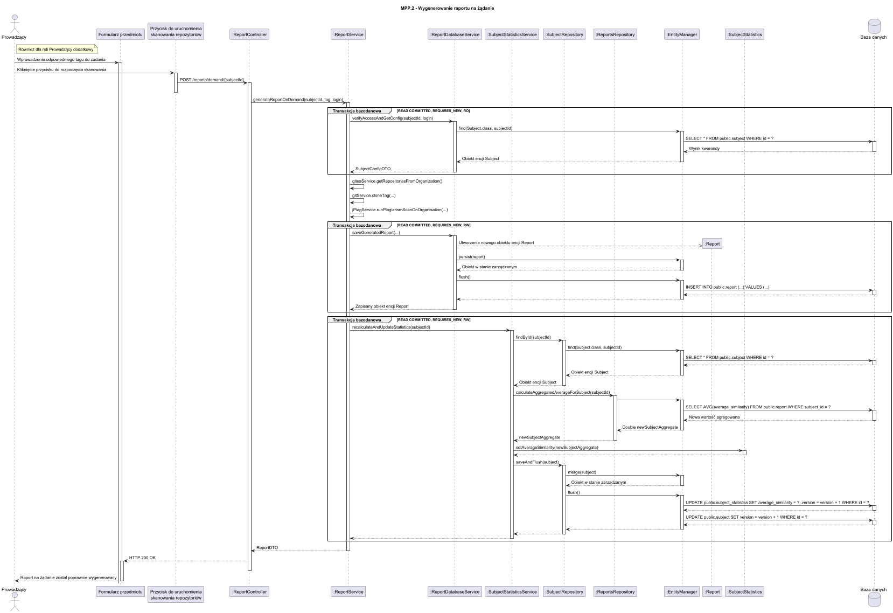
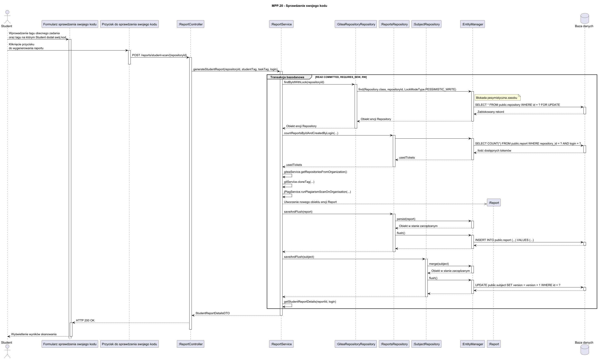
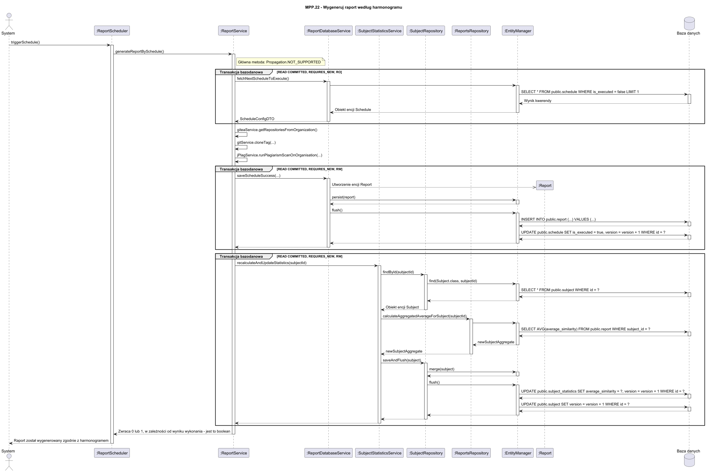

## 20 Diagramy sekwencji oraz identyfikacja transakcji bazodanowych - funkcjonalność krytyczna 2 pkt

W ramach realizacji modułu poszukiwania plagiatu wystapiły trzy przypadki użycia pełniące funkcjonalność krytyczną:
- MPP.2 - Generowanie raportu na żądanie
- MPP.20 - Sprawdzenie swojego kodu
- MPP.22 - Wygeneruj raport według harmonogramu

Każdy z przypadków związany jest z generowaniem raportu antyplagiatowego przez użytkownika systemu, ponieważ w taki sposób następuje agregacja danych i aktualizacja wyników danego repozytorium.

Rysunek 3.20.1 Diagram sekwencji dla przypadku MPP.2 - Generowanie raportu na żądanie

Rysunek 3.20.2 Diagram sekwencji dla przypadku MPP.20 - Sprawdzenie swojego kodu

Rysunek 3.20.3 Diagram sekwencji dla przypadku MPP.22 - Wygeneruj raport według harmonogramu
