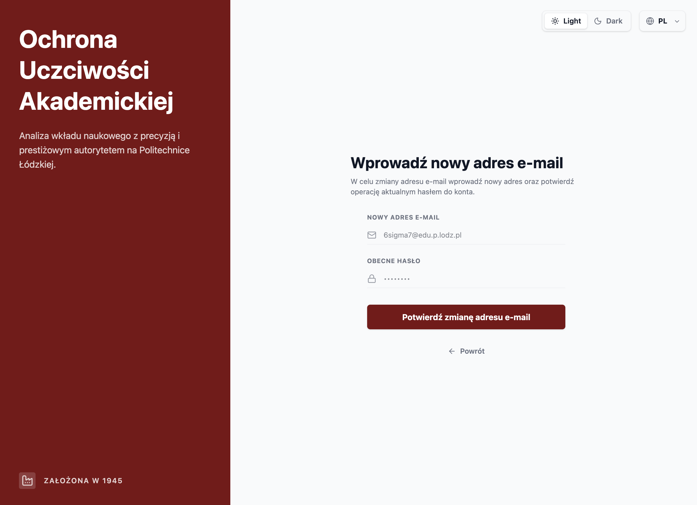
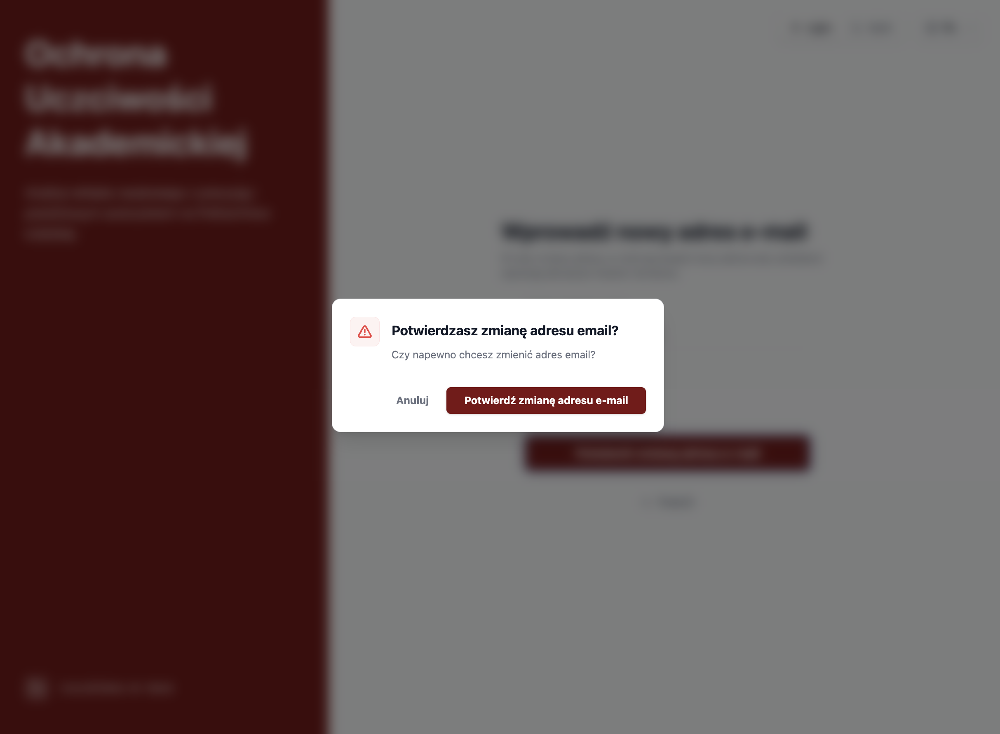
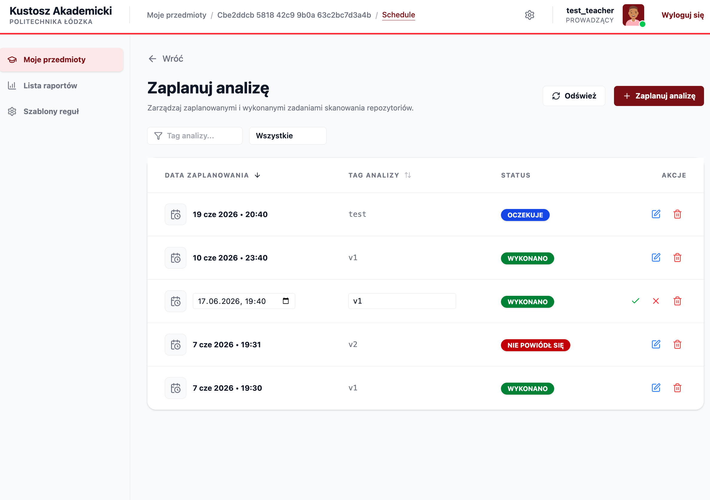
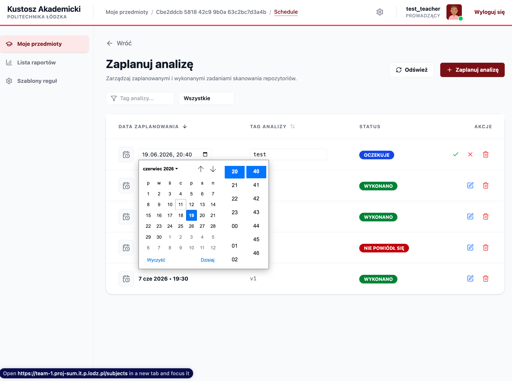
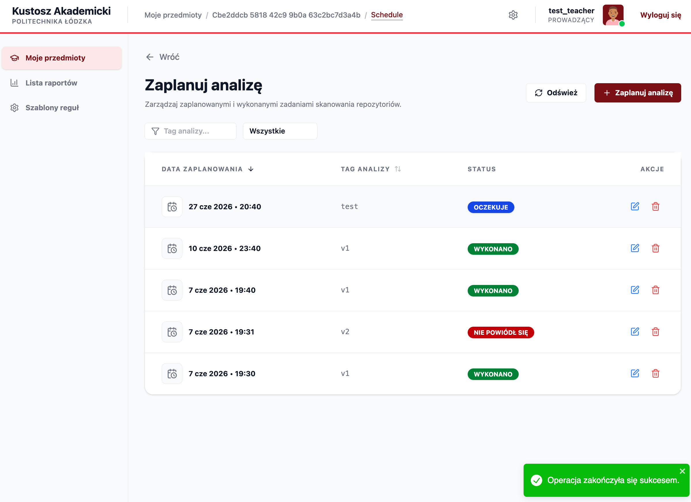
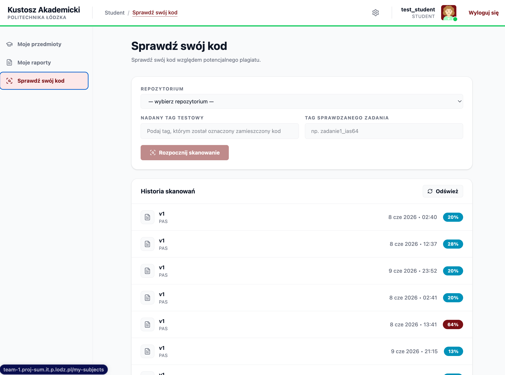
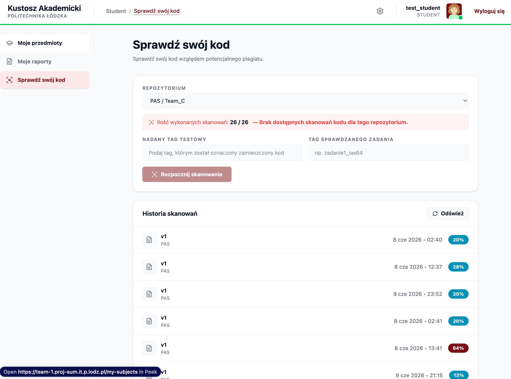
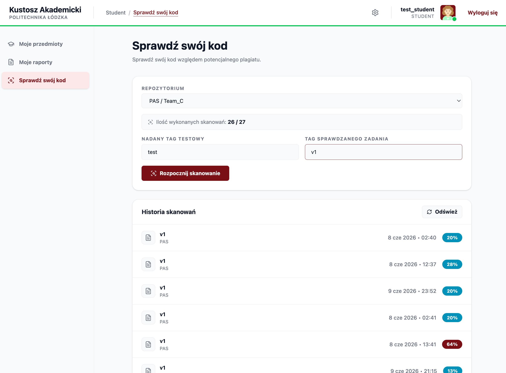
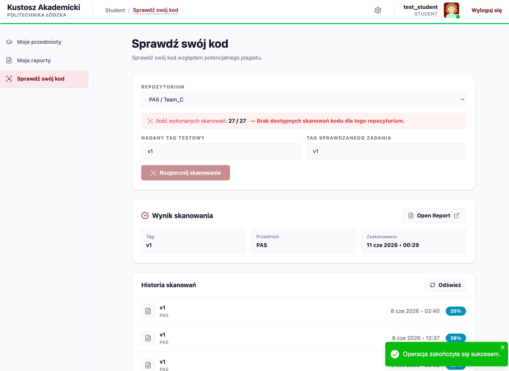
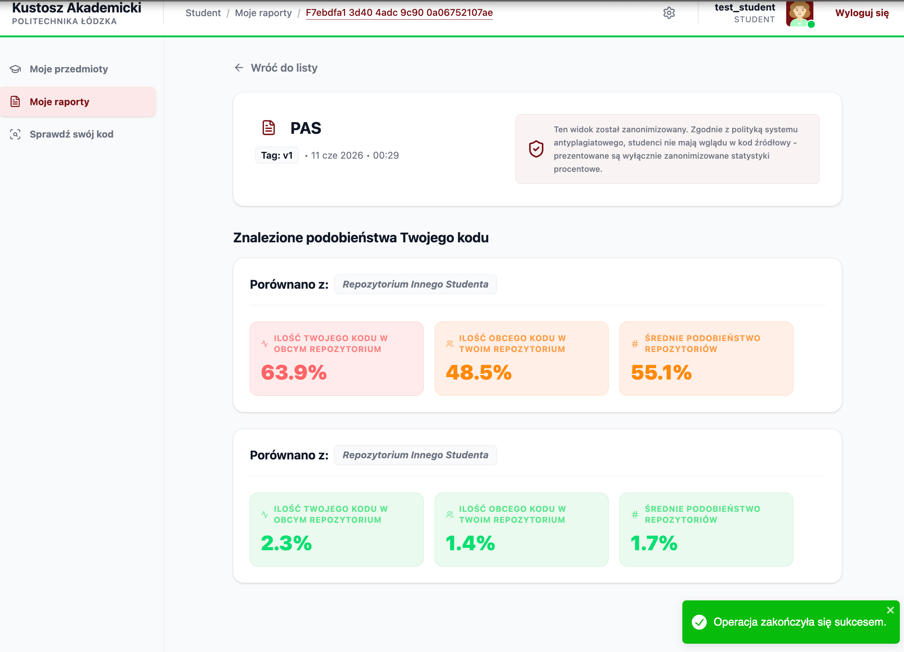

## 22 Wykaz akcji dostępnych z interfejsu użytkownika 4 pkt


### MOK.3 Reset hasła

Żądanie resertu hasła.

Role które mają dostęp: gość.

```json
"/auth/reset/request": {
      "post": {
        "tags": [
          "password-reset-controller"
        ],
        "summary": "Zresetuj hasło za podanym e-mailem (etap 1)",
        "description": "Wyślij kod na podany email o resetowaniu hasła",
        "operationId": "requestReset",
        "requestBody": {
          "content": {
            "application/json": {
              "schema": {
                "$ref": "#/components/schemas/ResetPasswordDTO"
              }
            }
          },
          "required": true
        },
        "responses": {
          "400": {
            "description": "Błąd walidacji wejścia",
            "content": {
              "application/json": {
                "schema": {
                  "$ref": "#/components/schemas/ValidationErrorResponse"
                }
              }
            }
          },
          "200": {
            "description": "Nie znaleziono adresu email"
          },
          "401": {
            "description": "Brak autoryzacji (nieprawidłowy token JWT)",
            "content": {
              "application/json": {
                "example": {
                  "error": "Unauthorized",
                  "message": "Brak lub niepoprawny token autoryzacyjny."
                }
              }
            }
          },
          "403": {
            "description": "Odmowa dostępu (brak roli)",
            "content": {
              "text/plain": {
                "example": "No access: Access Denied"
              }
            }
          },
          "500": {
            "description": "Wewnętrzny błąd serwera",
            "content": {
              "text/plain": {
                "example": "Exception: Wystąpił nieoczekiwany błąd serwera"
              }
            }
          },
          "503": {
            "description": "Niedostępność usługi bazy danych",
            "content": {
              "text/plain": {
                "example": "Service is temporarily unavailable. Please try again later."
              }
            }
          }
        }
      }
    },
```
Listing 22.1.3.1. Dokumentacja OpenApi dla metody POST `/auth/reset/request`.

Wywoływane metody.


1. PasswordResetController.requestReset(ResetPasswordDTO)(pl.lodz.p.it.ssbd2026.ssbd01.mok.controllers)
2. PasswordResetService.initiatePasswordReset(String) (pl.lodz.p.it.ssbd2026.ssbd01.mok.services)
3. Account.getLanguageVersion()  (pl.lodz.p.it.ssbd2026.ssbd01.entities)
4. AccountRepository.findByEmail(String)  (pl.lodz.p.it.ssbd2026.ssbd01.mok.repositories)
5. EmailService.sendResetPasswordEmail(String, String, String)  (pl.lodz.p.it.ssbd2026.ssbd01.mok.services)
6. EmailService.sendEmail(String, String, String)  (pl.lodz.p.it.ssbd2026.ssbd01.mok.services)
7. Translator.translateForUser(String, String, Object...)(2 usages)  (pl.lodz.p.it.ssbd2026.ssbd01.config.i18n)
8. JpaRepository.saveAllAndFlush(Iterable\<S>)  (org.springframework.data.jpa.repository)
9. SimpleJpaRepository.saveAllAndFlush(Iterable\<S>)  (org.springframework.data.jpa.repository.support)
10. JpaRepository.saveAndFlush(S)  (org.springframework.data.jpa.repository)
11. SimpleJpaRepository.saveAndFlush(S)  (org.springframework.data.jpa.repository.support)
12. LanguageDict.getLanguage()  (pl.lodz.p.it.ssbd2026.ssbd01.entities)
13. OneTimeTokenEnt.OneTimeTokenEnt()  (pl.lodz.p.it.ssbd2026.ssbd01.entities)
14. OneTimeTokenEnt.setExpiresAt(LocalDateTime)  (pl.lodz.p.it.ssbd2026.ssbd01.entities)
15. OneTimeTokenEnt.setIsUsed(Boolean)(2 usages)  (pl.lodz.p.it.ssbd2026.ssbd01.entities)
16. OneTimeTokenEnt.setTokenType(OneTimeTokenType)  (pl.lodz.p.it.ssbd2026.ssbd01.entities)
17. OneTimeTokenEnt.setTokenValue(String)  (pl.lodz.p.it.ssbd2026.ssbd01.entities)
18. OneTimeTokenEnt.setUsername(String)  (pl.lodz.p.it.ssbd2026.ssbd01.entities)
19. OneTimeTokenRepository.findByUsernameAndTokenTypeAndIsUsedIsFalse(String, OneTimeTokenType)  (pl.lodz.p.it.ssbd2026.ssbd01.mok.repositories)
20. PasswordResetService.hashToken(String)  (pl.lodz.p.it.ssbd2026.ssbd01.mok.services)
21. HashEncryptionException.HashEncryptionException(String, Throwable)  (pl.lodz.p.it.ssbd2026.ssbd01.exceptions)
22. PasswordResetService.getStringFromByteArray(byte\[])  (pl.lodz.p.it.ssbd2026.ssbd01.mok.services)
23. ResetPasswordDTO.email()  (pl.lodz.p.it.ssbd2026.ssbd01.dto.reset_password)

Potwierdzenie resetu hasła.

Role które mają dostęp: gość.

```json
"/auth/reset/confirm": {
      "post": {
        "tags": [
          "password-reset-controller"
        ],
        "summary": "Zresetuj hasło za podanym e-mailem (etap 2)",
        "description": "Weryfikuje kod z e-maila w procesie resetu hasła.",
        "operationId": "confirmReset",
        "requestBody": {
          "content": {
            "application/json": {
              "schema": {
                "$ref": "#/components/schemas/ConfirmResetDto"
              }
            }
          },
          "required": true
        },
        "responses": {
          "400": {
            "description": "Błąd walidacji wejścia",
            "content": {
              "application/json": {
                "schema": {
                  "$ref": "#/components/schemas/ValidationErrorResponse"
                }
              }
            }
          },
          "200": {
            "description": "Pomyślnie zweryfikowano, zwraca tokeny JWT",
            "content": {
              "*/*": {
                "schema": {
                  "type": "string"
                }
              }
            }
          },
          "404": {
            "description": "Konto z takim e-mailem nie istnieje",
            "content": {
              "text/plain": {
                "example": "Nie znaleziono konta powiązanego z tym adresem e-mail."
              }
            }
          },
          "409": {
            "description": "Niepoprawny token weryfikacyjny",
            "content": {
              "text/plain": {
                "example": "Czas na reset hasła minął lub token został już użyty."
              }
            }
          },
          "401": {
            "description": "Brak autoryzacji (nieprawidłowy token JWT)",
            "content": {
              "application/json": {
                "example": {
                  "error": "Unauthorized",
                  "message": "Brak lub niepoprawny token autoryzacyjny."
                }
              }
            }
          },
          "403": {
            "description": "Odmowa dostępu (brak roli)",
            "content": {
              "text/plain": {
                "example": "No access: Access Denied"
              }
            }
          },
          "500": {
            "description": "Wewnętrzny błąd serwera",
            "content": {
              "text/plain": {
                "example": "Exception: Wystąpił nieoczekiwany błąd serwera"
              }
            }
          },
          "503": {
            "description": "Niedostępność usługi bazy danych",
            "content": {
              "text/plain": {
                "example": "Service is temporarily unavailable. Please try again later."
              }
            }
          }
        }
      }
    },
```
Listing 22.1.3.3. Dokumentacja OpenApi dla metody POST `/auth/reset/confirm`.

Wywoływane metody.

1. PasswordResetController.confirmReset(ConfirmResetDto)(pl.lodz.p.it.ssbd2026.ssbd01.mok.controllers)
2. ConfirmResetDto.token()  (pl.lodz.p.it.ssbd2026.ssbd01.dto.reset_password)
3. ConfirmResetDto.newPassword()  (pl.lodz.p.it.ssbd2026.ssbd01.dto.reset_password)
4. PasswordResetService.resolvePasswordReset(String, String)  (pl.lodz.p.it.ssbd2026.ssbd01.mok.services)
5. PasswordResetService.hashToken(String)  (pl.lodz.p.it.ssbd2026.ssbd01.mok.services)
6. PasswordResetService.getStringFromByteArray(byte[])  (pl.lodz.p.it.ssbd2026.ssbd01.mok.services)
7. HashEncryptionException.HashEncryptionException(String, Throwable)  (pl.lodz.p.it.ssbd2026.ssbd01.exceptions)
8. OneTimeTokenRepository.findByTokenValueAndTokenTypeAndIsUsedIsFalseAndExpiresAtAfter(String, OneTimeTokenType, LocalDateTime)  (pl.lodz.p.it.ssbd2026.ssbd01.mok.repositories)
9. OneTimeTokenInvalidException.OneTimeTokenInvalidException(String)  (pl.lodz.p.it.ssbd2026.ssbd01.exceptions)
10. AppBaseException.AppBaseException(HttpStatusCode, String)  (pl.lodz.p.it.ssbd2026.ssbd01.exceptions)
11. OneTimeTokenEnt.setIsUsed(Boolean)  (pl.lodz.p.it.ssbd2026.ssbd01.entities)
12. JpaRepository.saveAndFlush(S)(2 usages)  (org.springframework.data.jpa.repository)
13. SimpleJpaRepository.saveAndFlush(S)  (org.springframework.data.jpa.repository.support)
14. OneTimeTokenEnt.getUsername()  (pl.lodz.p.it.ssbd2026.ssbd01.entities)
15. AccountRepository.findByEmail(String)  (pl.lodz.p.it.ssbd2026.ssbd01.mok.repositories)
16. AccountNotFoundException.AccountNotFoundException(String)  (pl.lodz.p.it.ssbd2026.ssbd01.exceptions)
17. AppBaseException.AppBaseException(HttpStatusCode, String)  (pl.lodz.p.it.ssbd2026.ssbd01.exceptions)
18. Account.getPasswordHash()  (pl.lodz.p.it.ssbd2026.ssbd01.entities)
19. PasswordSameAsOldException.PasswordSameAsOldException()  (pl.lodz.p.it.ssbd2026.ssbd01.exceptions)
20. AppBaseException.AppBaseException(HttpStatusCode, String)  (pl.lodz.p.it.ssbd2026.ssbd01.exceptions)
21. Account.getPasswordHistoryList()(2 usages)  (pl.lodz.p.it.ssbd2026.ssbd01.entities)
22. PasswordHistory.getPasswordHash()  (pl.lodz.p.it.ssbd2026.ssbd01.entities)
23. PasswordAlreadyUsedInPastException.PasswordAlreadyUsedInPastException()  (pl.lodz.p.it.ssbd2026.ssbd01.exceptions)
24. AppBaseException.AppBaseException(HttpStatusCode, String)  (pl.lodz.p.it.ssbd2026.ssbd01.exceptions)
25. Account.setPasswordHash(String)  (pl.lodz.p.it.ssbd2026.ssbd01.entities)
26. PasswordHistory.PasswordHistory(Account, String)  (pl.lodz.p.it.ssbd2026.ssbd01.entities)
27. Translator.translate(String)  (pl.lodz.p.it.ssbd2026.ssbd01.config.i18n)

Listing 22.1.3.4. Sekwencja wywoływanych metod dla metody kontrolera `PasswordResetController.confirmReset`.

Widoki użytkownika.


Rysunek 22.1.3.1. Interfejs graficzny użytkownika przedstawiający stronę żądania resetu hasła.


Rysunek 22.1.3.2. Interfejs graficzny użytkownika przedstawiający stronę żądania resetu hasła z błędem walidacji pola email.


Rysunek 22.1.3.3. Interfejs graficzny użytkownika przedstawiający stronę z komunikatem o pomyślnym wysłaniu email'u na podany adres.


Rysunek 22.1.3.4. Interfejs graficzny użytkownika przedstawiający stronę potwierdzenia resetu hasła.


Rysunek 22.1.3.5. Interfejs graficzny użytkownika przedstawiający stronę potwierdzenia resetu hasła z błędem walidacji tego hasła.


Rysunek 22.1.3.6. Interfejs graficzny użytkownika przedstawiający stronę potwierdzenia resetu hasła z prośbą o potwierdzenie zamiaru dokonania czynności resetu hasła.


Rysunek 22.1.3.7. Interfejs graficzny użytkownika przedstawiający stronę potwierdzenia resetu hasła z komunikatem o błędzie który wystąpił po stronie warstwy logiki.


Rysunek 22.1.3.8. Interfejs graficzny użytkownika przedstawiający stronę z komunikatem o pomyślnym resecie hasła.

### MOK.4 - Zablokuj konto użytkownika

**Role uprawnione:** Administrator (`ADMIN`)

```json
"/account/block/{id}": {
      "post": {
        "tags": [
          "Konta"
        ],
        "summary": "Zablokuj konto",
        "description": "Pozwala administratorowi ręcznie zablokować konto użytkownika. Wymaga nagłówka If-Match.",
        "operationId": "blockUserAccount",
        "parameters": [
          {
            "name": "id",
            "in": "path",
            "required": true,
            "schema": {
              "type": "string",
              "format": "uuid"
            }
          },
          {
            "name": "If-Match",
            "in": "header",
            "required": true,
            "schema": {
              "type": "string"
            }
          }
        ],
        "responses": {
          "400": {
            "description": "Błąd walidacji wejścia",
            "content": {
              "application/json": {
                "schema": {
                  "$ref": "#/components/schemas/ValidationErrorResponse"
                }
              }
            }
          },
          "204": {
            "description": "Konto zostało pomyślnie zablokowane"
          },
          "404": {
            "description": "Nie znaleziono konta",
            "content": {
              "text/plain": {
                "example": "Nie znaleziono konta o podanym ID."
              }
            }
          },
          "409": {
            "description": "Konflikt",
            "content": {
              "text/plain": {
                "example": "Konto jest już zablokowane."
              }
            }
          },
          "401": {
            "description": "Brak autoryzacji (nieprawidłowy token JWT)",
            "content": {
              "application/json": {
                "example": {
                  "error": "Unauthorized",
                  "message": "Brak lub niepoprawny token autoryzacyjny."
                }
              }
            }
          },
          "403": {
            "description": "Odmowa dostępu (brak roli)",
            "content": {
              "text/plain": {
                "example": "No access: Access Denied"
              }
            }
          },
          "500": {
            "description": "Wewnętrzny błąd serwera",
            "content": {
              "text/plain": {
                "example": "Exception: Wystąpił nieoczekiwany błąd serwera"
              }
            }
          },
          "503": {
            "description": "Niedostępność usługi bazy danych",
            "content": {
              "text/plain": {
                "example": "Service is temporarily unavailable. Please try again later."
              }
            }
          }
        }
      }
    },
```

Listing 22.1.4.1. Dokumentacja OpenApi dla metody POST `/account/block/{id}`.


**Sekwencja wywołań:**
1. AccountRepository.blockUserAccount(UUID, String) (pl.lodz.p.it.ssbd2026.ssbd01.mok.repositories)
2. AccountService.blockUserAccount(UUID, String)  (pl.lodz.p.it.ssbd2026.ssbd01.mok.services)
3. AccountRepository.findById(UUID)  (pl.lodz.p.it.ssbd2026.ssbd01.mok.repositories)
4. AccountNotFoundException.AccountNotFoundException()  (pl.lodz.p.it.ssbd2026.ssbd01.exceptions)
5. AppBaseException.AppBaseException(HttpStatusCode, String)  (pl.lodz.p.it.ssbd2026.ssbd01.exceptions)
6. MokRefreshRepository.refresh(AbstractEntity)  (pl.lodz.p.it.ssbd2026.ssbd01.mok.repositories)
7. AbstractEntity.getVersion()  (pl.lodz.p.it.ssbd2026.ssbd01.entities)
8. VersionHashService.hashObjectVersion(UUID, Integer)  (pl.lodz.p.it.ssbd2026.ssbd01.mok.services)
9. VersionHashService.getStringFromByteArray(byte[])  (pl.lodz.p.it.ssbd2026.ssbd01.mok.services)
10. HashEncryptionException.HashEncryptionException(String, Throwable)  (pl.lodz.p.it.ssbd2026.ssbd01.exceptions)
11. ConcurrentUpdateException.ConcurrentUpdateException()  (pl.lodz.p.it.ssbd2026.ssbd01.exceptions)
12. AppBaseException.AppBaseException(HttpStatusCode, String)  (pl.lodz.p.it.ssbd2026.ssbd01.exceptions)
13. Account.getIsBlocked()  (pl.lodz.p.it.ssbd2026.ssbd01.entities)
14. AccountIsBlockedException.AccountIsBlockedException()  (pl.lodz.p.it.ssbd2026.ssbd01.exceptions)
15. AppBaseException.AppBaseException(HttpStatusCode, String)  (pl.lodz.p.it.ssbd2026.ssbd01.exceptions)
16. Account.setIsBlocked(Boolean)  (pl.lodz.p.it.ssbd2026.ssbd01.entities)
17. JpaRepository.saveAndFlush(S)  (org.springframework.data.jpa.repository)
18. SimpleJpaRepository.saveAndFlush(S)  (org.springframework.data.jpa.repository.support)
19. Account.getEmail()  (pl.lodz.p.it.ssbd2026.ssbd01.entities)
20. Account.getLogin()  (pl.lodz.p.it.ssbd2026.ssbd01.entities)
21. Account.getLanguageVersion()  (pl.lodz.p.it.ssbd2026.ssbd01.entities)
22. LanguageDict.getLanguage()  (pl.lodz.p.it.ssbd2026.ssbd01.entities)
23. EmailService.sendAccountIsBlockedInfo(String, String, String)  (pl.lodz.p.it.ssbd2026.ssbd01.mok.services)
24. Translator.translateForUser(String, String, Object...)(2 usages)  (pl.lodz.p.it.ssbd2026.ssbd01.config.i18n)
25. EmailService.sendEmail(String, String, String)  (pl.lodz.p.it.ssbd2026.ssbd01.mok.services)
26. PostCommitTransactionManager.register(Runnable)  (pl.lodz.p.it.ssbd2026.ssbd01.common.utils)

Listing 22.1.4.2. Sekwencja wywołań dla blockUserAccount.

**Fragmenty graficznego interfejsu użytkownika:**


*Rys. 22.4.1. Widok danego konta i przycisku do blokowania konta.*


*Rys. 22.4.2. Widok potwierdzenia akcji blokowania konta.*


*Rys. 22.4.2. Widok danego konta po akcji blokowania konta.*

### MOK.5 - Odblokuj konto użytkownika

**Role uprawnione:** Administrator (`ADMIN`)

```json
"/account/unblock/{id}": {
      "post": {
        "tags": [
          "Konta"
        ],
        "summary": "Odblokuj konto",
        "description": "Pozwala administratorowi ręcznie odblokować zablokowane konto użytkownika. Wymaga nagłówka If-Match.",
        "operationId": "unblockUserAccount",
        "parameters": [
          {
            "name": "id",
            "in": "path",
            "required": true,
            "schema": {
              "type": "string",
              "format": "uuid"
            }
          },
          {
            "name": "If-Match",
            "in": "header",
            "required": true,
            "schema": {
              "type": "string"
            }
          }
        ],
        "responses": {
          "400": {
            "description": "Błąd walidacji wejścia",
            "content": {
              "application/json": {
                "schema": {
                  "$ref": "#/components/schemas/ValidationErrorResponse"
                }
              }
            }
          },
          "204": {
            "description": "Konto zostało pomyślnie odblokowane"
          },
          "404": {
            "description": "Nie znaleziono konta",
            "content": {
              "text/plain": {
                "example": "Nie znaleziono konta o podanym ID."
              }
            }
          },
          "409": {
            "description": "Konflikt",
            "content": {
              "text/plain": {
                "example": "Konto jest już odblokowane."
              }
            }
          },
          "401": {
            "description": "Brak autoryzacji (nieprawidłowy token JWT)",
            "content": {
              "application/json": {
                "example": {
                  "error": "Unauthorized",
                  "message": "Brak lub niepoprawny token autoryzacyjny."
                }
              }
            }
          },
          "403": {
            "description": "Odmowa dostępu (brak roli)",
            "content": {
              "text/plain": {
                "example": "No access: Access Denied"
              }
            }
          },
          "500": {
            "description": "Wewnętrzny błąd serwera",
            "content": {
              "text/plain": {
                "example": "Exception: Wystąpił nieoczekiwany błąd serwera"
              }
            }
          },
          "503": {
            "description": "Niedostępność usługi bazy danych",
            "content": {
              "text/plain": {
                "example": "Service is temporarily unavailable. Please try again later."
              }
            }
          }
        }
      }
    }
```

Listing 22.1.5.1. Dokumentacja OpenApi dla metody POST `/account/unblock/{id}`.


**Sekwencja wywołań:**
1. AccountRepository.unblockUserAccount(UUID, String) (pl.lodz.p.it.ssbd2026.ssbd01.mok.repositories)
2. AccountService.unblockUserAccount(UUID, String)  (pl.lodz.p.it.ssbd2026.ssbd01.mok.services)
3. AccountRepository.findById(UUID)  (pl.lodz.p.it.ssbd2026.ssbd01.mok.repositories)
4. AccountNotFoundException.AccountNotFoundException()  (pl.lodz.p.it.ssbd2026.ssbd01.exceptions)
5. AppBaseException.AppBaseException(HttpStatusCode, String)  (pl.lodz.p.it.ssbd2026.ssbd01.exceptions)
6. MokRefreshRepository.refresh(AbstractEntity)  (pl.lodz.p.it.ssbd2026.ssbd01.mok.repositories)
7. AbstractEntity.getVersion()  (pl.lodz.p.it.ssbd2026.ssbd01.entities)
8. VersionHashService.hashObjectVersion(UUID, Integer)  (pl.lodz.p.it.ssbd2026.ssbd01.mok.services)
9. VersionHashService.getStringFromByteArray(byte[])  (pl.lodz.p.it.ssbd2026.ssbd01.mok.services)
10. HashEncryptionException.HashEncryptionException(String, Throwable)  (pl.lodz.p.it.ssbd2026.ssbd01.exceptions)
11. ConcurrentUpdateException.ConcurrentUpdateException()  (pl.lodz.p.it.ssbd2026.ssbd01.exceptions)
12. AppBaseException.AppBaseException(HttpStatusCode, String)  (pl.lodz.p.it.ssbd2026.ssbd01.exceptions)
13. Account.getIsBlocked()  (pl.lodz.p.it.ssbd2026.ssbd01.entities)
14. AccountIsNotBlockedException.AccountIsNotBlockedException()  (pl.lodz.p.it.ssbd2026.ssbd01.exceptions)
15. AppBaseException.AppBaseException(HttpStatusCode, String)  (pl.lodz.p.it.ssbd2026.ssbd01.exceptions)
16. Account.setIsBlocked(Boolean)  (pl.lodz.p.it.ssbd2026.ssbd01.entities)
17. JpaRepository.saveAndFlush(S)  (org.springframework.data.jpa.repository)
18. SimpleJpaRepository.saveAndFlush(S)  (org.springframework.data.jpa.repository.support)
19. Account.getEmail()  (pl.lodz.p.it.ssbd2026.ssbd01.entities)
20. Account.getLogin()  (pl.lodz.p.it.ssbd2026.ssbd01.entities)
21. Account.getLanguageVersion()  (pl.lodz.p.it.ssbd2026.ssbd01.entities)
22. LanguageDict.getLanguage()  (pl.lodz.p.it.ssbd2026.ssbd01.entities)
23. EmailService.sendAccountIsUnblockedInfo(String, String, String)  (pl.lodz.p.it.ssbd2026.ssbd01.mok.services)
24. Translator.translateForUser(String, String, Object...)(2 usages)  (pl.lodz.p.it.ssbd2026.ssbd01.config.i18n)
25. EmailService.sendEmail(String, String, String)  (pl.lodz.p.it.ssbd2026.ssbd01.mok.services)
26. PostCommitTransactionManager.register(Runnable)  (pl.lodz.p.it.ssbd2026.ssbd01.common.utils)

Listing 22.1.5.2. Sekwencja wywołań dla unblockUserAccount.


**Fragmenty graficznego interfejsu użytkownika:**


*Rys. 22.5.1. Widok danego konta i przycisku do odblokowania konta.*


*Rys. 22.5.2. Widok potwierdzenia akcji odblokowania konta.*


*Rys. 22.5.2. Widok danego konta po akcji odblokowania konta.*


### MOK.10 - Zmień adres e-mail własnego konta

**Role uprawnione:** Administrator, Prowadzący, Prowadzący dodatkowy, Student

Część z wysłaniem linku do zmiany adresu e-mail własnego konta:

```json
"/account/email/change": {
      "post": {
        "tags": [
          "Konta"
        ],
        "summary": "Zarządaj zmiany e-maila",
        "description": "Inicjuje proces zmiany własnego adresu e-mail przez wysłanie tokenu autoryzacyjnego.",
        "operationId": "requestEmailChange",
        "responses": {
          "400": {
            "description": "Błąd walidacji wejścia",
            "content": {
              "application/json": {
                "schema": {
                  "$ref": "#/components/schemas/ValidationErrorResponse"
                }
              }
            }
          },
          "200": {
            "description": "Proces zainicjowany, wiadomość e-mail została wysłana"
          },
          "401": {
            "description": "Brak autoryzacji (nieprawidłowy token JWT)",
            "content": {
              "application/json": {
                "example": {
                  "error": "Unauthorized",
                  "message": "Brak lub niepoprawny token autoryzacyjny."
                }
              }
            }
          },
          "403": {
            "description": "Odmowa dostępu (brak roli)",
            "content": {
              "text/plain": {
                "example": "No access: Access Denied"
              }
            }
          },
          "500": {
            "description": "Wewnętrzny błąd serwera",
            "content": {
              "text/plain": {
                "example": "Exception: Wystąpił nieoczekiwany błąd serwera"
              }
            }
          },
          "503": {
            "description": "Niedostępność usługi bazy danych",
            "content": {
              "text/plain": {
                "example": "Service is temporarily unavailable. Please try again later."
              }
            }
          }
        }
      }
    }
```

Listing 22.1.10.1. Dokumentacja OpenApi dla metody POST `/account/email/change`.


Część z potwierdzeniem zmiany adresu e-mail za pomocą linku:

```json
"/account/email/confirm": {
      "post": {
        "tags": [
          "Konta"
        ],
        "summary": "Potwierdź zmianę e-maila",
        "description": "Weryfikuje token i aktualizuje adres na nowy.",
        "operationId": "confirmEmailChange",
        "requestBody": {
          "content": {
            "application/json": {
              "schema": {
                "$ref": "#/components/schemas/OwnEmailChangeDTO"
              }
            }
          },
          "required": true
        },
        "responses": {
          "400": {
            "description": "Błąd walidacji wejścia",
            "content": {
              "application/json": {
                "schema": {
                  "$ref": "#/components/schemas/ValidationErrorResponse"
                }
              }
            }
          },
          "200": {
            "description": "Adres e-mail został zmieniony poprawnie",
            "content": {
              "application/json": {
                "schema": {
                  "type": "string"
                }
              }
            }
          },
          "409": {
            "description": "Konflikt",
            "content": {
              "text/plain": {
                "example": "Podany nowy adres e-mail jest już zajęty."
              }
            }
          },
          "401": {
            "description": "Brak autoryzacji (nieprawidłowy token JWT)",
            "content": {
              "application/json": {
                "example": {
                  "error": "Unauthorized",
                  "message": "Brak lub niepoprawny token autoryzacyjny."
                }
              }
            }
          },
          "403": {
            "description": "Odmowa dostępu (brak roli)",
            "content": {
              "text/plain": {
                "example": "No access: Access Denied"
              }
            }
          },
          "500": {
            "description": "Wewnętrzny błąd serwera",
            "content": {
              "text/plain": {
                "example": "Exception: Wystąpił nieoczekiwany błąd serwera"
              }
            }
          },
          "503": {
            "description": "Niedostępność usługi bazy danych",
            "content": {
              "text/plain": {
                "example": "Service is temporarily unavailable. Please try again later."
              }
            }
          }
        }
      }
    }
```

Listing 22.1.10.2. Dokumentacja OpenApi dla metody POST `/account/email/confirm`.

**Sekwencja wywołań - wysłanie wiadomości mailowej z linkiem do zmiany e-mail:**
1. AccountController.requestEmailChange(Authentication)  (pl.lodz.p.it.ssbd2026.ssbd01.mok.controllers)
2. AccountService.createUrlOwnEmailChange(String)  (pl.lodz.p.it.ssbd2026.ssbd01.mok.services)
3. AccountRepository.findByLogin(String)  (pl.lodz.p.it.ssbd2026.ssbd01.mok.repositories)
4. AccountNotFoundException.AccountNotFoundException()  (pl.lodz.p.it.ssbd2026.ssbd01.exceptions)
5. AppBaseException.AppBaseException(HttpStatusCode, String)  (pl.lodz.p.it.ssbd2026.ssbd01.exceptions)
6. OneTimeTokenEnt.OneTimeTokenEnt()  (pl.lodz.p.it.ssbd2026.ssbd01.entities)
7. OneTimeTokenEnt.setTokenValue(String)  (pl.lodz.p.it.ssbd2026.ssbd01.entities)
8. OneTimeTokenEnt.setUsername(String)  (pl.lodz.p.it.ssbd2026.ssbd01.entities)
9. OneTimeTokenEnt.setExpiresAt(LocalDateTime)  (pl.lodz.p.it.ssbd2026.ssbd01.entities)
10. OneTimeTokenEnt.setTokenType(OneTimeTokenType)  (pl.lodz.p.it.ssbd2026.ssbd01.entities)
11. OneTimeTokenEnt.setIsUsed(Boolean)  (pl.lodz.p.it.ssbd2026.ssbd01.entities)
12. JpaRepository.saveAndFlush(S)  (org.springframework.data.jpa.repository)
13. SimpleJpaRepository.saveAndFlush(S)  (org.springframework.data.jpa.repository.support)
14. Account.getEmail()  (pl.lodz.p.it.ssbd2026.ssbd01.entities)
15. Account.getLogin()  (pl.lodz.p.it.ssbd2026.ssbd01.entities)
16. Account.getLanguageVersion()  (pl.lodz.p.it.ssbd2026.ssbd01.entities)
17. LanguageDict.getLanguage()  (pl.lodz.p.it.ssbd2026.ssbd01.entities)
18. EmailService.sendUrlToChangeOwnEmail(String, String, String, String)  (pl.lodz.p.it.ssbd2026.ssbd01.mok.services)
19. Translator.translateForUser(String, String, Object...)(2 usages)  (pl.lodz.p.it.ssbd2026.ssbd01.config.i18n)
20. EmailService.sendEmail(String, String, String)  (pl.lodz.p.it.ssbd2026.ssbd01.mok.services)
21. PostCommitTransactionManager.register(Runnable)  (pl.lodz.p.it.ssbd2026.ssbd01.common.utils)

Listing 22.1.10.3. Sekwencja wywołań dla requestEmailChange.


**Sekwencja wywołań - potwierdzenie zmiany adresu e-mail poprzez dostarczony link:**
1. AccountController.confirmEmailChange(OwnEmailChangeDTO)  (pl.lodz.p.it.ssbd2026.ssbd01.mok.controllers)
2. OwnEmailChangeDTO.token()  (pl.lodz.p.it.ssbd2026.ssbd01.dto)
3. OwnEmailChangeDTO.password()  (pl.lodz.p.it.ssbd2026.ssbd01.dto)
4. OwnEmailChangeDTO.newEmail()  (pl.lodz.p.it.ssbd2026.ssbd01.dto)
5. AccountService.confirmOwnEmailChange(String, String, String)  (pl.lodz.p.it.ssbd2026.ssbd01.mok.services)
6. OneTimeTokenRepository.findByTokenValueAndTokenTypeAndIsUsedIsFalseAndExpiresAtAfter(String, OneTimeTokenType, LocalDateTime)  (pl.lodz.p.it.ssbd2026.ssbd01.mok.repositories)
7. OneTimeTokenInvalidException.OneTimeTokenInvalidException()  (pl.lodz.p.it.ssbd2026.ssbd01.exceptions)
8. OneTimeTokenEnt.getUsername()  (pl.lodz.p.it.ssbd2026.ssbd01.entities)
9. AccountRepository.findByLogin(String)  (pl.lodz.p.it.ssbd2026.ssbd01.mok.repositories)
10. AccountNotFoundException.AccountNotFoundException()  (pl.lodz.p.it.ssbd2026.ssbd01.exceptions)
11. Account.getPasswordHash()  (pl.lodz.p.it.ssbd2026.ssbd01.entities)
12. InvalidCredentialsProvidedException.InvalidCredentialsProvidedException()  (pl.lodz.p.it.ssbd2026.ssbd01.exceptions)
13. Account.getEmail()  (pl.lodz.p.it.ssbd2026.ssbd01.entities)
14. Account.setEmail(String)  (pl.lodz.p.it.ssbd2026.ssbd01.entities)
15. OneTimeTokenEnt.setIsUsed(Boolean)  (pl.lodz.p.it.ssbd2026.ssbd01.entities)
16. EmailRevertTokenEnt.EmailRevertTokenEnt()  (pl.lodz.p.it.ssbd2026.ssbd01.entities)
17.  EmailRevertTokenEnt.setTokenValue(String)  (pl.lodz.p.it.ssbd2026.ssbd01.entities)
18. Account.getLogin()(2 usages)  (pl.lodz.p.it.ssbd2026.ssbd01.entities)
19. EmailRevertTokenEnt.setUsername(String)  (pl.lodz.p.it.ssbd2026.ssbd01.entities)
20. EmailRevertTokenEnt.setOldEmail(String)  (pl.lodz.p.it.ssbd2026.ssbd01.entities)
21. EmailRevertTokenEnt.setExpiresAt(LocalDateTime)  (pl.lodz.p.it.ssbd2026.ssbd01.entities)
22. EmailRevertTokenEnt.setUsed(boolean)  (pl.lodz.p.it.ssbd2026.ssbd01.entities)
23. JpaRepository.saveAndFlush(S)(3 usages)  (org.springframework.data.jpa.repository)
24. Account.getLanguageVersion()  (pl.lodz.p.it.ssbd2026.ssbd01.entities)
25. LanguageDict.getLanguage()  (pl.lodz.p.it.ssbd2026.ssbd01.entities)
26. EmailService.sendComebackEmailAddressLink(String, String, String, String, String)  (pl.lodz.p.it.ssbd2026.ssbd01.mok.services)
27. PostCommitTransactionManager.register(Runnable)  (pl.lodz.p.it.ssbd2026.ssbd01.common.utils)

Listing 22.1.10.4. Sekwencja wywołań dla confirmEmailChange.


*Rys. 22.10.1. Widok edycji swojego konta wraz z guzikiem do zmiany adresu e-mail.*


*Rys. 22.10.2. Widok po naciśnięciu guzika do zmiany adresu e-mail.*


*Rys. 22.10.3. Widok wiadomości z linkiem do zmiany adresu e-mail.*


*Rys. 22.10.4. Widok po naciśnięciu opcji do wysłania wiadomości z linkiem ponownie.*


*Rys. 22.10.5. Widok po wejściu w link do zmiany adresu e-mail.*


*Rys. 22.10.6. Widok zatwierdzania nowego adresu e-mail oraz wprowadzeniu obecnego hasła.*

### MOK.12 Edytuj dane własnego konta

Role które mają dostęp: prowadzący, administrator, student.

```json
"/account/update-myself": {
      "patch": {
        "tags": [
          "Konta"
        ],
        "summary": "Aktualizuj konto użytkownika",
        "description": "Modyfikuje podstawowe dane konta użytkownika przez administratora. Wymaga nagłówka If-Match.",
        "operationId": "updateMyAccount",
        "parameters": [
          {
            "name": "If-Match",
            "in": "header",
            "required": true,
            "schema": {
              "type": "string"
            }
          }
        ],
        "requestBody": {
          "content": {
            "application/json": {
              "schema": {
                "$ref": "#/components/schemas/AccountDTO"
              }
            }
          },
          "required": true
        },
        "responses": {
          "400": {
            "description": "Błąd walidacji wejścia",
            "content": {
              "application/json": {
                "schema": {
                  "$ref": "#/components/schemas/ValidationErrorResponse"
                }
              }
            }
          },
          "200": {
            "description": "Konto zostało pomyślnie zaktualizowane",
            "content": {
              "application/json": {
                "schema": {
                  "$ref": "#/components/schemas/AccountWithAccessLevelsDTO"
                }
              }
            }
          },
          "409": {
            "description": "Błąd blokady optymistycznej",
            "content": {
              "text/plain": {
                "example": "Konto zostało zmodyfikowane, odśwież stronę."
              }
            }
          },
          "401": {
            "description": "Brak autoryzacji (nieprawidłowy token JWT)",
            "content": {
              "application/json": {
                "example": {
                  "error": "Unauthorized",
                  "message": "Brak lub niepoprawny token autoryzacyjny."
                }
              }
            }
          },
          "403": {
            "description": "Odmowa dostępu (brak roli)",
            "content": {
              "text/plain": {
                "example": "No access: Access Denied"
              }
            }
          },
          "500": {
            "description": "Wewnętrzny błąd serwera",
            "content": {
              "text/plain": {
                "example": "Exception: Wystąpił nieoczekiwany błąd serwera"
              }
            }
          },
          "503": {
            "description": "Niedostępność usługi bazy danych",
            "content": {
              "text/plain": {
                "example": "Service is temporarily unavailable. Please try again later."
              }
            }
          }
        }
      }
    },
```
Listing 22.1.12.1. Dokumentacja OpenApi dla metody PATCH `/account/update-myself`.

Wywoływane metody.


1. AccountController.updateMyAccount(AccountDTO, String, Principal)
2. (pl.lodz.p.it.ssbd2026.ssbd01.mok.controllers)
3. AccountMapper.toUpdateAccount(AccountDTO)  (pl.lodz.p.it.ssbd2026.ssbd01.dto.converters)
4. AccountService.updateAccountByLogin(String, String, Account)  (pl.lodz.p.it.ssbd2026.ssbd01.mok.services)
5. AccountRepository.findByLogin(String)  (pl.lodz.p.it.ssbd2026.ssbd01.mok.repositories)
6. AccountNotFoundException.AccountNotFoundException()  (pl.lodz.p.it.ssbd2026.ssbd01.exceptions)
7. AppBaseException.AppBaseException(HttpStatusCode, String)  (pl.lodz.p.it.ssbd2026.ssbd01.exceptions)
8. MokRefreshRepository.refresh(AbstractEntity)  (pl.lodz.p.it.ssbd2026.ssbd01.mok.repositories)
9. AbstractEntity.getId()  (pl.lodz.p.it.ssbd2026.ssbd01.entities)
10. AbstractEntity.getVersion()  (pl.lodz.p.it.ssbd2026.ssbd01.entities)
11. VersionHashService.hashObjectVersion(UUID, Integer)  (pl.lodz.p.it.ssbd2026.ssbd01.mok.services)
12. VersionHashService.getStringFromByteArray(byte[])  (pl.lodz.p.it.ssbd2026.ssbd01.mok.services)
13. HashEncryptionException.HashEncryptionException(String, Throwable)  (pl.lodz.p.it.ssbd2026.ssbd01.exceptions)
14. ConcurrentUpdateException.ConcurrentUpdateException()  (pl.lodz.p.it.ssbd2026.ssbd01.exceptions)
15. AppBaseException.AppBaseException(HttpStatusCode, String)  (pl.lodz.p.it.ssbd2026.ssbd01.exceptions)
16. AccountMapper.updateExistingAccount(Account, Account)  (pl.lodz.p.it.ssbd2026.ssbd01.dto.converters)
17. JpaRepository.saveAndFlush(S)  (org.springframework.data.jpa.repository)
18. SimpleJpaRepository.saveAndFlush(S)  (org.springframework.data.jpa.repository.support)
19. AccountMapper.toAccountWithAccessLevelsDTO(Account)  (pl.lodz.p.it.ssbd2026.ssbd01.dto.converters)


Listing 22.1.12.2. Sekwencja wywoływanych metod dla metody kontrolera `AccountController.updateMyAccount`.

Widoki użytkownika.


Rysunek 22.1.12.1. Interfejs graficzny użytkownika przedstawiający stronę edycji swoich danych.


Rysunek 22.1.12.2. Interfejs graficzny użytkownika przedstawiający stronę edycji swoich danych z prośbą o potwierdzenie zamiaru dokonania czynności edycji konta.


Rysunek 22.1.12.3. Interfejs graficzny użytkownika przedstawiający stronę edycji swoich danych z komunikatem o błędzie walidacji wprowadzonych danych.


Rysunek 22.1.12.4. Interfejs graficzny użytkownika przedstawiający stronę edycji swoich danych z komunikatem o błędzie po stronie warstwy logiki. 


Rysunek 22.1.12.5. Interfejs graficzny użytkownika przedstawiający stronę edycji swoich danych z komunikatem o pomyślnej zmianie. 


### MOK.13 Edytuj dane konta innego użytkownika

Role które mają dostęp: administrator.

```json
	"/account/{id}": {
      "patch": {
        "tags": [
          "Konta"
        ],
        "summary": "Aktualizuj konto użytkownika",
        "description": "Modyfikuje podstawowe dane konta użytkownika przez administratora. Wymaga nagłówka If-Match.",
        "operationId": "updateOtherAccount",
        "parameters": [
          {
            "name": "id",
            "in": "path",
            "required": true,
            "schema": {
              "type": "string",
              "format": "uuid"
            }
          },
          {
            "name": "If-Match",
            "in": "header",
            "required": true,
            "schema": {
              "type": "string"
            }
          }
        ],
        "requestBody": {
          "content": {
            "application/json": {
              "schema": {
                "$ref": "#/components/schemas/AccountDTO"
              }
            }
          },
          "required": true
        },
        "responses": {
          "400": {
            "description": "Błąd walidacji wejścia",
            "content": {
              "application/json": {
                "schema": {
                  "$ref": "#/components/schemas/ValidationErrorResponse"
                }
              }
            }
          },
          "200": {
            "description": "Konto zostało pomyślnie zaktualizowane",
            "content": {
              "application/json": {
                "schema": {
                  "$ref": "#/components/schemas/AccountWithAccessLevelsDTO"
                }
              }
            }
          },
          "404": {
            "description": "Nie znaleziono konta",
            "content": {
              "text/plain": {
                "example": "Nie znaleziono konta."
              }
            }
          },
          "409": {
            "description": "Błąd blokady optymistycznej",
            "content": {
              "text/plain": {
                "example": "Konto zostało zmodyfikowane, odśwież stronę."
              }
            }
          },
          "401": {
            "description": "Brak autoryzacji (nieprawidłowy token JWT)",
            "content": {
              "application/json": {
                "example": {
                  "error": "Unauthorized",
                  "message": "Brak lub niepoprawny token autoryzacyjny."
                }
              }
            }
          },
          "403": {
            "description": "Odmowa dostępu (brak roli)",
            "content": {
              "text/plain": {
                "example": "No access: Access Denied"
              }
            }
          },
          "500": {
            "description": "Wewnętrzny błąd serwera",
            "content": {
              "text/plain": {
                "example": "Exception: Wystąpił nieoczekiwany błąd serwera"
              }
            }
          },
          "503": {
            "description": "Niedostępność usługi bazy danych",
            "content": {
              "text/plain": {
                "example": "Service is temporarily unavailable. Please try again later."
              }
            }
          }
        }
      }
    },
```
Listing 22.1.13.1. Dokumentacja OpenApi dla metody PATCH `/account/{id}`.

Wywoływane metody.


1. AccountController.updateOtherAccount(UUID, AccountDTO, String)
2. (pl.lodz.p.it.ssbd2026.ssbd01.mok.controllers)
3. AccountMapper.toUpdateAccount(AccountDTO)  (pl.lodz.p.it.ssbd2026.ssbd01.dto.converters)
4. AccountService.updateAccount(UUID, String, Account)  (pl.lodz.p.it.ssbd2026.ssbd01.mok.services)
5. AccountRepository.findById(UUID)  (pl.lodz.p.it.ssbd2026.ssbd01.mok.repositories)
6. AccountNotFoundException.AccountNotFoundException()  (pl.lodz.p.it.ssbd2026.ssbd01.exceptions)
7. AppBaseException.AppBaseException(HttpStatusCode, String)  (pl.lodz.p.it.ssbd2026.ssbd01.exceptions)
8. MokRefreshRepository.refresh(AbstractEntity)  (pl.lodz.p.it.ssbd2026.ssbd01.mok.repositories)
9. AbstractEntity.getVersion()  (pl.lodz.p.it.ssbd2026.ssbd01.entities)
10. VersionHashService.hashObjectVersion(UUID, Integer)  (pl.lodz.p.it.ssbd2026.ssbd01.mok.services)
11. VersionHashService.getStringFromByteArray(byte[])  (pl.lodz.p.it.ssbd2026.ssbd01.mok.services)
12. HashEncryptionException.HashEncryptionException(String, Throwable)  (pl.lodz.p.it.ssbd2026.ssbd01.exceptions)
13. ConcurrentUpdateException.ConcurrentUpdateException()  (pl.lodz.p.it.ssbd2026.ssbd01.exceptions)
14. AppBaseException.AppBaseException(HttpStatusCode, String)  (pl.lodz.p.it.ssbd2026.ssbd01.exceptions)
15. AccountMapper.updateExistingAccount(Account, Account)  (pl.lodz.p.it.ssbd2026.ssbd01.dto.converters)
16. JpaRepository.saveAndFlush(S)  (org.springframework.data.jpa.repository)
17. SimpleJpaRepository.saveAndFlush(S)  (org.springframework.data.jpa.repository.support)
18. AccountMapper.toAccountWithAccessLevelsDTO(Account)  (pl.lodz.p.it.ssbd2026.ssbd01.dto.converters)

Widoki użytkownika.


Rysunek 22.1.13.1. Interfejs graficzny użytkownika przedstawiający stronę edycji danych innego użytkownika.


Rysunek 22.1.13.2. Interfejs graficzny użytkownika przedstawiający stronę edycji danych innego użytkownika z prośbą o potwierdzenie zamiaru dokonania czynności edycji konta.


Rysunek 22.1.13.3. Interfejs graficzny użytkownika przedstawiający stronę edycji danych innego użytkownika z komunikatem o błędzie walidacji wprowadzonych danych.


Rysunek 22.1.13.4. Interfejs graficzny użytkownika przedstawiający stronę edycji danych innego użytkownika z komunikatem o pomyślnej zmianie. 


### MOK.6 - Dołącz poziom dostępu do konta

**Role uprawnione:** Administrator (`ADMIN`)

```json
    "/account/{id}/access-levels/{accessLevelName}/grant": {
      "post": {
        "tags": [
          "Konta"
        ],
        "summary": "Przyznaj poziom dostępu",
        "description": "Nadaje wybranemu kontu konkretny poziom dostępu. Wymaga nagłówka If-Match.",
        "operationId": "grantAccessLevel",
        "parameters": [
          {
            "name": "id",
            "in": "path",
            "required": true,
            "schema": {
              "type": "string",
              "format": "uuid"
            }
          },
          {
            "name": "accessLevelName",
            "in": "path",
            "required": true,
            "schema": {
              "type": "string"
            }
          },
          {
            "name": "If-Match",
            "in": "header",
            "required": true,
            "schema": {
              "type": "string"
            }
          }
        ],
        "responses": {
          "400": {
            "description": "Błąd walidacji wejścia",
            "content": {
              "application/json": {
                "schema": {
                  "$ref": "#/components/schemas/ValidationErrorResponse"
                }
              }
            }
          },
          "200": {
            "description": "Poziom dostępu został pomyślnie nadany",
            "content": {
              "application/json": {
                "schema": {
                  "$ref": "#/components/schemas/AccountWithAccessLevelsDTO"
                }
              }
            }
          },
          "404": {
            "description": "Brak zasobu",
            "content": {
              "text/plain": {
                "example": "Konto lub poziom dostępu nie istnieje."
              }
            }
          },
          "409": {
            "description": "Konflikt",
            "content": {
              "text/plain": {
                "example": "Konto posiada już ten poziom dostępu."
              }
            }
          },
          "401": {
            "description": "Brak autoryzacji (nieprawidłowy token JWT)",
            "content": {
              "application/json": {
                "example": {
                  "error": "Unauthorized",
                  "message": "Brak lub niepoprawny token autoryzacyjny."
                }
              }
            }
          },
          "403": {
            "description": "Odmowa dostępu (brak roli)",
            "content": {
              "text/plain": {
                "example": "No access: Access Denied"
              }
            }
          },
          "500": {
            "description": "Wewnętrzny błąd serwera",
            "content": {
              "text/plain": {
                "example": "Exception: Wystąpił nieoczekiwany błąd serwera"
              }
            }
          },
          "503": {
            "description": "Niedostępność usługi bazy danych",
            "content": {
              "text/plain": {
                "example": "Service is temporarily unavailable. Please try again later."
              }
            }
          }
        }
      }
    }
```

Listing 22.1.6.1. Dokumentacja OpenApi dla metody POST `/account/{id}/access-levels/{accessLevelName}/grant`.

**Sekwencja wywołań:**
1. AccountController.grantAccessLevel(UUID, String, String)  (pl.lodz.p.it.ssbd2026.ssbd01.mok.controllers)
2. AccountService.grantAccessLevel(UUID, String, String)  (pl.lodz.p.it.ssbd2026.ssbd01.mok.services)
3. AccountRepository.findById(UUID)  (pl.lodz.p.it.ssbd2026.ssbd01.mok.repositories)
4. AccountNotFoundException.AccountNotFoundException()  (pl.lodz.p.it.ssbd2026.ssbd01.exceptions)
5. AppBaseException.AppBaseException(HttpStatusCode, String)  (pl.lodz.p.it.ssbd2026.ssbd01.exceptions)
6. MokRefreshRepository.refresh(AbstractEntity)  (pl.lodz.p.it.ssbd2026.ssbd01.mok.repositories)
7. AbstractEntity.getVersion()(3 usages)  (pl.lodz.p.it.ssbd2026.ssbd01.entities)
8. VersionHashService.hashObjectVersion(UUID, Integer)(3 usages)  (pl.lodz.p.it.ssbd2026.ssbd01.mok.services)
9. VersionHashService.getStringFromByteArray(byte[])  (pl.lodz.p.it.ssbd2026.ssbd01.mok.services)
10. HashEncryptionException.HashEncryptionException(String, Throwable)  (pl.lodz.p.it.ssbd2026.ssbd01.exceptions)
11. ConcurrentUpdateException.ConcurrentUpdateException()  (pl.lodz.p.it.ssbd2026.ssbd01.exceptions)
12. AppBaseException.AppBaseException(HttpStatusCode, String)  (pl.lodz.p.it.ssbd2026.ssbd01.exceptions)
13. AccessLevelDictRepository.findByAccessLevelName(String)  (pl.lodz.p.it.ssbd2026.ssbd01.mok.repositories)
14. AccessLevelDictNotFoundException.AccessLevelDictNotFoundException()(2 usages)  (pl.lodz.p.it.ssbd2026.ssbd01.exceptions.accesslevel)
15. AppBaseException.AppBaseException(HttpStatusCode, String)  (pl.lodz.p.it.ssbd2026.ssbd01.exceptions)
16. Account.getAccessLevelList()(2 usages)  (pl.lodz.p.it.ssbd2026.ssbd01.entities)
17. AccessLevel.getAccessLevelDict()(2 usages)  (pl.lodz.p.it.ssbd2026.ssbd01.entities)
18. AccessLevelDict.getId()(2 usages)  (pl.lodz.p.it.ssbd2026.ssbd01.entities)
19. AccessLevel.getActive()  (pl.lodz.p.it.ssbd2026.ssbd01.entities)
20. AccessLevelAlreadyAssignedException.AccessLevelAlreadyAssignedException()  (pl.lodz.p.it.ssbd2026.ssbd01.exceptions.accesslevel)
21. AppBaseException.AppBaseException(HttpStatusCode, String)  (pl.lodz.p.it.ssbd2026.ssbd01.exceptions)
22. AccessLevel.setActive(Boolean)(2 usages)  (pl.lodz.p.it.ssbd2026.ssbd01.entities)
23. JpaRepository.saveAndFlush(S)(2 usages)  (org.springframework.data.jpa.repository)
24. SimpleJpaRepository.saveAndFlush(S)  (org.springframework.data.jpa.repository.support)
25. Account.getEmail()(2 usages)  (pl.lodz.p.it.ssbd2026.ssbd01.entities)
26. Account.getLogin()(2 usages)  (pl.lodz.p.it.ssbd2026.ssbd01.entities)
27. Account.getLanguageVersion()(2 usages)  (pl.lodz.p.it.ssbd2026.ssbd01.entities)
28. LanguageDict.getLanguage()(2 usages)  (pl.lodz.p.it.ssbd2026.ssbd01.entities)
29. EmailService.sendAccessLevelGrantedInfo(String, String, String, String)(2 usages)  (pl.lodz.p.it.ssbd2026.ssbd01.mok.services)
30. Translator.translateForUser(String, String, Object...)(2 usages)  (pl.lodz.p.it.ssbd2026.ssbd01.config.i18n)
31. EmailService.sendEmail(String, String, String)  (pl.lodz.p.it.ssbd2026.ssbd01.mok.services)
32. PostCommitTransactionManager.register(Runnable)(2 usages)  (pl.lodz.p.it.ssbd2026.ssbd01.common.utils)
33. AbstractEntity.getId()(2 usages)  (pl.lodz.p.it.ssbd2026.ssbd01.entities)
34. AccountMapper.toAccountWithAccessLevelsAndVersionHashDTO(Account, String)(2 usages)  (pl.lodz.p.it.ssbd2026.ssbd01.dto.converters)
35. Admin.Admin()  (pl.lodz.p.it.ssbd2026.ssbd01.entities)
36. AccessLevel.AccessLevel()  (pl.lodz.p.it.ssbd2026.ssbd01.entities)
37. Student.Student()  (pl.lodz.p.it.ssbd2026.ssbd01.entities)
38. AccessLevel.AccessLevel()  (pl.lodz.p.it.ssbd2026.ssbd01.entities)
39. Teacher.Teacher()  (pl.lodz.p.it.ssbd2026.ssbd01.entities)
40. AccessLevel.AccessLevel()  (pl.lodz.p.it.ssbd2026.ssbd01.entities)
41. AccessLevel.setAccessLevelDict(AccessLevelDict)  (pl.lodz.p.it.ssbd2026.ssbd01.entities)
42. AccessLevel.setAccount(Account)  (pl.lodz.p.it.ssbd2026.ssbd01.entities)

**Fragmenty graficznego interfejsu użytkownika:**

TODO (rysunki):


*Rys. 22.1.6.1. Fragment graficznego interfejsu użytkownika przedstawiający widok kont z rolami użytkowników.*


*Rys. 22.1.6.2. Fragment graficznego interfejsu użytkownika przedstawiający widok szczegółów konta z dostępnymi poziomami dostępu.*


*Rys. 22.1.6.3. Fragment graficznego interfejsu użytkownika przedstawiający widok z oknem potwierdzającym nadanie poziomu dostępu.*


*Rys. 22.1.6.4. Fragment graficznego interfejsu użytkownika przedstawiający widok po pomyślnym nadaniu poziomu dostępu.*

### MOK.7 - Odłącz poziom dostępu od konta

```json
    "/account/{id}/access-levels/{accessLevelName}/revoke": {
      "post": {
        "tags": [
          "Konta"
        ],
        "summary": "Odbierz poziom dostępu",
        "description": "Odbiera wybranemu kontu konkretny poziom dostępu (rolę). Wymaga nagłówka If-Match.",
        "operationId": "revokeAccessLevel",
        "parameters": [
          {
            "name": "id",
            "in": "path",
            "required": true,
            "schema": {
              "type": "string",
              "format": "uuid"
            }
          },
          {
            "name": "accessLevelName",
            "in": "path",
            "required": true,
            "schema": {
              "type": "string"
            }
          },
          {
            "name": "If-Match",
            "in": "header",
            "required": true,
            "schema": {
              "type": "string"
            }
          }
        ],
        "responses": {
          "400": {
            "description": "Błąd walidacji wejścia",
            "content": {
              "application/json": {
                "schema": {
                  "$ref": "#/components/schemas/ValidationErrorResponse"
                }
              }
            }
          },
          "200": {
            "description": "Poziom dostępu został pomyślnie odebrany",
            "content": {
              "application/json": {
                "schema": {
                  "$ref": "#/components/schemas/AccountWithAccessLevelsDTO"
                }
              }
            }
          },
          "404": {
            "description": "Brak zasobu",
            "content": {
              "text/plain": {
                "example": "Konto lub poziom dostępu nie istnieje."
              }
            }
          },
          "409": {
            "description": "Konflikt",
            "content": {
              "text/plain": {
                "example": "Konto nie posiadało tego poziomu dostępu."
              }
            }
          },
          "401": {
            "description": "Brak autoryzacji (nieprawidłowy token JWT)",
            "content": {
              "application/json": {
                "example": {
                  "error": "Unauthorized",
                  "message": "Brak lub niepoprawny token autoryzacyjny."
                }
              }
            }
          },
          "403": {
            "description": "Odmowa dostępu (brak roli)",
            "content": {
              "text/plain": {
                "example": "No access: Access Denied"
              }
            }
          },
          "500": {
            "description": "Wewnętrzny błąd serwera",
            "content": {
              "text/plain": {
                "example": "Exception: Wystąpił nieoczekiwany błąd serwera"
              }
            }
          },
          "503": {
            "description": "Niedostępność usługi bazy danych",
            "content": {
              "text/plain": {
                "example": "Service is temporarily unavailable. Please try again later."
              }
            }
          }
        }
      }
    }
```

Listing 22.1.7.1. Dokumentacja OpenApi dla metody POST `/account/{id}/access-levels/{accessLevelName}/revoke`.

**Sekwencja wywołań:**

1. AccountController.revokeAccessLevel(UUID, String, String)  (pl.lodz.p.it.ssbd2026.ssbd01.mok.controllers)
2. AccountService.revokeAccessLevel(UUID, String, String)  (pl.lodz.p.it.ssbd2026.ssbd01.mok.services)
3. AccountRepository.findById(UUID)  (pl.lodz.p.it.ssbd2026.ssbd01.mok.repositories)
4. AccountNotFoundException.AccountNotFoundException()  (pl.lodz.p.it.ssbd2026.ssbd01.exceptions)
5. MokRefreshRepository.refresh(AbstractEntity)  (pl.lodz.p.it.ssbd2026.ssbd01.mok.repositories)
6. AbstractEntity.getVersion()  (pl.lodz.p.it.ssbd2026.ssbd01.entities)
7. VersionHashService.hashObjectVersion(UUID, Integer)  (pl.lodz.p.it.ssbd2026.ssbd01.mok.services)
8. ConcurrentUpdateException.ConcurrentUpdateException()  (pl.lodz.p.it.ssbd2026.ssbd01.exceptions)
9. AccessLevelDictRepository.findByAccessLevelName(String)  (pl.lodz.p.it.ssbd2026.ssbd01.mok.repositories)
10. AccessLevelDictNotFoundException.AccessLevelDictNotFoundException()  (pl.lodz.p.it.ssbd2026.ssbd01.exceptions.accesslevel)
11. Account.getAccessLevelList()  (pl.lodz.p.it.ssbd2026.ssbd01.entities)
12. AccessLevel.getAccessLevelDict()(2 usages)  (pl.lodz.p.it.ssbd2026.ssbd01.entities)
13. AccessLevelDict.getId()(2 usages)  (pl.lodz.p.it.ssbd2026.ssbd01.entities)
14. AccessLevelNotAssignedException.AccessLevelNotAssignedException()  (pl.lodz.p.it.ssbd2026.ssbd01.exceptions.accesslevel)
15. AccessLevel.getActive()  (pl.lodz.p.it.ssbd2026.ssbd01.entities)
16. AccessLevelAlreadyRevokedException.AccessLevelAlreadyRevokedException()  (pl.lodz.p.it.ssbd2026.ssbd01.exceptions.accesslevel)
17. AccessLevel.setActive(Boolean)  (pl.lodz.p.it.ssbd2026.ssbd01.entities)
18. JpaRepository.saveAndFlush(S)  (org.springframework.data.jpa.repository)
19. Account.getEmail()  (pl.lodz.p.it.ssbd2026.ssbd01.entities)
20. Account.getLogin()  (pl.lodz.p.it.ssbd2026.ssbd01.entities)
21. Account.getLanguageVersion()  (pl.lodz.p.it.ssbd2026.ssbd01.entities)
22. LanguageDict.getLanguage()  (pl.lodz.p.it.ssbd2026.ssbd01.entities)
23. EmailService.sendAccessLevelRevokedInfo(String, String, String, String)  (pl.lodz.p.it.ssbd2026.ssbd01.mok.services)
24. PostCommitTransactionManager.register(Runnable)  (pl.lodz.p.it.ssbd2026.ssbd01.common.utils)
25. AccountService.getAccountWithAccessLevels(UUID)  (pl.lodz.p.it.ssbd2026.ssbd01.mok.services)
26. AccountRepository.findById(UUID)  (pl.lodz.p.it.ssbd2026.ssbd01.mok.repositories)
27. AccountNotFoundException.AccountNotFoundException()  (pl.lodz.p.it.ssbd2026.ssbd01.exceptions)
28. Account.getAccessLevelList()  (pl.lodz.p.it.ssbd2026.ssbd01.entities)
29. AccessLevel.getAccessLevelDict()(2 usages)  (pl.lodz.p.it.ssbd2026.ssbd01.entities)
30. AccessLevelDict.getAccessLevelName()  (pl.lodz.p.it.ssbd2026.ssbd01.entities)
31. AbstractEntity.getId()  (pl.lodz.p.it.ssbd2026.ssbd01.entities)
32. AbstractEntity.getVersion()  (pl.lodz.p.it.ssbd2026.ssbd01.entities)
33. VersionHashService.hashObjectVersion(UUID, Integer)  (pl.lodz.p.it.ssbd2026.ssbd01.mok.services)
34. VersionHashService.getStringFromByteArray(byte[])  (pl.lodz.p.it.ssbd2026.ssbd01.mok.services)
35. HashEncryptionException.HashEncryptionException(String, Throwable)  (pl.lodz.p.it.ssbd2026.ssbd01.exceptions)
36. AccountMapper.toAccountWithAccessLevelsAndVersionHashDTO(Account, String)  (pl.lodz.p.it.ssbd2026.ssbd01.dto.converters)

**Fragmenty graficznego interfejsu użytkownika:**

TODO (rysunki):


*Rys. 22.1.7.1. Fragment graficznego interfejsu użytkownika przedstawiający widok kont z rolami użytkowników.*


*Rys. 22.1.7.2. Fragment graficznego interfejsu użytkownika przedstawiający widok szczegółów konta z aktywnymi poziomami dostępu.*


*Rys. 22.1.7.3. Fragment graficznego interfejsu użytkownika przedstawiający widok okno potwierdzające odebranie poziomu dostępu.*


*Rys. 22.1.7.3. Fragment graficznego interfejsu użytkownika przedstawiający widok po pomyślnym odebraniu poziomu dostępu.*

### MOK.8 - Zmień własne hasło

**Role uprawnione:** Student, Prowadzący, Administrator

```json
"/account/security/password": {
      "post": {
        "tags": [
          "Konta"
        ],
        "summary": "Zmień własne hasło",
        "description": "Pozwala zalogowanemu użytkownikowi zmienić swoje hasło. Wymaga nagłówka If-Match.",
        "operationId": "changeOwnPassword",
        "parameters": [
          {
            "name": "If-Match",
            "in": "header",
            "required": true,
            "schema": {
              "type": "string"
            }
          }
        ],
        "requestBody": {
          "content": {
            "application/json": {
              "schema": {
                "$ref": "#/components/schemas/ChangeOwnPasswordDto"
              }
            }
          },
          "required": true
        },
        "responses": {
          "400": {
            "description": "Błąd walidacji wejścia",
            "content": {
              "application/json": {
                "schema": {
                  "$ref": "#/components/schemas/ValidationErrorResponse"
                }
              }
            }
          },
          "204": {
            "description": "Hasło zostało pomyślnie zmienione"
          },
          "409": {
            "description": "Błąd blokady optymistycznej",
            "content": {
              "text/plain": {
                "example": "Niezgodność wersji danych (If-Match)."
              }
            }
          },
          "401": {
            "description": "Brak autoryzacji (nieprawidłowy token JWT)",
            "content": {
              "application/json": {
                "example": {
                  "error": "Unauthorized",
                  "message": "Brak lub niepoprawny token autoryzacyjny."
                }
              }
            }
          },
          "403": {
            "description": "Odmowa dostępu (brak roli)",
            "content": {
              "text/plain": {
                "example": "No access: Access Denied"
              }
            }
          },
          "500": {
            "description": "Wewnętrzny błąd serwera",
            "content": {
              "text/plain": {
                "example": "Exception: Wystąpił nieoczekiwany błąd serwera"
              }
            }
          },
          "503": {
            "description": "Niedostępność usługi bazy danych",
            "content": {
              "text/plain": {
                "example": "Service is temporarily unavailable. Please try again later."
              }
            }
          }
        }
      }
    },
```
Listing 22.1.8.1 Dokumentacja OpenApi dla metody POST `/account/security/password`.

**Sekwencja wywoływanych metod** dla metody kontrolera `AccountController.changeOwnPassword(ChangeOwnPasswordDto, String, Principal)`.

1. AccountController.changeOwnPassword(ChangeOwnPasswordDto, String, Principal) (pl.lodz.p.it.ssbd2026.ssbd01.mok.controllers)
2. ChangeOwnPasswordDto.getOldPassword()  (pl.lodz.p.it.ssbd2026.ssbd01.dto)
3. ChangeOwnPasswordDto.getNewPassword()  (pl.lodz.p.it.ssbd2026.ssbd01.dto)
4. AccountService.changeOwnPassword(String, String, String, String)  (pl.lodz.p.it.ssbd2026.ssbd01.mok.services)
5. AccountRepository.findByLogin(String)  (pl.lodz.p.it.ssbd2026.ssbd01.mok.repositories)
6. AccountNotFoundException.AccountNotFoundException()  (pl.lodz.p.it.ssbd2026.ssbd01.exceptions)
7. AppBaseException.AppBaseException(HttpStatusCode, String)  (pl.lodz.p.it.ssbd2026.ssbd01.exceptions)
8. MokRefreshRepository.refresh(AbstractEntity)  (pl.lodz.p.it.ssbd2026.ssbd01.mok.repositories)
9. AbstractEntity.getId()  (pl.lodz.p.it.ssbd2026.ssbd01.entities)
10. AbstractEntity.getVersion()  (pl.lodz.p.it.ssbd2026.ssbd01.entities)
11. VersionHashService.hashObjectVersion(UUID, Integer)  (pl.lodz.p.it.ssbd2026.ssbd01.mok.services)
12. VersionHashService.getStringFromByteArray(byte[])  (pl.lodz.p.it.ssbd2026.ssbd01.mok.services)
13. HashEncryptionException.HashEncryptionException(String, Throwable)  (pl.lodz.p.it.ssbd2026.ssbd01.exceptions)
14. ConcurrentUpdateException.ConcurrentUpdateException()  (pl.lodz.p.it.ssbd2026.ssbd01.exceptions)
15. AppBaseException.AppBaseException(HttpStatusCode, String)  (pl.lodz.p.it.ssbd2026.ssbd01.exceptions)
16. Account.getPasswordHash()  (pl.lodz.p.it.ssbd2026.ssbd01.entities)
17. InvalidOldPasswordException.InvalidOldPasswordException()  (pl.lodz.p.it.ssbd2026.ssbd01.exceptions)
18. AppBaseException.AppBaseException(HttpStatusCode, String)  (pl.lodz.p.it.ssbd2026.ssbd01.exceptions)
19. AccountService.validateAndSetNewPassword(Account, String)  (pl.lodz.p.it.ssbd2026.ssbd01.mok.services)
20. Account.getPasswordHash()  (pl.lodz.p.it.ssbd2026.ssbd01.entities)
21. PasswordSameAsOldException.PasswordSameAsOldException()  (pl.lodz.p.it.ssbd2026.ssbd01.exceptions)
22. Account.getPasswordHistoryList()(2 usages)  (pl.lodz.p.it.ssbd2026.ssbd01.entities)
23. PasswordHistory.getPasswordHash()  (pl.lodz.p.it.ssbd2026.ssbd01.entities)
24. PasswordAlreadyUsedInPastException.PasswordAlreadyUsedInPastException()  (pl.lodz.p.it.ssbd2026.ssbd01.exceptions)
25. Account.setPasswordHash(String)  (pl.lodz.p.it.ssbd2026.ssbd01.entities)
26. PasswordHistory.PasswordHistory(Account, String)  (pl.lodz.p.it.ssbd2026.ssbd01.entities)
27. Account.setForcePasswordChange(Boolean)  (pl.lodz.p.it.ssbd2026.ssbd01.entities)
28. JpaRepository.saveAndFlush(S)  (org.springframework.data.jpa.repository)
29. SimpleJpaRepository.saveAndFlush(S)  (org.springframework.data.jpa.repository.support)

**Fragmenty graficznego interfejsu użytkownika:**


*Rys. 22.1.8.1. Fragment graficznego interfejsu użytkownika przedstawiający widok kont z rolami użytkowników.*


*Rys. 22.1.8.2. Fragment graficznego interfejsu użytkownika przedstawiający widok szczegółów konta z aktywnymi poziomami dostępu.*


*Rys. 22.1.8.3. Fragment graficznego interfejsu użytkownika przedstawiający widok okno potwierdzające odebranie poziomu dostępu.*


*Rys. 22.1.8.4. Fragment graficznego interfejsu użytkownika przedstawiający widok po pomyślnym odebraniu poziomu dostępu.*


### MOK.9 - Zmiana hasła innego użytkownika

**Role uprawnione:** Administrator 

```json
"/account/{login}/password": {
      "post": {
        "tags": [
          "Konta"
        ],
        "summary": "Zmień hasło innego użytkownika",
        "description": "Administrator wymusza zmianę hasła na koncie innego użytkownika. Wymaga nagłówka If-Match.",
        "operationId": "changeOtherPassword",
        "parameters": [
          {
            "name": "login",
            "in": "path",
            "required": true,
            "schema": {
              "type": "string"
            }
          },
          {
            "name": "If-Match",
            "in": "header",
            "required": true,
            "schema": {
              "type": "string"
            }
          }
        ],
        "requestBody": {
          "content": {
            "application/json": {
              "schema": {
                "$ref": "#/components/schemas/ChangeOtherPasswordDto"
              }
            }
          },
          "required": true
        },
        "responses": {
          "400": {
            "description": "Błąd walidacji wejścia",
            "content": {
              "application/json": {
                "schema": {
                  "$ref": "#/components/schemas/ValidationErrorResponse"
                }
              }
            }
          },
          "204": {
            "description": "Hasło użytkownika zostało pomyślnie zmienione"
          },
          "404": {
            "description": "Nie znaleziono konta",
            "content": {
              "text/plain": {
                "example": "Nie znaleziono użytkownika."
              }
            }
          },
          "409": {
            "description": "Błąd blokady optymistycznej",
            "content": {
              "text/plain": {
                "example": "Konto zostało zmodyfikowane, odśwież stronę."
              }
            }
          },
          "401": {
            "description": "Brak autoryzacji (nieprawidłowy token JWT)",
            "content": {
              "application/json": {
                "example": {
                  "error": "Unauthorized",
                  "message": "Brak lub niepoprawny token autoryzacyjny."
                }
              }
            }
          },
          "403": {
            "description": "Odmowa dostępu (brak roli)",
            "content": {
              "text/plain": {
                "example": "No access: Access Denied"
              }
            }
          },
          "500": {
            "description": "Wewnętrzny błąd serwera",
            "content": {
              "text/plain": {
                "example": "Exception: Wystąpił nieoczekiwany błąd serwera"
              }
            }
          },
          "503": {
            "description": "Niedostępność usługi bazy danych",
            "content": {
              "text/plain": {
                "example": "Service is temporarily unavailable. Please try again later."
              }
            }
          }
        }
      }
    },
```
Listing 22.1.9.1 Dokumentacja OpenApi dla metody `POST` dla metody kontrolera `changeOtherPassword`.

**Sekwencja wywołań:**

1. AccountController.changeOtherPassword(String, ChangeOtherPasswordDto, String) (pl.lodz.p.it.ssbd2026.ssbd01.mok.controllers)
2. ChangeOtherPasswordDto.getNewPassword()  (pl.lodz.p.it.ssbd2026.ssbd01.dto)
3. AccountService.changeOtherPassword(String, String, String)  (pl.lodz.p.it.ssbd2026.ssbd01.mok.services)
4. AccountRepository.findByLogin(String)  (pl.lodz.p.it.ssbd2026.ssbd01.mok.repositories)
5. AccountNotFoundException.AccountNotFoundException()  (pl.lodz.p.it.ssbd2026.ssbd01.exceptions)
6. AppBaseException.AppBaseException(HttpStatusCode, String)  (pl.lodz.p.it.ssbd2026.ssbd01.exceptions)
7. MokRefreshRepository.refresh(AbstractEntity)  (pl.lodz.p.it.ssbd2026.ssbd01.mok.repositories)
8. AbstractEntity.getId()  (pl.lodz.p.it.ssbd2026.ssbd01.entities)
9. AbstractEntity.getVersion()  (pl.lodz.p.it.ssbd2026.ssbd01.entities)
10. VersionHashService.hashObjectVersion(UUID, Integer)  (pl.lodz.p.it.ssbd2026.ssbd01.mok.services)
11. VersionHashService.getStringFromByteArray(byte[])  (pl.lodz.p.it.ssbd2026.ssbd01.mok.services)
12. HashEncryptionException.HashEncryptionException(String, Throwable)  (pl.lodz.p.it.ssbd2026.ssbd01.exceptions)
13. ConcurrentUpdateException.ConcurrentUpdateException()  (pl.lodz.p.it.ssbd2026.ssbd01.exceptions)
14. AppBaseException.AppBaseException(HttpStatusCode, String)  (pl.lodz.p.it.ssbd2026.ssbd01.exceptions)
15. AccountService.validateAndSetNewPassword(Account, String)  (pl.lodz.p.it.ssbd2026.ssbd01.mok.services)
16. Account.getPasswordHash()  (pl.lodz.p.it.ssbd2026.ssbd01.entities)
17. PasswordSameAsOldException.PasswordSameAsOldException()  (pl.lodz.p.it.ssbd2026.ssbd01.exceptions)
18. AppBaseException.AppBaseException(HttpStatusCode, String)  (pl.lodz.p.it.ssbd2026.ssbd01.exceptions)
19. Account.getPasswordHistoryList()(2 usages)  (pl.lodz.p.it.ssbd2026.ssbd01.entities)
20. PasswordHistory.getPasswordHash()  (pl.lodz.p.it.ssbd2026.ssbd01.entities)
21. PasswordAlreadyUsedInPastException.PasswordAlreadyUsedInPastException()  (pl.lodz.p.it.ssbd2026.ssbd01.exceptions)
22. AppBaseException.AppBaseException(HttpStatusCode, String)  (pl.lodz.p.it.ssbd2026.ssbd01.exceptions)
23. Account.setPasswordHash(String)  (pl.lodz.p.it.ssbd2026.ssbd01.entities)
24. PasswordHistory.PasswordHistory(Account, String)  (pl.lodz.p.it.ssbd2026.ssbd01.entities)
25. Account.setForcePasswordChange(Boolean)  (pl.lodz.p.it.ssbd2026.ssbd01.entities)
26. JpaRepository.saveAndFlush(S)  (org.springframework.data.jpa.repository)
27. SimpleJpaRepository.saveAndFlush(S)  (org.springframework.data.jpa.repository.support)


**Fragmenty graficznego interfejsu użytkownika:**
[//]: # (TODO mchodulski)


### MOK.15 - Wyświetl listę użytkowników

**Role uprawnione:** Administrator (`ADMIN`)

```json
    "/account": {
      "get": {
        "tags": [
          "Konta"
        ],
        "summary": "Pobierz wszystkie konta",
        "description": "Pobiera stronicowaną listę wszystkich kont, opcjonalnie filtrowaną po frazie.",
        "operationId": "getAllAccounts",
        "parameters": [
          {
            "name": "page",
            "in": "query",
            "required": false,
            "schema": {
              "type": "integer",
              "format": "int32"
            }
          },
          {
            "name": "size",
            "in": "query",
            "required": false,
            "schema": {
              "type": "integer",
              "format": "int32"
            }
          },
          {
            "name": "sortBy",
            "in": "query",
            "required": false,
            "schema": {
              "type": "string"
            }
          },
          {
            "name": "sortDesc",
            "in": "query",
            "required": false,
            "schema": {
              "type": "boolean"
            }
          },
          {
            "name": "phrase",
            "in": "query",
            "required": false,
            "schema": {
              "type": "string"
            }
          },
          {
            "name": "pagedResourcesAssembler",
            "in": "query",
            "required": true,
            "schema": {
              "$ref": "#/components/schemas/PagedResourcesAssemblerAccountWithAccessLevelsDTO"
            }
          }
        ],
        "responses": {
          "400": {
            "description": "Błąd walidacji wejścia",
            "content": {
              "application/json": {
                "schema": {
                  "$ref": "#/components/schemas/ValidationErrorResponse"
                }
              }
            }
          },
          "200": {
            "description": "Poprawnie pobrano stronicowaną listę kont z hiperłączami",
            "content": {
              "application/json": {
                "schema": {
                  "$ref": "#/components/schemas/PagedModelEntityModelAccountWithAccessLevelsDTO"
                }
              }
            }
          },
          "404": {
            "description": "Nie znaleziono zasobu",
            "content": {
              "text/plain": {
                "example": "Nie znaleziono konta administratora wykonującego zapytanie."
              }
            }
          },
          "409": {
            "description": "Błąd blokady optymistycznej",
            "content": {
              "text/plain": {
                "example": "Konto zostało zmodyfikowane w międzyczasie, spróbuj ponownie."
              }
            }
          },
          "401": {
            "description": "Brak autoryzacji (nieprawidłowy token JWT)",
            "content": {
              "application/json": {
                "example": {
                  "error": "Unauthorized",
                  "message": "Brak lub niepoprawny token autoryzacyjny."
                }
              }
            }
          },
          "403": {
            "description": "Odmowa dostępu (brak roli)",
            "content": {
              "text/plain": {
                "example": "No access: Access Denied"
              }
            }
          },
          "500": {
            "description": "Wewnętrzny błąd serwera",
            "content": {
              "text/plain": {
                "example": "Exception: Wystąpił nieoczekiwany błąd serwera"
              }
            }
          },
          "503": {
            "description": "Niedostępność usługi bazy danych",
            "content": {
              "text/plain": {
                "example": "Service is temporarily unavailable. Please try again later."
              }
            }
          }
        }
      }
    }
```

Listing 22.1.15.1. Dokumentacja OpenApi dla metody GET `/account`.

**Sekwencja wywołań:**

1. AccountController.getAllAccounts(Integer, Integer, String, Boolean, String)  (pl.lodz.p.it.ssbd2026.ssbd01.mok.controllers)
2. AccountService.getAllAccounts(Integer, Integer, String, Boolean, String)  (pl.lodz.p.it.ssbd2026.ssbd01.mok.services)
3. AccountRepository.findByLogin(String)  (pl.lodz.p.it.ssbd2026.ssbd01.mok.repositories)
4. AccountNotFoundException.AccountNotFoundException()  (pl.lodz.p.it.ssbd2026.ssbd01.exceptions)
5. AccountService.updatePreferencesIfProvided(Account, Integer, String, Boolean)  (pl.lodz.p.it.ssbd2026.ssbd01.mok.services)
6. AccountService.createPageable(Integer, Account)  (pl.lodz.p.it.ssbd2026.ssbd01.mok.services)
7. AccountRepository.findAll(Pageable)  (pl.lodz.p.it.ssbd2026.ssbd01.mok.repositories)
8. AccountService.searchAccounts(String, Integer, Integer, String, Boolean, String)  (pl.lodz.p.it.ssbd2026.ssbd01.mok.services)
9. AccountRepository.findByLogin(String)  (pl.lodz.p.it.ssbd2026.ssbd01.mok.repositories)
10. AccountNotFoundException.AccountNotFoundException()  (pl.lodz.p.it.ssbd2026.ssbd01.exceptions)
11. AccountService.updatePreferencesIfProvided(Account, Integer, String, Boolean)  (pl.lodz.p.it.ssbd2026.ssbd01.mok.services)
12. AccountService.createPageable(Integer, Account)  (pl.lodz.p.it.ssbd2026.ssbd01.mok.services)
13. AccountRepository.findByNameContainingIgnoreCaseOrSurnameContainingIgnoreCase(String, String, Pageable)  (pl.lodz.p.it.ssbd2026.ssbd01.mok.repositories)
14. AbstractEntity.getId()  (pl.lodz.p.it.ssbd2026.ssbd01.entities)
15. AbstractEntity.getVersion()  (pl.lodz.p.it.ssbd2026.ssbd01.entities)
16. VersionHashService.hashObjectVersion(UUID, Integer)  (pl.lodz.p.it.ssbd2026.ssbd01.mok.services)
17. VersionHashService.getStringFromByteArray(byte[])  (pl.lodz.p.it.ssbd2026.ssbd01.mok.services)
18. HashEncryptionException.HashEncryptionException(String, Throwable)  (pl.lodz.p.it.ssbd2026.ssbd01.exceptions)
19. AccountMapper.toAccountWithAccessLevelsAndVersionHashDTO(Account, String)  (pl.lodz.p.it.ssbd2026.ssbd01.dto.converters)

**Fragmenty graficznego interfejsu użytkownika:**

TODO (rysunki):


*Rys. 22.1.15.1. Fragment graficznego interfejsu użytkownika przedstawiający widok listy wszystkich użytkowników.*


*Rys. 22.1.15.2. Fragment graficznego interfejsu użytkownika przedstawiający widok listy użytkowników z zastosowanym filtrowaniem po frazie "Jan".*


*Rys. 22.1.15.3. Fragment graficznego interfejsu użytkownika przedstawiający widok listy użytkowników z zastosowanym sortowaniem po nazwisku.*


### MPP.1 - Synchronizacja przedmiotu z Gitea

**Role uprawnione:** Prowadzący (Owner, Editor)

```json
"/subjects/{subjectId}/sync": {
      "post": {
        "tags": [
          "subject-controller"
        ],
        "summary": "Synchronizuj z Gitea (MPP.1)",
        "description": "Pobiera najnowszą listę repozytoriów z przypisanej organizacji na Gitea, pobiera ich współtwórców i aktualizuje stan w bazie danych.",
        "operationId": "syncSubjectWithGitea",
        "parameters": [
          {
            "name": "subjectId",
            "in": "path",
            "required": true,
            "schema": {
              "type": "string",
              "format": "uuid"
            }
          }
        ],
        "responses": {
          "400": {
            "description": "Błąd walidacji wejścia",
            "content": {
              "application/json": {
                "schema": {
                  "$ref": "#/components/schemas/ValidationErrorResponse"
                }
              }
            }
          },
          "204": {
            "description": "Pomyślnie zsynchronizowano przedmioty z platformą Gitea"
          },
          "404": {
            "description": "Nie znaleziono podanego przedmiotu",
            "content": {
              "text/plain": {
                "example": "Nie znaleziono podanego przedmiotu"
              }
            }
          },
          "500": {
            "description": "Wewnętrzny błąd serwera",
            "content": {
              "text/plain": {
                "example": "Exception: Wystąpił nieoczekiwany błąd serwera"
              }
            }
          },
          "401": {
            "description": "Brak autoryzacji (nieprawidłowy token JWT)",
            "content": {
              "application/json": {
                "example": {
                  "error": "Unauthorized",
                  "message": "Brak lub niepoprawny token autoryzacyjny."
                }
              }
            }
          },
          "403": {
            "description": "Odmowa dostępu (brak roli)",
            "content": {
              "text/plain": {
                "example": "No access: Access Denied"
              }
            }
          },
          "503": {
            "description": "Niedostępność usługi bazy danych",
            "content": {
              "text/plain": {
                "example": "Service is temporarily unavailable. Please try again later."
              }
            }
          }
        }
      }
    },

```
Listing 22.2.1.1 Dokumentacja OpenApi dla metody `POST` dla metody kontrolera `/subjects/{subjectId}/sync`.

**Sekwencja wywołań:**

1. SubjectController.syncSubjectWithGitea(UUID) (pl.lodz.p.it.ssbd2026.ssbd01.mpp.controllers)
2. SubjectService.syncSubjectWithGitea(UUID)  (pl.lodz.p.it.ssbd2026.ssbd01.mpp.services)
3. SubjectNotFoundException.SubjectNotFoundException()  (pl.lodz.p.it.ssbd2026.ssbd01.exceptions)
4. AppBaseException.AppBaseException(HttpStatusCode, String)  (pl.lodz.p.it.ssbd2026.ssbd01.exceptions)
5. SubjectService.checkIfNotArchived(Subject)  (pl.lodz.p.it.ssbd2026.ssbd01.mpp.services)
6. Subject.getArchived()  (pl.lodz.p.it.ssbd2026.ssbd01.entities)
7. SubjectArchivedException.SubjectArchivedException()  (pl.lodz.p.it.ssbd2026.ssbd01.exceptions.subject)
8. Subject.getSubjectAssignmentList()  (pl.lodz.p.it.ssbd2026.ssbd01.entities)
9. SubjectAssignment.getTeacher()  (pl.lodz.p.it.ssbd2026.ssbd01.entities)
10. AccessLevel.getAccount()  (pl.lodz.p.it.ssbd2026.ssbd01.entities)
11. Account.getLogin()  (pl.lodz.p.it.ssbd2026.ssbd01.entities)
12. SubjectAssignment.getSubjectRole()(2 usages)  (pl.lodz.p.it.ssbd2026.ssbd01.entities)
13. SubjectAccessDeniedException.SubjectAccessDeniedException()  (pl.lodz.p.it.ssbd2026.ssbd01.exceptions)
14. AppBaseException.AppBaseException(HttpStatusCode, String)  (pl.lodz.p.it.ssbd2026.ssbd01.exceptions)
15. SubjectService.internalSyncWithGitea(Subject)  (pl.lodz.p.it.ssbd2026.ssbd01.mpp.services)
16. Subject.getOrganizationName()(2 usages)  (pl.lodz.p.it.ssbd2026.ssbd01.entities)
17. GiteaService.getRepositoriesFromOrganization(String)  (pl.lodz.p.it.ssbd2026.ssbd01.mpp.services)
18. Subject.getRepositoryList()(2 usages)  (pl.lodz.p.it.ssbd2026.ssbd01.entities)
19. Repository.getRepositoryName()  (pl.lodz.p.it.ssbd2026.ssbd01.entities)
20. GiteaRepoDTO.name()(3 usages)  (pl.lodz.p.it.ssbd2026.ssbd01.dto.mpp)
21. Repository.Repository()  (pl.lodz.p.it.ssbd2026.ssbd01.entities)
22. Repository.setRepositoryName(String)  (pl.lodz.p.it.ssbd2026.ssbd01.entities)
23. Repository.setSubject(Subject)  (pl.lodz.p.it.ssbd2026.ssbd01.entities)
24. Repository.setStudentList(List<Student>)  (pl.lodz.p.it.ssbd2026.ssbd01.entities)
25. GiteaService.getRepoCollaborators(String, String)  (pl.lodz.p.it.ssbd2026.ssbd01.mpp.services)
26. Repository.getStudentList()(3 usages)  (pl.lodz.p.it.ssbd2026.ssbd01.entities)
27. GiteaUserDTO.email()(2 usages)  (pl.lodz.p.it.ssbd2026.ssbd01.dto.mpp)
28. StudentRepository.findByAccountEmailIgnoreCase(String)  (pl.lodz.p.it.ssbd2026.ssbd01.mpp.repositories)
29. JpaRepository.saveAndFlush(S)  (org.springframework.data.jpa.repository)
30. SimpleJpaRepository.saveAndFlush(S)  (org.springframework.data.jpa.repository.support)


**Fragmenty graficznego interfejsu użytkownika:**

[//]: # (TODO mchodulski)


### MPP.2 Generowanie raportu na żądanie.

Role które mają dostęp: prowadzący, prowadzący dodatkowy.

```json
"/reports/demand/{subjectId}": {
      "post": {
        "tags": [
          "report-controller"
        ],
        "summary": "Wykonaj skanowanie",
        "description": "Uruchom skanowanie repozytoriów za etykietą w przedmiocie",
        "operationId": "generateReportOnDemand",
        "parameters": [
          {
            "name": "subjectId",
            "in": "path",
            "required": true,
            "schema": {
              "type": "string",
              "format": "uuid"
            }
          },
          {
            "name": "tag",
            "in": "query",
            "required": true,
            "schema": {
              "type": "string"
            }
          }
        ],
        "responses": {
          "400": {
            "description": "Błąd walidacji wejścia",
            "content": {
              "application/json": {
                "schema": {
                  "$ref": "#/components/schemas/ValidationErrorResponse"
                }
              }
            }
          },
          "200": {
            "description": "Skanowanie ukończone pomyślnie",
            "content": {
              "*/*": {
                "schema": {
                  "$ref": "#/components/schemas/ReportDTO"
                }
              }
            }
          },
          "404": {
            "description": "Nie znaleziono tag",
            "content": {
              "text/plain": {
                "example": "Podany tag nie znaleziono w żadnym z repozytoriów."
              }
            }
          },
          "500": {
            "description": "Wewnętrzny błąd serwera",
            "content": {
              "text/plain": {
                "example": "Exception: Wystąpił nieoczekiwany błąd serwera"
              }
            }
          },
          "401": {
            "description": "Brak autoryzacji (nieprawidłowy token JWT)",
            "content": {
              "application/json": {
                "example": {
                  "error": "Unauthorized",
                  "message": "Brak lub niepoprawny token autoryzacyjny."
                }
              }
            }
          },
          "403": {
            "description": "Odmowa dostępu (brak roli)",
            "content": {
              "text/plain": {
                "example": "No access: Access Denied"
              }
            }
          },
          "503": {
            "description": "Niedostępność usługi bazy danych",
            "content": {
              "text/plain": {
                "example": "Service is temporarily unavailable. Please try again later."
              }
            }
          }
        }
      }
    },
```
Listing 22.2.2.1. Dokumentacja OpenApi dla metody POST `/reports/demand/{subjectId}`.

Wywoływane metody.

1. ReportController.generateReportOnDemand(UUID, String, Principal)
2. (pl.lodz.p.it.ssbd2026.ssbd01.mpp.controllers)
3. ReportService.generateReportOnDemand(UUID, String, String)  (pl.lodz.p.it.ssbd2026.ssbd01.mpp.services)
4. ReportDatabaseService.verifyAccessAndGetConfig(UUID, String)  (pl.lodz.p.it.ssbd2026.ssbd01.mpp.services)
5. SubjectNotFoundException.SubjectNotFoundException()  (pl.lodz.p.it.ssbd2026.ssbd01.exceptions)
6. AppBaseException.AppBaseException(HttpStatusCode, String)  (pl.lodz.p.it.ssbd2026.ssbd01.exceptions)
7. SubjectRepository.isTeacherAssignedToSubject(UUID, String)  (pl.lodz.p.it.ssbd2026.ssbd01.mpp.repositories)
8. SubjectAccessDeniedException.SubjectAccessDeniedException()  (pl.lodz.p.it.ssbd2026.ssbd01.exceptions)
9. AppBaseException.AppBaseException(HttpStatusCode, String)  (pl.lodz.p.it.ssbd2026.ssbd01.exceptions)
10. Subject.getRulePreset()  (pl.lodz.p.it.ssbd2026.ssbd01.entities)
11. Subject.getOrganizationName()  (pl.lodz.p.it.ssbd2026.ssbd01.entities)
12. RulePreset.getMinimumTokensMatch()  (pl.lodz.p.it.ssbd2026.ssbd01.entities)
13. RulePreset.getEnableNormalization()  (pl.lodz.p.it.ssbd2026.ssbd01.entities)
14. SubjectConfigDTO.SubjectConfigDTO(String, Integer, Boolean)  (pl.lodz.p.it.ssbd2026.ssbd01.dto.mpp)
15. SubjectNotFoundException.SubjectNotFoundException()  (pl.lodz.p.it.ssbd2026.ssbd01.exceptions)
16. AppBaseException.AppBaseException(HttpStatusCode, String)  (pl.lodz.p.it.ssbd2026.ssbd01.exceptions)
17. Subject.getArchived()  (pl.lodz.p.it.ssbd2026.ssbd01.entities)
18. SubjectArchivedException.SubjectArchivedException()  (pl.lodz.p.it.ssbd2026.ssbd01.exceptions.subject)
19. AppBaseException.AppBaseException(HttpStatusCode, String)  (pl.lodz.p.it.ssbd2026.ssbd01.exceptions)
20. SubjectConfigDTO.organizationName()(4 usages)  (pl.lodz.p.it.ssbd2026.ssbd01.dto.mpp)
21. GiteaService.getRepositoriesFromOrganization(String)  (pl.lodz.p.it.ssbd2026.ssbd01.mpp.services)
22. GiteaIntegrationException.GiteaIntegrationException(Throwable)  (pl.lodz.p.it.ssbd2026.ssbd01.exceptions)
23. AppBaseException.AppBaseException(HttpStatusCode, String, Throwable)  (pl.lodz.p.it.ssbd2026.ssbd01.exceptions)
24. GiteaRepoDTO.template()  (pl.lodz.p.it.ssbd2026.ssbd01.dto.mpp)
25. GiteaRepoDTO.name()  (pl.lodz.p.it.ssbd2026.ssbd01.dto.mpp)
26. GiteaRepoDTO.clone_url()  (pl.lodz.p.it.ssbd2026.ssbd01.dto.mpp)
27. GitService.cloneTag(String, String, File, String)  (pl.lodz.p.it.ssbd2026.ssbd01.mpp.utils)
28. GitCloneException.GitCloneException()  (pl.lodz.p.it.ssbd2026.ssbd01.exceptions)
29. AppBaseException.AppBaseException(HttpStatusCode, String)  (pl.lodz.p.it.ssbd2026.ssbd01.exceptions)
30. SubjectConfigDTO.minimumTokensMatch()  (pl.lodz.p.it.ssbd2026.ssbd01.dto.mpp)
31. SubjectConfigDTO.enableNormalization()  (pl.lodz.p.it.ssbd2026.ssbd01.dto.mpp)
32. JPlagService.runPlagiarismScanOnOrganisation(String, String, Integer, Boolean, String)  (pl.lodz.p.it.ssbd2026.ssbd01.mpp.utils)
33. ReportFileException.ReportFileException(Throwable)  (pl.lodz.p.it.ssbd2026.ssbd01.exceptions)
34. AppBaseException.AppBaseException(HttpStatusCode, String, Throwable)  (pl.lodz.p.it.ssbd2026.ssbd01.exceptions)
35. JplagScanException.JplagScanException(Throwable)  (pl.lodz.p.it.ssbd2026.ssbd01.exceptions)
36. AppBaseException.AppBaseException(HttpStatusCode, String, Throwable)  (pl.lodz.p.it.ssbd2026.ssbd01.exceptions)
37. ReportDatabaseService.saveGeneratedReport(UUID, String, long, String, Double)  (pl.lodz.p.it.ssbd2026.ssbd01.mpp.services)
38. SubjectNotFoundException.SubjectNotFoundException()  (pl.lodz.p.it.ssbd2026.ssbd01.exceptions)
39. AppBaseException.AppBaseException(HttpStatusCode, String)  (pl.lodz.p.it.ssbd2026.ssbd01.exceptions)
40. GiteaRepositoryRepository.getAllBySubjectId(UUID)  (pl.lodz.p.it.ssbd2026.ssbd01.mpp.repositories)
41. Report.Report()  (pl.lodz.p.it.ssbd2026.ssbd01.entities)
42. Report.setSubject(Subject)  (pl.lodz.p.it.ssbd2026.ssbd01.entities)
43. Report.setTag(String)  (pl.lodz.p.it.ssbd2026.ssbd01.entities)
44. Report.setIsStudentReport(Boolean)  (pl.lodz.p.it.ssbd2026.ssbd01.entities)
45. Report.setScannedRepositories(Long)  (pl.lodz.p.it.ssbd2026.ssbd01.entities)
46. Report.setPathToReport(String)  (pl.lodz.p.it.ssbd2026.ssbd01.entities)
47. Report.setRepositoryList(List\<Repository>)  (pl.lodz.p.it.ssbd2026.ssbd01.entities)
48. Report.setAverageSimilarity(Double)  (pl.lodz.p.it.ssbd2026.ssbd01.entities)
49. JpaRepository.saveAndFlush(S)  (org.springframework.data.jpa.repository)
50. SimpleJpaRepository.saveAndFlush(S)  (org.springframework.data.jpa.repository.support)  SubjectStatisticsService.recalculateAndUpdateStatistics(UUID)  (pl.lodz.p.it.ssbd2026.ssbd01.mpp.services)
51. SubjectNotFoundException.SubjectNotFoundException()  (pl.lodz.p.it.ssbd2026.ssbd01.exceptions)
52. AppBaseException.AppBaseException(HttpStatusCode, String)  (pl.lodz.p.it.ssbd2026.ssbd01.exceptions)
53. ReportsRepository.calculateAggregatedAverageForSubject(UUID)  (pl.lodz.p.it.ssbd2026.ssbd01.mpp.repositories)
54. Subject.getSubjectStatistics()(3 usages)  (pl.lodz.p.it.ssbd2026.ssbd01.entities)
55. SubjectStatistics.SubjectStatistics()  (pl.lodz.p.it.ssbd2026.ssbd01.entities)
56. SubjectStatistics.setAverageSimilarity(Double)(2 usages)  (pl.lodz.p.it.ssbd2026.ssbd01.entities)
57. SubjectStatistics.setSubject(Subject)  (pl.lodz.p.it.ssbd2026.ssbd01.entities)
58. Subject.setSubjectStatistics(SubjectStatistics)  (pl.lodz.p.it.ssbd2026.ssbd01.entities)
59. SubjectStatistics.getAverageSimilarity()  (pl.lodz.p.it.ssbd2026.ssbd01.entities)
60. JpaRepository.saveAndFlush(S)  (org.springframework.data.jpa.repository)
61. SimpleJpaRepository.saveAndFlush(S)  (org.springframework.data.jpa.repository.support)
62. ReportMapper.toDto(Report)  (pl.lodz.p.it.ssbd2026.ssbd01.dto.converters)

Widoki użytkownika.


Rysunek 22.2.2.1. Interfejs graficzny użytkownika przedstawiający stronę uruchomienia skanowania.


Rysunek 22.2.2.2. Interfejs graficzny użytkownika przedstawiający stronę uruchomienia skanowania z komunikatem błędu który powstał po stronie warstwy logiki.


Rysunek 22.2.2.3. Interfejs graficzny użytkownika przedstawiający stronę przedmiotu z komunikatem o sukcesie po pomyślnym wykonaniu skanowania.


### MPP.3 Wyświetl listę raportów

Role które mają dostęp: prowadzący, prowadzący dodatkowy.

```json
"/reports/teacher": {
      "get": {
        "tags": [
          "report-controller"
        ],
        "summary": "Pobierz swoje raporty",
        "description": "Pobierz listę raportów dla swojego konta użytkownika",
        "operationId": "getAllReportsForTeacher",
        "parameters": [
          {
            "name": "page",
            "in": "query",
            "description": "Zero-based page index (0..N)",
            "required": false,
            "schema": {
              "type": "integer",
              "default": 0,
              "minimum": 0
            }
          },
          {
            "name": "size",
            "in": "query",
            "description": "The size of the page to be returned",
            "required": false,
            "schema": {
              "type": "integer",
              "default": 20,
              "minimum": 1
            }
          },
          {
            "name": "sort",
            "in": "query",
            "description": "Sorting criteria in the format: property,(asc|desc). Default sort order is ascending. Multiple sort criteria are supported.",
            "required": false,
            "schema": {
              "type": "array",
              "items": {
                "type": "string"
              }
            }
          }
        ],
        "responses": {
          "400": {
            "description": "Błąd walidacji wejścia",
            "content": {
              "application/json": {
                "schema": {
                  "$ref": "#/components/schemas/ValidationErrorResponse"
                }
              }
            }
          },
          "200": {
            "description": "Zwrócono listę raportów",
            "content": {
              "*/*": {
                "schema": {
                  "$ref": "#/components/schemas/PageReportDTO"
                }
              }
            }
          },
          "401": {
            "description": "Brak autoryzacji (nieprawidłowy token JWT)",
            "content": {
              "application/json": {
                "example": {
                  "error": "Unauthorized",
                  "message": "Brak lub niepoprawny token autoryzacyjny."
                }
              }
            }
          },
          "403": {
            "description": "Odmowa dostępu (brak roli)",
            "content": {
              "text/plain": {
                "example": "No access: Access Denied"
              }
            }
          },
          "500": {
            "description": "Wewnętrzny błąd serwera",
            "content": {
              "text/plain": {
                "example": "Exception: Wystąpił nieoczekiwany błąd serwera"
              }
            }
          },
          "503": {
            "description": "Niedostępność usługi bazy danych",
            "content": {
              "text/plain": {
                "example": "Service is temporarily unavailable. Please try again later."
              }
            }
          }
        }
      }
    },
```
Listing 22.2.3.1. Dokumentacja OpenApi dla metody GET `/reports/teacher`.

Wywoływane metody.

1. ReportController.getAllReportsForTeacher(Principal, Pageable)
2. (pl.lodz.p.it.ssbd2026.ssbd01.mpp.controllers)
3. ReportService.getAllReportsForTeacher(String, Pageable)  (pl.lodz.p.it.ssbd2026.ssbd01.mpp.services)
4. ReportsRepository.findAllReportsForAssignedTeacherByLogin(String, Pageable)  (pl.lodz.p.it.ssbd2026.ssbd01.mpp.repositories)
5. ReportMapper.toDto(Report)  (pl.lodz.p.it.ssbd2026.ssbd01.dto.converters)

Widoki użytkownika.


Rysunek 22.2.3.1. Interfejs graficzny użytkownika przedstawiający stronę z listą raportów.


Rysunek 22.2.3.2. Interfejs graficzny użytkownika przedstawiający stronę z pustą listą raportów.

### MPP.5 Usuwanie raportów

Role które mają dostęp: prowadzący, prowadzący dodatkowy.

```json
"/reports/{reportId}": {
	"delete": {
        "tags": [
          "report-controller"
        ],
        "summary": "Usuń raport",
        "description": "Usuwa raporty z bazy oraz pliki z maszyny",
        "operationId": "deleteReport",
        "parameters": [
          {
            "name": "reportId",
            "in": "path",
            "required": true,
            "schema": {
              "type": "string",
              "format": "uuid"
            }
          }
        ],
        "responses": {
          "400": {
            "description": "Błąd walidacji wejścia",
            "content": {
              "application/json": {
                "schema": {
                  "$ref": "#/components/schemas/ValidationErrorResponse"
                }
              }
            }
          },
          "200": {
            "description": "Usunięto raport"
          },
          "404": {
            "description": "Nie znaleziono raportu",
            "content": {
              "text/plain": {
                "example": "Podany raport nie istnieje."
              }
            }
          },
          "401": {
            "description": "Brak autoryzacji (nieprawidłowy token JWT)",
            "content": {
              "application/json": {
                "example": {
                  "error": "Unauthorized",
                  "message": "Brak lub niepoprawny token autoryzacyjny."
                }
              }
            }
          },
          "403": {
            "description": "Odmowa dostępu (brak roli)",
            "content": {
              "text/plain": {
                "example": "No access: Access Denied"
              }
            }
          },
          "500": {
            "description": "Wewnętrzny błąd serwera",
            "content": {
              "text/plain": {
                "example": "Exception: Wystąpił nieoczekiwany błąd serwera"
              }
            }
          },
          "503": {
            "description": "Niedostępność usługi bazy danych",
            "content": {
              "text/plain": {
                "example": "Service is temporarily unavailable. Please try again later."
              }
            }
          }
        }
      }
    },
```
Listing 22.2.5.1. Dokumentacja OpenApi dla metody GET `/reports/{reportId}`.

Wywoływane metody.

1. ReportController.deleteReport(UUID)
2. (pl.lodz.p.it.ssbd2026.ssbd01.mpp.controllers)
3. ReportController.deleteReport(UUID) (pl.lodz.p.it.ssbd2026.ssbd01.mpp.controllers)
4. ReportService.deleteReport(UUID)  (pl.lodz.p.it.ssbd2026.ssbd01.mpp.services)
5. ReportNotFoundException.ReportNotFoundException()  (pl.lodz.p.it.ssbd2026.ssbd01.exceptions)
6. AppBaseException.AppBaseException(HttpStatusCode, String)  (pl.lodz.p.it.ssbd2026.ssbd01.exceptions)
7. Report.getPathToReport()  (pl.lodz.p.it.ssbd2026.ssbd01.entities)
8. Report.getSubject()  (pl.lodz.p.it.ssbd2026.ssbd01.entities)
9. Subject.getArchived()  (pl.lodz.p.it.ssbd2026.ssbd01.entities)
10. SubjectArchivedException.SubjectArchivedException()  (pl.lodz.p.it.ssbd2026.ssbd01.exceptions.subject)
11. AppBaseException.AppBaseException(HttpStatusCode, String)  (pl.lodz.p.it.ssbd2026.ssbd01.exceptions)
12. SubjectRepository.findByReportId(UUID)  (pl.lodz.p.it.ssbd2026.ssbd01.mpp.repositories)
13. SubjectNotFoundException.SubjectNotFoundException()  (pl.lodz.p.it.ssbd2026.ssbd01.exceptions)
14. AppBaseException.AppBaseException(HttpStatusCode, String)  (pl.lodz.p.it.ssbd2026.ssbd01.exceptions)
15. AbstractEntity.getId()  (pl.lodz.p.it.ssbd2026.ssbd01.entities)
16. SubjectStatisticsService.recalculateAndUpdateStatistics(UUID)  (pl.lodz.p.it.ssbd2026.ssbd01.mpp.services)
17. SubjectNotFoundException.SubjectNotFoundException()  (pl.lodz.p.it.ssbd2026.ssbd01.exceptions)
18. AppBaseException.AppBaseException(HttpStatusCode, String)  (pl.lodz.p.it.ssbd2026.ssbd01.exceptions)
19. ReportsRepository.calculateAggregatedAverageForSubject(UUID)  (pl.lodz.p.it.ssbd2026.ssbd01.mpp.repositories)
20. Subject.getSubjectStatistics()(3 usages)  (pl.lodz.p.it.ssbd2026.ssbd01.entities)
21. SubjectStatistics.SubjectStatistics()  (pl.lodz.p.it.ssbd2026.ssbd01.entities)
22. SubjectStatistics.setAverageSimilarity(Double)(2 usages)  (pl.lodz.p.it.ssbd2026.ssbd01.entities)
23. SubjectStatistics.setSubject(Subject)  (pl.lodz.p.it.ssbd2026.ssbd01.entities)
24. Subject.setSubjectStatistics(SubjectStatistics)  (pl.lodz.p.it.ssbd2026.ssbd01.entities)
25. SubjectStatistics.getAverageSimilarity()  (pl.lodz.p.it.ssbd2026.ssbd01.entities)
26. JpaRepository.saveAndFlush(S)  (org.springframework.data.jpa.repository)
27. SimpleJpaRepository.saveAndFlush(S)  (org.springframework.data.jpa.repository.support)

Widoki użytkownika.


Rysunek 22.2.5.1. Interfejs graficzny użytkownika przedstawiający stronę z listą raportów i opcją usuwania raportu.


Rysunek 22.2.5.2. Interfejs graficzny użytkownika przedstawiający stronę z prośbą o potwierdzenia zamiaru dokonania czynności usuwania raportu.


Rysunek 22.2.5.3. Interfejs graficzny użytkownika przedstawiający stronę listy raportów z komunikatem o pomyślnym usuwaniu raportu.


Rysunek 22.2.5.4. Interfejs graficzny użytkownika przedstawiający stronę listy raportów z komunikatem o błędzie usuwania raportu.


### MPP.6 - Pobierz liste przedmiotów

**Role uprawnione:** Administor, Powadzacy, Student

```json
"/subjects": {
      "get": {
        "tags": [
          "subject-controller"
        ],
        "summary": "Pobierz listę przedmiotów (Nauczyciel)",
        "operationId": "getTeacherSubjects",
        "responses": {
          "400": {
            "description": "Błąd walidacji wejścia",
            "content": {
              "application/json": {
                "schema": {
                  "$ref": "#/components/schemas/ValidationErrorResponse"
                }
              }
            }
          },
          "200": {
            "description": "Pomyślnie pobrano listę przedmiotów",
            "content": {
              "*/*": {
                "schema": {
                  "type": "array",
                  "items": {
                    "$ref": "#/components/schemas/SubjectDTO"
                  }
                }
              }
            }
          },
          "401": {
            "description": "Brak autoryzacji (nieprawidłowy token JWT)",
            "content": {
              "application/json": {
                "example": {
                  "error": "Unauthorized",
                  "message": "Brak lub niepoprawny token autoryzacyjny."
                }
              }
            }
          },
          "403": {
            "description": "Odmowa dostępu (brak roli)",
            "content": {
              "text/plain": {
                "example": "No access: Access Denied"
              }
            }
          },
          "500": {
            "description": "Wewnętrzny błąd serwera",
            "content": {
              "text/plain": {
                "example": "Exception: Wystąpił nieoczekiwany błąd serwera"
              }
            }
          },
          "503": {
            "description": "Niedostępność usługi bazy danych",
            "content": {
              "text/plain": {
                "example": "Service is temporarily unavailable. Please try again later."
              }
            }
          }
        }
      }
    },
```
Listing 22.2.6.1 Dokumentacja OpenApi dla metody `GET` dla Nauczyciela, metody kontrolera `/subjects`.

**Sekwencja wywołań:**
1. SubjectController.getTeacherSubjects() (pl.lodz.p.it.ssbd2026.ssbd01.mpp.controllers)
2. SubjectService.getTeacherSubjects()  (pl.lodz.p.it.ssbd2026.ssbd01.mpp.services)
3. SubjectAssignmentRepository.findAllByTeacherLogin(String)  (pl.lodz.p.it.ssbd2026.ssbd01.mpp.repositories)
4. SubjectAssignment.getSubject()(2 usages)  (pl.lodz.p.it.ssbd2026.ssbd01.entities)
5. AbstractEntity.getId()(5 usages)  (pl.lodz.p.it.ssbd2026.ssbd01.entities)
6. SubjectDescriptionTranslationRepository.findBySubjectIdInAndIsOriginalTrue(List<UUID>)  (pl.lodz.p.it.ssbd2026.ssbd01.mpp.repositories)
7. SubjectDescriptionTranslation.getTranslatedDescription()  (pl.lodz.p.it.ssbd2026.ssbd01.entities)
8. ScheduleRepository.findNextScanTimesForSubjects(List<UUID>)  (pl.lodz.p.it.ssbd2026.ssbd01.mpp.repositories)
9. getSubjectId() in SubjectNextScan in ScheduleRepository  (pl.lodz.p.it.ssbd2026.ssbd01.mpp.repositories)
10. getNextScanTime() in SubjectNextScan in ScheduleRepository  (pl.lodz.p.it.ssbd2026.ssbd01.mpp.repositories)
11. SubjectAssignment.getSubjectRole()  (pl.lodz.p.it.ssbd2026.ssbd01.entities)
12. AbstractEntity.getVersion()  (pl.lodz.p.it.ssbd2026.ssbd01.entities)
13. VersionHashService.hashObjectVersion(UUID, Integer)  (pl.lodz.p.it.ssbd2026.ssbd01.mok.services)
14. VersionHashService.getStringFromByteArray(byte[])  (pl.lodz.p.it.ssbd2026.ssbd01.mok.services)
15. HashEncryptionException.HashEncryptionException(String, Throwable)  (pl.lodz.p.it.ssbd2026.ssbd01.exceptions)
16. SubjectMapper.toSubjectDTO(Subject, String, boolean, boolean, boolean, UUID, RulePresetDTO, ...)  (pl.lodz.p.it.ssbd2026.ssbd01.dto.converters)


```json
 "/subjects/student/list": {
      "get": {
        "tags": [
          "subject-controller"
        ],
        "summary": "Pobierz listę przedmiotów (Student)",
        "operationId": "getStudentSubjects",
        "responses": {
          "400": {
            "description": "Błąd walidacji wejścia",
            "content": {
              "application/json": {
                "schema": {
                  "$ref": "#/components/schemas/ValidationErrorResponse"
                }
              }
            }
          },
          "200": {
            "description": "Pomyślnie pobrano listę przedmiotów",
            "content": {
              "*/*": {
                "schema": {
                  "type": "array",
                  "items": {
                    "$ref": "#/components/schemas/SubjectDTO"
                  }
                }
              }
            }
          },
          "401": {
            "description": "Brak autoryzacji (nieprawidłowy token JWT)",
            "content": {
              "application/json": {
                "example": {
                  "error": "Unauthorized",
                  "message": "Brak lub niepoprawny token autoryzacyjny."
                }
              }
            }
          },
          "403": {
            "description": "Odmowa dostępu (brak roli)",
            "content": {
              "text/plain": {
                "example": "No access: Access Denied"
              }
            }
          },
          "500": {
            "description": "Wewnętrzny błąd serwera",
            "content": {
              "text/plain": {
                "example": "Exception: Wystąpił nieoczekiwany błąd serwera"
              }
            }
          },
          "503": {
            "description": "Niedostępność usługi bazy danych",
            "content": {
              "text/plain": {
                "example": "Service is temporarily unavailable. Please try again later."
              }
            }
          }
        }
      }
    },

```
Listing 22.2.6.2 Dokumentacja OpenApi dla metody `GET` dla Studenta, metody kontrolera `/subjects/student/list`.

**Sekwencja wywołań:**
1. SubjectController.getStudentSubjects() (pl.lodz.p.it.ssbd2026.ssbd01.mpp.controllers)
2. SubjectService.getStudentSubjects()  (pl.lodz.p.it.ssbd2026.ssbd01.mpp.services)
3. SubjectRepository.findAllByStudentLogin(String)  (pl.lodz.p.it.ssbd2026.ssbd01.mpp.repositories)
4. AbstractEntity.getId()(5 usages)  (pl.lodz.p.it.ssbd2026.ssbd01.entities)
5. SubjectDescriptionTranslationRepository.findBySubjectIdInAndIsOriginalTrue(List<UUID>)  (pl.lodz.p.it.ssbd2026.ssbd01.mpp.repositories)
6. SubjectDescriptionTranslation.getTranslatedDescription()  (pl.lodz.p.it.ssbd2026.ssbd01.entities)
7. ScheduleRepository.findNextScanTimesForSubjects(List<UUID>)  (pl.lodz.p.it.ssbd2026.ssbd01.mpp.repositories)
8. getSubjectId() in SubjectNextScan in ScheduleRepository  (pl.lodz.p.it.ssbd2026.ssbd01.mpp.repositories)
9. getNextScanTime() in SubjectNextScan in ScheduleRepository  (pl.lodz.p.it.ssbd2026.ssbd01.mpp.repositories)
10. AbstractEntity.getVersion()  (pl.lodz.p.it.ssbd2026.ssbd01.entities)
11. VersionHashService.hashObjectVersion(UUID, Integer)  (pl.lodz.p.it.ssbd2026.ssbd01.mok.services)
12. VersionHashService.getStringFromByteArray(byte[])  (pl.lodz.p.it.ssbd2026.ssbd01.mok.services)
13. HashEncryptionException.HashEncryptionException(String, Throwable)  (pl.lodz.p.it.ssbd2026.ssbd01.exceptions)
14. SubjectMapper.toSubjectDTO(Subject, String, boolean, boolean, boolean, UUID, RulePresetDTO, ...)  (pl.lodz.p.it.ssbd2026.ssbd01.dto.converters)


```json
   "/subjects/all": {
      "get": {
        "tags": [
          "subject-controller"
        ],
        "summary": "Pobierz listę wszystkich przedmiotów (Admin)",
        "operationId": "getAllSubjects",
        "responses": {
          "400": {
            "description": "Błąd walidacji wejścia",
            "content": {
              "application/json": {
                "schema": {
                  "$ref": "#/components/schemas/ValidationErrorResponse"
                }
              }
            }
          },
          "200": {
            "description": "Pomyślnie pobrano listę przedmiotów",
            "content": {
              "*/*": {
                "schema": {
                  "type": "array",
                  "items": {
                    "$ref": "#/components/schemas/SubjectDTO"
                  }
                }
              }
            }
          },
          "401": {
            "description": "Brak autoryzacji (nieprawidłowy token JWT)",
            "content": {
              "application/json": {
                "example": {
                  "error": "Unauthorized",
                  "message": "Brak lub niepoprawny token autoryzacyjny."
                }
              }
            }
          },
          "403": {
            "description": "Odmowa dostępu (brak roli)",
            "content": {
              "text/plain": {
                "example": "No access: Access Denied"
              }
            }
          },
          "500": {
            "description": "Wewnętrzny błąd serwera",
            "content": {
              "text/plain": {
                "example": "Exception: Wystąpił nieoczekiwany błąd serwera"
              }
            }
          },
          "503": {
            "description": "Niedostępność usługi bazy danych",
            "content": {
              "text/plain": {
                "example": "Service is temporarily unavailable. Please try again later."
              }
            }
          }
        }
      }
    },
```
Listing 22.2.6.3 Dokumentacja OpenApi dla metody `GET` dla Administratora, metody kontrolera `/subjects/all`.

**Sekwencja wywołań:**
1. SubjectController.getAllSubjects() (pl.lodz.p.it.ssbd2026.ssbd01.mpp.controllers)
2. SubjectService.getAllSubjects()  (pl.lodz.p.it.ssbd2026.ssbd01.mpp.services)
3. AbstractEntity.getId()(5 usages)  (pl.lodz.p.it.ssbd2026.ssbd01.entities)
4. SubjectDescriptionTranslationRepository.findBySubjectIdInAndIsOriginalTrue(List<UUID>)  (pl.lodz.p.it.ssbd2026.ssbd01.mpp.repositories)
5. SubjectDescriptionTranslation.getTranslatedDescription()  (pl.lodz.p.it.ssbd2026.ssbd01.entities)
6. ScheduleRepository.findNextScanTimesForSubjects(List<UUID>)  (pl.lodz.p.it.ssbd2026.ssbd01.mpp.repositories)
7. getSubjectId() in SubjectNextScan in ScheduleRepository  (pl.lodz.p.it.ssbd2026.ssbd01.mpp.repositories)
8. getNextScanTime() in SubjectNextScan in ScheduleRepository  (pl.lodz.p.it.ssbd2026.ssbd01.mpp.repositories)
9. AbstractEntity.getVersion()  (pl.lodz.p.it.ssbd2026.ssbd01.entities)
10. VersionHashService.hashObjectVersion(UUID, Integer)  (pl.lodz.p.it.ssbd2026.ssbd01.mok.services)
11. VersionHashService.getStringFromByteArray(byte[])  (pl.lodz.p.it.ssbd2026.ssbd01.mok.services)
12. HashEncryptionException.HashEncryptionException(String, Throwable)  (pl.lodz.p.it.ssbd2026.ssbd01.exceptions)
13. SubjectMapper.toSubjectDTO(Subject, String, boolean, boolean, boolean, UUID, RulePresetDTO, ...)  (pl.lodz.p.it.ssbd2026.ssbd01.dto.converters)


**Fragmenty graficznego interfejsu użytkownika:**

[//]: # (TODO mchodulski)


### MPP.7 - Tworzenie przedmiotu

**Role uprawnione:** Prowadzący 

```json
"/subjects/template": {
      "post": {
        "tags": [
          "subject-controller"
        ],
        "summary": "Utwórz nowy przedmiot (szablon) (MPP.7)",
        "description": "Tworzy nowy przedmiot wykorzystując szablon reguł i przypisuje do niego aktualnie zalogowanego prowadzącego.",
        "operationId": "createSubjectFromTemplate",
        "parameters": [
          {
            "name": "Accept-Language",
            "in": "header",
            "required": true,
            "schema": {
              "type": "string"
            }
          }
        ],
        "requestBody": {
          "content": {
            "application/json": {
              "schema": {
                "$ref": "#/components/schemas/CreateSubjectTemplateDTO"
              }
            }
          },
          "required": true
        },
        "responses": {
          "400": {
            "description": "Błąd walidacji wejścia",
            "content": {
              "application/json": {
                "schema": {
                  "$ref": "#/components/schemas/ValidationErrorResponse"
                }
              }
            }
          },
          "201": {
            "description": "Przedmiot został poprawnie utworzony"
          },
          "409": {
            "description": "Użytkownik nie posiada aktywnego poziomu dostępu Nauczyciel",
            "content": {
              "application/json": {

              }
            }
          },
          "401": {
            "description": "Brak autoryzacji (nieprawidłowy token JWT)",
            "content": {
              "application/json": {
                "example": {
                  "error": "Unauthorized",
                  "message": "Brak lub niepoprawny token autoryzacyjny."
                }
              }
            }
          },
          "403": {
            "description": "Odmowa dostępu (brak roli)",
            "content": {
              "text/plain": {
                "example": "No access: Access Denied"
              }
            }
          },
          "500": {
            "description": "Wewnętrzny błąd serwera",
            "content": {
              "text/plain": {
                "example": "Exception: Wystąpił nieoczekiwany błąd serwera"
              }
            }
          },
          "503": {
            "description": "Niedostępność usługi bazy danych",
            "content": {
              "text/plain": {
                "example": "Service is temporarily unavailable. Please try again later."
              }
            }
          }
        }
      }
    },
```
Listing 22.2.7.1 Dokumentacja OpenApi dla metody `POST` dla metody kontrolera `/subjects/template`.

**Sekwencja wywołań:**
1. SubjectController.createSubjectFromTemplate(CreateSubjectTemplateDTO, Principal, String) (pl.lodz.p.it.ssbd2026.ssbd01.mpp.controllers)
2. SubjectService.createSubjectFromTemplate(CreateSubjectTemplateDTO, String, String)  (pl.lodz.p.it.ssbd2026.ssbd01.mpp.services)
3. TeacherRepository.findActiveTeacherByLogin(String)  (pl.lodz.p.it.ssbd2026.ssbd01.mpp.repositories)
4. AccessLevelNotAssignedException.AccessLevelNotAssignedException()  (pl.lodz.p.it.ssbd2026.ssbd01.exceptions.accesslevel)
5. AppBaseException.AppBaseException(HttpStatusCode, String)  (pl.lodz.p.it.ssbd2026.ssbd01.exceptions)
6. CreateSubjectTemplateDTO.organizationName()(3 usages)  (pl.lodz.p.it.ssbd2026.ssbd01.dto.mpp)
7. SubjectRepository.existsByOrganizationNameIgnoreCase(String)  (pl.lodz.p.it.ssbd2026.ssbd01.mpp.repositories)
8. SubjectAlreadyExistsException.SubjectAlreadyExistsException()  (pl.lodz.p.it.ssbd2026.ssbd01.exceptions.subject)
9. AppBaseException.AppBaseException(HttpStatusCode, String)  (pl.lodz.p.it.ssbd2026.ssbd01.exceptions)
10. CreateSubjectTemplateDTO.name()  (pl.lodz.p.it.ssbd2026.ssbd01.dto.mpp)
11. CreateSubjectTemplateDTO.edition()  (pl.lodz.p.it.ssbd2026.ssbd01.dto.mpp)
12. CreateSubjectTemplateDTO.subjectDescription()(2 usages)  (pl.lodz.p.it.ssbd2026.ssbd01.dto.mpp)
13. SubjectService.createBaseSubject(String, String, String, String, String, String)  (pl.lodz.p.it.ssbd2026.ssbd01.mpp.services)
14. Subject.Subject()  (pl.lodz.p.it.ssbd2026.ssbd01.entities)
15. Subject.setName(String)  (pl.lodz.p.it.ssbd2026.ssbd01.entities)
16. Subject.setOrganizationName(String)  (pl.lodz.p.it.ssbd2026.ssbd01.entities)
17. Subject.setEdition(String)  (pl.lodz.p.it.ssbd2026.ssbd01.entities)
18. Subject.setGiteaURL(String)  (pl.lodz.p.it.ssbd2026.ssbd01.entities)
19. Subject.setArchived(Boolean)  (pl.lodz.p.it.ssbd2026.ssbd01.entities)
20. Subject.setSubjectAssignmentList(List<SubjectAssignment>)  (pl.lodz.p.it.ssbd2026.ssbd01.entities)
21. SubjectStatistics.SubjectStatistics()  (pl.lodz.p.it.ssbd2026.ssbd01.entities)
22. SubjectStatistics.setAverageSimilarity(Double)  (pl.lodz.p.it.ssbd2026.ssbd01.entities)
23. SubjectStatistics.setSubject(Subject)  (pl.lodz.p.it.ssbd2026.ssbd01.entities)
24. Subject.setSubjectStatistics(SubjectStatistics)  (pl.lodz.p.it.ssbd2026.ssbd01.entities)
25. CreateSubjectTemplateDTO.templateId()  (pl.lodz.p.it.ssbd2026.ssbd01.dto.mpp)
26. RulePresetTemplateNotFoundException.RulePresetTemplateNotFoundException()  (pl.lodz.p.it.ssbd2026.ssbd01.exceptions.rulePreset)
27. AppBaseException.AppBaseException(HttpStatusCode, String)  (pl.lodz.p.it.ssbd2026.ssbd01.exceptions)
28. RulePreset.RulePreset()  (pl.lodz.p.it.ssbd2026.ssbd01.entities)
29. CreateSubjectTemplateDTO.raportLevelName()  (pl.lodz.p.it.ssbd2026.ssbd01.dto.mpp)
30. SubjectService.fetchRaportLevel(String)  (pl.lodz.p.it.ssbd2026.ssbd01.mpp.services)
31. RaportLevelRepository.findByName(String)  (pl.lodz.p.it.ssbd2026.ssbd01.mpp.repositories)
32. RaportLevelDictNotFoundException.RaportLevelDictNotFoundException()  (pl.lodz.p.it.ssbd2026.ssbd01.exceptions.raportLevel)
33. RulePreset.setRaportLevel(ReportLevelDict)  (pl.lodz.p.it.ssbd2026.ssbd01.entities)
34. RulePreset.getStudentTicketCount()  (pl.lodz.p.it.ssbd2026.ssbd01.entities)
35. RulePreset.setStudentTicketCount(Integer)  (pl.lodz.p.it.ssbd2026.ssbd01.entities)
36. RulePreset.getMinimumTokensMatch()  (pl.lodz.p.it.ssbd2026.ssbd01.entities)
37. RulePreset.setMinimumTokensMatch(Integer)  (pl.lodz.p.it.ssbd2026.ssbd01.entities)
38. RulePreset.getEnableNormalization()  (pl.lodz.p.it.ssbd2026.ssbd01.entities)
39. RulePreset.setEnableNormalization(Boolean)  (pl.lodz.p.it.ssbd2026.ssbd01.entities)
40. RulePreset.setIsPreset(Boolean)  (pl.lodz.p.it.ssbd2026.ssbd01.entities)
41. RulePreset.setSubject(Subject)  (pl.lodz.p.it.ssbd2026.ssbd01.entities)
42. Subject.setRulePreset(RulePreset)  (pl.lodz.p.it.ssbd2026.ssbd01.entities)
43. CreateSubjectTemplateDTO.teachers()  (pl.lodz.p.it.ssbd2026.ssbd01.dto.mpp)
44. SubjectService.assignTeachers(Subject, Teacher, String, List<TeacherAssignmentDTO>)  (pl.lodz.p.it.ssbd2026.ssbd01.mpp.services)
45. SubjectAssignment.SubjectAssignment()(2 usages)  (pl.lodz.p.it.ssbd2026.ssbd01.entities)
46. SubjectAssignment.setSubject(Subject)(2 usages)  (pl.lodz.p.it.ssbd2026.ssbd01.entities)
47. SubjectAssignment.setTeacher(Teacher)(2 usages)  (pl.lodz.p.it.ssbd2026.ssbd01.entities)
48. SubjectAssignment.setSubjectRole(TeacherSubjectRole)(2 usages)  (pl.lodz.p.it.ssbd2026.ssbd01.entities)
49. Subject.getSubjectAssignmentList()(2 usages)  (pl.lodz.p.it.ssbd2026.ssbd01.entities)
50. TeacherAssignmentDTO.login()(2 usages)  (pl.lodz.p.it.ssbd2026.ssbd01.dto.mpp)
51. TeacherRepository.findActiveTeacherByLogin(String)  (pl.lodz.p.it.ssbd2026.ssbd01.mpp.repositories)
52. AccessLevelNotAssignedException.AccessLevelNotAssignedException()  (pl.lodz.p.it.ssbd2026.ssbd01.exceptions.accesslevel)
53. TeacherAssignmentDTO.role()  (pl.lodz.p.it.ssbd2026.ssbd01.dto.mpp)
54. SubjectService.internalSyncWithGitea(Subject)  (pl.lodz.p.it.ssbd2026.ssbd01.mpp.services)
55. Subject.getOrganizationName()(2 usages)  (pl.lodz.p.it.ssbd2026.ssbd01.entities)
56. GiteaService.getRepositoriesFromOrganization(String)  (pl.lodz.p.it.ssbd2026.ssbd01.mpp.services)
57. Subject.getRepositoryList()(2 usages)  (pl.lodz.p.it.ssbd2026.ssbd01.entities)
58. Repository.getRepositoryName()  (pl.lodz.p.it.ssbd2026.ssbd01.entities)
59. GiteaRepoDTO.name()(3 usages)  (pl.lodz.p.it.ssbd2026.ssbd01.dto.mpp)
60. Repository.Repository()  (pl.lodz.p.it.ssbd2026.ssbd01.entities)
61. Repository.setRepositoryName(String)  (pl.lodz.p.it.ssbd2026.ssbd01.entities)
62. Repository.setSubject(Subject)  (pl.lodz.p.it.ssbd2026.ssbd01.entities)
63. Repository.setStudentList(List<Student>)  (pl.lodz.p.it.ssbd2026.ssbd01.entities)
64. GiteaService.getRepoCollaborators(String, String)  (pl.lodz.p.it.ssbd2026.ssbd01.mpp.services)
65. Repository.getStudentList()(3 usages)  (pl.lodz.p.it.ssbd2026.ssbd01.entities)
66. GiteaUserDTO.email()(2 usages)  (pl.lodz.p.it.ssbd2026.ssbd01.dto.mpp)
67. StudentRepository.findByAccountEmailIgnoreCase(String)  (pl.lodz.p.it.ssbd2026.ssbd01.mpp.repositories)
68. JpaRepository.saveAndFlush(S)(2 usages)  (org.springframework.data.jpa.repository)
69. SimpleJpaRepository.saveAndFlush(S)  (org.springframework.data.jpa.repository.support)
70. SubjectDescriptionTranslation.SubjectDescriptionTranslation()  (pl.lodz.p.it.ssbd2026.ssbd01.entities)
71. SubjectDescriptionTranslation.setTranslatedDescription(String)  (pl.lodz.p.it.ssbd2026.ssbd01.entities)
72. LanguageDictRepositoryMPP.findByLanguage(String)  (pl.lodz.p.it.ssbd2026.ssbd01.mpp.repositories)
73. LanguageDictNotFoundException.LanguageDictNotFoundException()  (pl.lodz.p.it.ssbd2026.ssbd01.exceptions)
74. AppBaseException.AppBaseException(HttpStatusCode, String)  (pl.lodz.p.it.ssbd2026.ssbd01.exceptions)
75. SubjectDescriptionTranslation.setLanguageDict(LanguageDict)  (pl.lodz.p.it.ssbd2026.ssbd01.entities)
76. SubjectDescriptionTranslation.setIsOriginal(Boolean)  (pl.lodz.p.it.ssbd2026.ssbd01.entities)
77. SubjectDescriptionTranslation.setSubject(Subject)  (pl.lodz.p.it.ssbd2026.ssbd01.entities)
78. Subject.getSubjectDescriptionTranslationList()  (pl.lodz.p.it.ssbd2026.ssbd01.entities)


```json
    "/subjects/manual": {
      "post": {
        "tags": [
          "subject-controller"
        ],
        "summary": "Utwórz nowy przedmiot (konfiguracja ręczna) (MPP.7)",
        "description": "Tworzy nowy przedmiot z ręczną konfiguracją reguł i przypisuje do niego aktualnie zalogowanego prowadzącego.",
        "operationId": "createSubjectManual",
        "parameters": [
          {
            "name": "Accept-Language",
            "in": "header",
            "required": true,
            "schema": {
              "type": "string"
            }
          }
        ],
        "requestBody": {
          "content": {
            "application/json": {
              "schema": {
                "$ref": "#/components/schemas/CreateSubjectManualDTO"
              }
            }
          },
          "required": true
        },
        "responses": {
          "400": {
            "description": "Błąd walidacji wejścia",
            "content": {
              "application/json": {
                "schema": {
                  "$ref": "#/components/schemas/ValidationErrorResponse"
                }
              }
            }
          },
          "201": {
            "description": "Przedmiot został poprawnie utworzony"
          },
          "409": {
            "description": "Użytkownik nie posiada aktywnego poziomu dostępu Nauczyciel",
            "content": {
              "application/json": {

              }
            }
          },
          "401": {
            "description": "Brak autoryzacji (nieprawidłowy token JWT)",
            "content": {
              "application/json": {
                "example": {
                  "error": "Unauthorized",
                  "message": "Brak lub niepoprawny token autoryzacyjny."
                }
              }
            }
          },
          "403": {
            "description": "Odmowa dostępu (brak roli)",
            "content": {
              "text/plain": {
                "example": "No access: Access Denied"
              }
            }
          },
          "500": {
            "description": "Wewnętrzny błąd serwera",
            "content": {
              "text/plain": {
                "example": "Exception: Wystąpił nieoczekiwany błąd serwera"
              }
            }
          },
          "503": {
            "description": "Niedostępność usługi bazy danych",
            "content": {
              "text/plain": {
                "example": "Service is temporarily unavailable. Please try again later."
              }
            }
          }
        }
      }
    },
```
Listing 22.2.7.2 Dokumentacja OpenApi dla metody `POST` dla metody kontrolera `/subjects/manual`.

**Sekwencja wywołań:**
1. SubjectController.createSubjectManual(CreateSubjectManualDTO, Principal, String) (pl.lodz.p.it.ssbd2026.ssbd01.mpp.controllers)
2. SubjectService.createSubjectManual(CreateSubjectManualDTO, String, String)  (pl.lodz.p.it.ssbd2026.ssbd01.mpp.services)
3. TeacherRepository.findActiveTeacherByLogin(String)  (pl.lodz.p.it.ssbd2026.ssbd01.mpp.repositories)
4. AccessLevelNotAssignedException.AccessLevelNotAssignedException()  (pl.lodz.p.it.ssbd2026.ssbd01.exceptions.accesslevel)
5. AppBaseException.AppBaseException(HttpStatusCode, String)  (pl.lodz.p.it.ssbd2026.ssbd01.exceptions)
6. CreateSubjectManualDTO.organizationName()(3 usages)  (pl.lodz.p.it.ssbd2026.ssbd01.dto.mpp)
7. SubjectRepository.existsByOrganizationNameIgnoreCase(String)  (pl.lodz.p.it.ssbd2026.ssbd01.mpp.repositories)
8. SubjectAlreadyExistsException.SubjectAlreadyExistsException()  (pl.lodz.p.it.ssbd2026.ssbd01.exceptions.subject)
9. AppBaseException.AppBaseException(HttpStatusCode, String)  (pl.lodz.p.it.ssbd2026.ssbd01.exceptions)
10. CreateSubjectManualDTO.name()  (pl.lodz.p.it.ssbd2026.ssbd01.dto.mpp)
11. CreateSubjectManualDTO.edition()  (pl.lodz.p.it.ssbd2026.ssbd01.dto.mpp)
12. CreateSubjectManualDTO.subjectDescription()(2 usages)  (pl.lodz.p.it.ssbd2026.ssbd01.dto.mpp)
13. SubjectService.createBaseSubject(String, String, String, String, String, String)  (pl.lodz.p.it.ssbd2026.ssbd01.mpp.services)
14. Subject.Subject()  (pl.lodz.p.it.ssbd2026.ssbd01.entities)
15. Subject.setName(String)  (pl.lodz.p.it.ssbd2026.ssbd01.entities)
16. Subject.setOrganizationName(String)  (pl.lodz.p.it.ssbd2026.ssbd01.entities)
17. Subject.setEdition(String)  (pl.lodz.p.it.ssbd2026.ssbd01.entities)
18. Subject.setGiteaURL(String)  (pl.lodz.p.it.ssbd2026.ssbd01.entities)
19. Subject.setArchived(Boolean)  (pl.lodz.p.it.ssbd2026.ssbd01.entities)
20. Subject.setSubjectAssignmentList(List<SubjectAssignment>)  (pl.lodz.p.it.ssbd2026.ssbd01.entities)
21. SubjectStatistics.SubjectStatistics()  (pl.lodz.p.it.ssbd2026.ssbd01.entities)
22. SubjectStatistics.setAverageSimilarity(Double)  (pl.lodz.p.it.ssbd2026.ssbd01.entities)
23. SubjectStatistics.setSubject(Subject)  (pl.lodz.p.it.ssbd2026.ssbd01.entities)
24. Subject.setSubjectStatistics(SubjectStatistics)  (pl.lodz.p.it.ssbd2026.ssbd01.entities)
25. RulePreset.RulePreset()  (pl.lodz.p.it.ssbd2026.ssbd01.entities)
26. CreateSubjectManualDTO.manualRules()(4 usages)  (pl.lodz.p.it.ssbd2026.ssbd01.dto.mpp)
27. RulePresetDTO.raportLevelName()  (pl.lodz.p.it.ssbd2026.ssbd01.dto.mpp)
28. SubjectService.fetchRaportLevel(String)  (pl.lodz.p.it.ssbd2026.ssbd01.mpp.services)
29. RaportLevelRepository.findByName(String)  (pl.lodz.p.it.ssbd2026.ssbd01.mpp.repositories)
30. RaportLevelDictNotFoundException.RaportLevelDictNotFoundException()  (pl.lodz.p.it.ssbd2026.ssbd01.exceptions.raportLevel)
31. RulePreset.setRaportLevel(ReportLevelDict)  (pl.lodz.p.it.ssbd2026.ssbd01.entities)
32. RulePresetDTO.studentTicketCount()  (pl.lodz.p.it.ssbd2026.ssbd01.dto.mpp)
33. RulePreset.setStudentTicketCount(Integer)  (pl.lodz.p.it.ssbd2026.ssbd01.entities)
34. RulePresetDTO.minimumTokensMatch()  (pl.lodz.p.it.ssbd2026.ssbd01.dto.mpp)
35. RulePreset.setMinimumTokensMatch(Integer)  (pl.lodz.p.it.ssbd2026.ssbd01.entities)
36. RulePresetDTO.enableNormalization()  (pl.lodz.p.it.ssbd2026.ssbd01.dto.mpp)
37. RulePreset.setEnableNormalization(Boolean)  (pl.lodz.p.it.ssbd2026.ssbd01.entities)
38. RulePreset.setIsPreset(Boolean)  (pl.lodz.p.it.ssbd2026.ssbd01.entities)
39. RulePreset.setSubject(Subject)  (pl.lodz.p.it.ssbd2026.ssbd01.entities)
40. Subject.setRulePreset(RulePreset)  (pl.lodz.p.it.ssbd2026.ssbd01.entities)
41. CreateSubjectManualDTO.teachers()  (pl.lodz.p.it.ssbd2026.ssbd01.dto.mpp)
42. SubjectService.assignTeachers(Subject, Teacher, String, List<TeacherAssignmentDTO>)  (pl.lodz.p.it.ssbd2026.ssbd01.mpp.services)
43. SubjectAssignment.SubjectAssignment()(2 usages)  (pl.lodz.p.it.ssbd2026.ssbd01.entities)
44. SubjectAssignment.setSubject(Subject)(2 usages)  (pl.lodz.p.it.ssbd2026.ssbd01.entities)
45. SubjectAssignment.setTeacher(Teacher)(2 usages)  (pl.lodz.p.it.ssbd2026.ssbd01.entities)
46. SubjectAssignment.setSubjectRole(TeacherSubjectRole)(2 usages)  (pl.lodz.p.it.ssbd2026.ssbd01.entities)
47. Subject.getSubjectAssignmentList()(2 usages)  (pl.lodz.p.it.ssbd2026.ssbd01.entities)
48. TeacherAssignmentDTO.login()(2 usages)  (pl.lodz.p.it.ssbd2026.ssbd01.dto.mpp)
49. TeacherRepository.findActiveTeacherByLogin(String)  (pl.lodz.p.it.ssbd2026.ssbd01.mpp.repositories)
50. AccessLevelNotAssignedException.AccessLevelNotAssignedException()  (pl.lodz.p.it.ssbd2026.ssbd01.exceptions.accesslevel)
51. TeacherAssignmentDTO.role()  (pl.lodz.p.it.ssbd2026.ssbd01.dto.mpp)
52. SubjectService.internalSyncWithGitea(Subject)  (pl.lodz.p.it.ssbd2026.ssbd01.mpp.services)
53. Subject.getOrganizationName()(2 usages)  (pl.lodz.p.it.ssbd2026.ssbd01.entities)
54. GiteaService.getRepositoriesFromOrganization(String)  (pl.lodz.p.it.ssbd2026.ssbd01.mpp.services)
55. Subject.getRepositoryList()(2 usages)  (pl.lodz.p.it.ssbd2026.ssbd01.entities)
56. Repository.getRepositoryName()  (pl.lodz.p.it.ssbd2026.ssbd01.entities)
57. GiteaRepoDTO.name()(3 usages)  (pl.lodz.p.it.ssbd2026.ssbd01.dto.mpp)
58. Repository.Repository()  (pl.lodz.p.it.ssbd2026.ssbd01.entities)
59. Repository.setRepositoryName(String)  (pl.lodz.p.it.ssbd2026.ssbd01.entities)
60. Repository.setSubject(Subject)  (pl.lodz.p.it.ssbd2026.ssbd01.entities)
61. Repository.setStudentList(List<Student>)  (pl.lodz.p.it.ssbd2026.ssbd01.entities)
62. GiteaService.getRepoCollaborators(String, String)  (pl.lodz.p.it.ssbd2026.ssbd01.mpp.services)
63. Repository.getStudentList()(3 usages)  (pl.lodz.p.it.ssbd2026.ssbd01.entities)
64. GiteaUserDTO.email()(2 usages)  (pl.lodz.p.it.ssbd2026.ssbd01.dto.mpp)
65. StudentRepository.findByAccountEmailIgnoreCase(String)  (pl.lodz.p.it.ssbd2026.ssbd01.mpp.repositories)
66. JpaRepository.saveAndFlush(S)(2 usages)  (org.springframework.data.jpa.repository)
67. SimpleJpaRepository.saveAndFlush(S)  (org.springframework.data.jpa.repository.support)
68. SubjectDescriptionTranslation.SubjectDescriptionTranslation()  (pl.lodz.p.it.ssbd2026.ssbd01.entities)
69. SubjectDescriptionTranslation.setTranslatedDescription(String)  (pl.lodz.p.it.ssbd2026.ssbd01.entities)
70. LanguageDictRepositoryMPP.findByLanguage(String)  (pl.lodz.p.it.ssbd2026.ssbd01.mpp.repositories)
71. LanguageDictNotFoundException.LanguageDictNotFoundException()  (pl.lodz.p.it.ssbd2026.ssbd01.exceptions)
72. SubjectDescriptionTranslation.setLanguageDict(LanguageDict)  (pl.lodz.p.it.ssbd2026.ssbd01.entities)
73. SubjectDescriptionTranslation.setIsOriginal(Boolean)  (pl.lodz.p.it.ssbd2026.ssbd01.entities)
74. SubjectDescriptionTranslation.setSubject(Subject)  (pl.lodz.p.it.ssbd2026.ssbd01.entities)
75. Subject.getSubjectDescriptionTranslationList()  (pl.lodz.p.it.ssbd2026.ssbd01.entities)


**Fragmenty graficznego interfejsu użytkownika:**

[//]: # (TODO mchodulski)


### MOK.8 - Edycja przedmiotu

**Role uprawnione:** Prowadzący (Owner, Editor)

```json
  "paths": {
    "/subjects/{subjectId}": {
      "put": {
        "tags": [
          "subject-controller"
        ],
        "summary": "Aktualizuj przedmiot (MPP.8)",
        "description": "Aktualizuje podstawowe dane przedmiotu, zasady oraz przypisanych menedżerów.",
        "operationId": "updateSubject",
        "parameters": [
          {
            "name": "subjectId",
            "in": "path",
            "required": true,
            "schema": {
              "type": "string",
              "format": "uuid"
            }
          },
          {
            "name": "If-Match",
            "in": "header",
            "required": true,
            "schema": {
              "type": "string"
            }
          },
          {
            "name": "Accept-Language",
            "in": "header",
            "required": true,
            "schema": {
              "type": "string"
            }
          }
        ],
        "requestBody": {
          "content": {
            "application/json": {
              "schema": {
                "$ref": "#/components/schemas/UpdateSubjectDTO"
              }
            }
          },
          "required": true
        },
        "responses": {
          "400": {
            "description": "Błąd walidacji wejścia",
            "content": {
              "application/json": {
                "schema": {
                  "$ref": "#/components/schemas/ValidationErrorResponse"
                }
              }
            }
          },
          "204": {
            "description": "Przedmiot został pomyślnie zaktualizowany"
          },
          "404": {
            "description": "Nie znaleziono podanego przedmiotu",
            "content": {
              "text/plain": {
                "example": "Nie znaleziono podanego przedmiotu"
              }
            }
          },
          "409": {
            "description": "Błąd blokady optymistycznej - dane uległy zmianie w międzyczasie"
          },
          "401": {
            "description": "Brak autoryzacji (nieprawidłowy token JWT)",
            "content": {
              "application/json": {
                "example": {
                  "error": "Unauthorized",
                  "message": "Brak lub niepoprawny token autoryzacyjny."
                }
              }
            }
          },
          "403": {
            "description": "Odmowa dostępu (brak roli)",
            "content": {
              "text/plain": {
                "example": "No access: Access Denied"
              }
            }
          },
          "500": {
            "description": "Wewnętrzny błąd serwera",
            "content": {
              "text/plain": {
                "example": "Exception: Wystąpił nieoczekiwany błąd serwera"
              }
            }
          },
          "503": {
            "description": "Niedostępność usługi bazy danych",
            "content": {
              "text/plain": {
                "example": "Service is temporarily unavailable. Please try again later."
              }
            }
          }
        }
      },

```
Listing 22.x.x.x Dokumentacja OpenApi dla metody PUT `/subjects/{subjectId}`.

**Sekwencja wywołań:**
1. SubjectController.updateSubject(UUID, String, UpdateSubjectDTO, String) (pl.lodz.p.it.ssbd2026.ssbd01.mpp.controllers)
2. SubjectService.updateSubject(UUID, UpdateSubjectDTO, String, String)  (pl.lodz.p.it.ssbd2026.ssbd01.mpp.services)
3. SubjectRepository.findByIdForceIncrement(UUID)  (pl.lodz.p.it.ssbd2026.ssbd01.mpp.repositories)
4. SubjectNotFoundException.SubjectNotFoundException()  (pl.lodz.p.it.ssbd2026.ssbd01.exceptions)
5. AppBaseException.AppBaseException(HttpStatusCode, String)  (pl.lodz.p.it.ssbd2026.ssbd01.exceptions)
6. SubjectService.checkIfNotArchived(Subject)  (pl.lodz.p.it.ssbd2026.ssbd01.mpp.services)
7. Subject.getArchived()  (pl.lodz.p.it.ssbd2026.ssbd01.entities)
8. SubjectArchivedException.SubjectArchivedException()  (pl.lodz.p.it.ssbd2026.ssbd01.exceptions.subject)
9. AbstractEntity.getVersion()  (pl.lodz.p.it.ssbd2026.ssbd01.entities)
10. VersionHashService.hashObjectVersion(UUID, Integer)  (pl.lodz.p.it.ssbd2026.ssbd01.mok.services)
11. VersionHashService.getStringFromByteArray(byte[])  (pl.lodz.p.it.ssbd2026.ssbd01.mok.services)
12. HashEncryptionException.HashEncryptionException(String, Throwable)  (pl.lodz.p.it.ssbd2026.ssbd01.exceptions)
13. ConcurrentUpdateException.ConcurrentUpdateException()  (pl.lodz.p.it.ssbd2026.ssbd01.exceptions)
14. AppBaseException.AppBaseException(HttpStatusCode, String)  (pl.lodz.p.it.ssbd2026.ssbd01.exceptions)
15. Subject.getSubjectAssignmentList()(5 usages)  (pl.lodz.p.it.ssbd2026.ssbd01.entities)
16. SubjectAssignment.getTeacher()(5 usages)  (pl.lodz.p.it.ssbd2026.ssbd01.entities)
17. AccessLevel.getAccount()(5 usages)  (pl.lodz.p.it.ssbd2026.ssbd01.entities)
18. Account.getLogin()(5 usages)  (pl.lodz.p.it.ssbd2026.ssbd01.entities)
19. SubjectAssignment.getSubjectRole()(4 usages)  (pl.lodz.p.it.ssbd2026.ssbd01.entities)
20. SubjectAccessDeniedException.SubjectAccessDeniedException()(2 usages)  (pl.lodz.p.it.ssbd2026.ssbd01.exceptions)
21. AppBaseException.AppBaseException(HttpStatusCode, String)  (pl.lodz.p.it.ssbd2026.ssbd01.exceptions)
22. AbstractEntity.getId()  (pl.lodz.p.it.ssbd2026.ssbd01.entities)
23. SubjectDescriptionTranslationRepository.deleteAllBySubjectId(UUID)  (pl.lodz.p.it.ssbd2026.ssbd01.mpp.repositories)
24. SubjectDescriptionTranslation.SubjectDescriptionTranslation()  (pl.lodz.p.it.ssbd2026.ssbd01.entities)
25. SubjectDescriptionTranslation.setSubject(Subject)  (pl.lodz.p.it.ssbd2026.ssbd01.entities)
26. UpdateSubjectDTO.subjectDescription()  (pl.lodz.p.it.ssbd2026.ssbd01.dto.mpp)
27. SubjectDescriptionTranslation.setTranslatedDescription(String)  (pl.lodz.p.it.ssbd2026.ssbd01.entities)
28. SubjectDescriptionTranslation.setIsOriginal(Boolean)  (pl.lodz.p.it.ssbd2026.ssbd01.entities)
29. LanguageDictRepositoryMPP.findByLanguage(String)  (pl.lodz.p.it.ssbd2026.ssbd01.mpp.repositories)
30. LanguageDictNotFoundException.LanguageDictNotFoundException()  (pl.lodz.p.it.ssbd2026.ssbd01.exceptions)
31. AppBaseException.AppBaseException(HttpStatusCode, String)  (pl.lodz.p.it.ssbd2026.ssbd01.exceptions)
32. SubjectDescriptionTranslation.setLanguageDict(LanguageDict)  (pl.lodz.p.it.ssbd2026.ssbd01.entities)
33. UpdateSubjectDTO.name()  (pl.lodz.p.it.ssbd2026.ssbd01.dto.mpp)
34. Subject.setName(String)  (pl.lodz.p.it.ssbd2026.ssbd01.entities)
35. Subject.getSubjectDescriptionTranslationList()  (pl.lodz.p.it.ssbd2026.ssbd01.entities)
36. JpaRepository.saveAndFlush(S)(2 usages)  (org.springframework.data.jpa.repository)
37. SimpleJpaRepository.saveAndFlush(S)  (org.springframework.data.jpa.repository.support)
38. UpdateSubjectDTO.rules()(5 usages)  (pl.lodz.p.it.ssbd2026.ssbd01.dto.mpp)
39. Subject.getRulePreset()  (pl.lodz.p.it.ssbd2026.ssbd01.entities)
40. UpdateRulePresetDTO.raportLevelName()  (pl.lodz.p.it.ssbd2026.ssbd01.dto.mpp)
41. SubjectService.fetchRaportLevel(String)  (pl.lodz.p.it.ssbd2026.ssbd01.mpp.services)
42. RulePreset.setRaportLevel(ReportLevelDict)  (pl.lodz.p.it.ssbd2026.ssbd01.entities)
43. UpdateRulePresetDTO.studentTicketCount()  (pl.lodz.p.it.ssbd2026.ssbd01.dto.mpp)
44. RulePreset.setStudentTicketCount(Integer)  (pl.lodz.p.it.ssbd2026.ssbd01.entities)
45. UpdateRulePresetDTO.minimumTokensMatch()  (pl.lodz.p.it.ssbd2026.ssbd01.dto.mpp)
46. RulePreset.setMinimumTokensMatch(Integer)  (pl.lodz.p.it.ssbd2026.ssbd01.entities)
47. UpdateRulePresetDTO.enableNormalization()  (pl.lodz.p.it.ssbd2026.ssbd01.dto.mpp)
48. RulePreset.setEnableNormalization(Boolean)  (pl.lodz.p.it.ssbd2026.ssbd01.entities)
49. RulePreset.setIsPreset(Boolean)  (pl.lodz.p.it.ssbd2026.ssbd01.entities)
50. UpdateSubjectDTO.teachers()(5 usages)  (pl.lodz.p.it.ssbd2026.ssbd01.dto.mpp)
51. TeacherAssignmentDTO.login()(4 usages)  (pl.lodz.p.it.ssbd2026.ssbd01.dto.mpp)
52. TeacherAssignmentDTO.role()(3 usages)  (pl.lodz.p.it.ssbd2026.ssbd01.dto.mpp)
53. SubjectAssignment.setSubjectRole(TeacherSubjectRole)(2 usages)  (pl.lodz.p.it.ssbd2026.ssbd01.entities)
54. TeacherRepository.findActiveTeacherByLogin(String)  (pl.lodz.p.it.ssbd2026.ssbd01.mpp.repositories)
55. AccessLevelNotAssignedException.AccessLevelNotAssignedException()  (pl.lodz.p.it.ssbd2026.ssbd01.exceptions.accesslevel)
56. SubjectAssignment.SubjectAssignment()  (pl.lodz.p.it.ssbd2026.ssbd01.entities)
57. SubjectAssignment.setSubject(Subject)  (pl.lodz.p.it.ssbd2026.ssbd01.entities)
58. SubjectAssignment.setTeacher(Teacher)  (pl.lodz.p.it.ssbd2026.ssbd01.entities)
59. SubjectMustHaveOwnerException.SubjectMustHaveOwnerException()  (pl.lodz.p.it.ssbd2026.ssbd01.exceptions.subject)


**Fragmenty graficznego interfejsu użytkownika:**

[//]: # (TODO mchodulski)


### MPP.10 - Przeglądanie reguł

**Role uprawnione:** Nauczyciel (`TEACHER`)

```json
    "/rules/templates": {
      "get": {
        "tags": [
          "rule-controller"
        ],
        "summary": "Pobierz listę szablonów reguł",
        "description": "Pobiera listę wszystkich dostępnych szablonów reguł.",
        "operationId": "getRulePresetsTemplates",
        "responses": {
          "400": {
            "description": "Błąd walidacji wejścia",
            "content": {
              "application/json": {
                "schema": {
                  "$ref": "#/components/schemas/ValidationErrorResponse"
                }
              }
            }
          },
          "200": {
            "description": "Lista szablonów pobrana pomyślnie",
            "content": {
              "application/json": {
                "schema": {
                  "type": "array",
                  "items": {
                    "$ref": "#/components/schemas/RulePresetDTO"
                  }
                }
              }
            }
          },
          "401": {
            "description": "Brak autoryzacji (nieprawidłowy token JWT)",
            "content": {
              "application/json": {
                "example": {
                  "error": "Unauthorized",
                  "message": "Brak lub niepoprawny token autoryzacyjny."
                }
              }
            }
          },
          "403": {
            "description": "Odmowa dostępu (brak roli)",
            "content": {
              "text/plain": {
                "example": "No access: Access Denied"
              }
            }
          },
          "500": {
            "description": "Wewnętrzny błąd serwera",
            "content": {
              "text/plain": {
                "example": "Exception: Wystąpił nieoczekiwany błąd serwera"
              }
            }
          },
          "503": {
            "description": "Niedostępność usługi bazy danych",
            "content": {
              "text/plain": {
                "example": "Service is temporarily unavailable. Please try again later."
              }
            }
          }
        }
      }
    }
```

Listing 22.2.10.1. Dokumentacja OpenApi dla metody GET `/rules/templates`.

**Sekwencja wywołań:**

1. RuleController.getRulePresetsTemplates()  (pl.lodz.p.it.ssbd2026.ssbd01.mpp.controllers)
2. RuleService.getRulePresetsTemplates()  (pl.lodz.p.it.ssbd2026.ssbd01.mpp.services)
3. RuleRepository.findAllByIsPreset(Boolean)  (pl.lodz.p.it.ssbd2026.ssbd01.mpp.repositories)
4. RuleMapper.toRuleDTO(RulePreset)  (pl.lodz.p.it.ssbd2026.ssbd01.dto.converters)
5. RulePresetDTO.id()  (pl.lodz.p.it.ssbd2026.ssbd01.dto.mpp)
6. RulePresetDTO.raportLevelName()  (pl.lodz.p.it.ssbd2026.ssbd01.dto.mpp)
7. RulePresetDTO.studentTicketCount()  (pl.lodz.p.it.ssbd2026.ssbd01.dto.mpp)
8. RulePresetDTO.minimumTokensMatch()  (pl.lodz.p.it.ssbd2026.ssbd01.dto.mpp)
9. RulePresetDTO.enableNormalization()  (pl.lodz.p.it.ssbd2026.ssbd01.dto.mpp)
10. RulePresetDTO.version()  (pl.lodz.p.it.ssbd2026.ssbd01.dto.mpp)
11. AbstractEntity.getId()  (pl.lodz.p.it.ssbd2026.ssbd01.entities)
12. AbstractEntity.getVersion()  (pl.lodz.p.it.ssbd2026.ssbd01.entities)
13. VersionHashService.hashObjectVersion(UUID, Integer)  (pl.lodz.p.it.ssbd2026.ssbd01.mok.services)
14. VersionHashService.getStringFromByteArray(byte[])  (pl.lodz.p.it.ssbd2026.ssbd01.mok.services)
15. HashEncryptionException.HashEncryptionException(String, Throwable)  (pl.lodz.p.it.ssbd2026.ssbd01.exceptions)
16. RulePresetDTO.RulePresetDTO(UUID, String, Integer, Integer, Boolean, Integer, String)  (pl.lodz.p.it.ssbd2026.ssbd01.dto.mpp)

**Fragmenty graficznego interfejsu użytkownika:**


*Rys. 22.2.10.1. Fragment graficznego interfejsu użytkownika przedstawiający widok listy szablonów reguł.*

### MPP.11 - Tworzenie reguł

**Role uprawnione:** Nauczyciel (`TEACHER`)

```json
    "/rules/templates": {
      "post": {
        "tags": [
          "rule-controller"
        ],
        "summary": "Utworzenie predefiniowanego szablonu reguł",
        "description": "Tworzy nowy, globalny szablon konfiguracji reguł, który może być później wykorzystany jako podstawa dla przedmiotów.",
        "operationId": "createRulePresetTemplate",
        "requestBody": {
          "content": {
            "application/json": {
              "schema": {
                "$ref": "#/components/schemas/CreateRulePresetDTO"
              }
            }
          },
          "required": true
        },
        "responses": {
          "400": {
            "description": "Błąd walidacji wejścia",
            "content": {
              "application/json": {
                "schema": {
                  "$ref": "#/components/schemas/ValidationErrorResponse"
                }
              }
            }
          },
          "200": {
            "description": "Szablon reguł został pomyślnie utworzony"
          },
          "404": {
            "description": "Nie znaleziono słownika dla poziomu raportów"
          },
          "401": {
            "description": "Brak autoryzacji (nieprawidłowy token JWT)",
            "content": {
              "application/json": {
                "example": {
                  "error": "Unauthorized",
                  "message": "Brak lub niepoprawny token autoryzacyjny."
                }
              }
            }
          },
          "403": {
            "description": "Odmowa dostępu (brak roli)",
            "content": {
              "text/plain": {
                "example": "No access: Access Denied"
              }
            }
          },
          "500": {
            "description": "Wewnętrzny błąd serwera",
            "content": {
              "text/plain": {
                "example": "Exception: Wystąpił nieoczekiwany błąd serwera"
              }
            }
          },
          "503": {
            "description": "Niedostępność usługi bazy danych",
            "content": {
              "text/plain": {
                "example": "Service is temporarily unavailable. Please try again later."
              }
            }
          }
        }
      }
    }
  }
```

Listing 22.2.11.1. Dokumentacja OpenApi dla metody POST `/rules/templates`.

**Sekwencja wywołań:**

1. RuleController.createRulePresetTemplates(CreateRulePresetDTO)  (pl.lodz.p.it.ssbd2026.ssbd01.mpp.controllers)
2. RuleService.createRulePreset(CreateRulePresetDTO)  (pl.lodz.p.it.ssbd2026.ssbd01.mpp.services)
3. RulePreset.RulePreset()  (pl.lodz.p.it.ssbd2026.ssbd01.entities)
4. AbstractEntity.AbstractEntity()  (pl.lodz.p.it.ssbd2026.ssbd01.entities)
5. RulePreset.setIsPreset(Boolean)  (pl.lodz.p.it.ssbd2026.ssbd01.entities)
6. RulePreset.setSubject(Subject)  (pl.lodz.p.it.ssbd2026.ssbd01.entities)
7. CreateRulePresetDTO.raportLevelName()(2 usages)  (pl.lodz.p.it.ssbd2026.ssbd01.dto.mpp)
8. CreateRulePresetDTO.studentTicketCount()(2 usages)  (pl.lodz.p.it.ssbd2026.ssbd01.dto.mpp)
9. CreateRulePresetDTO.minimumTokensMatch()(2 usages)  (pl.lodz.p.it.ssbd2026.ssbd01.dto.mpp)
10. CreateRulePresetDTO.enableNormalization()(2 usages)  (pl.lodz.p.it.ssbd2026.ssbd01.dto.mpp)
11. RulePresetInvalidPartametersException.RulePresetInvalidPartametersException()  (pl.lodz.p.it.ssbd2026.ssbd01.exceptions.rulePreset)
12. AppBaseException.AppBaseException(HttpStatusCode, String)  (pl.lodz.p.it.ssbd2026.ssbd01.exceptions)
13. RaportLevelDictRepository.findByName(String)  (pl.lodz.p.it.ssbd2026.ssbd01.mpp.repositories)
14. RaportLevelDictNotFoundException.RaportLevelDictNotFoundException()  (pl.lodz.p.it.ssbd2026.ssbd01.exceptions.raportLevel)
15. AppBaseException.AppBaseException(HttpStatusCode, String)  (pl.lodz.p.it.ssbd2026.ssbd01.exceptions)
16. RulePreset.setRaportLevel(ReportLevelDict)  (pl.lodz.p.it.ssbd2026.ssbd01.entities)
17. RulePreset.setStudentTicketCount(Integer)  (pl.lodz.p.it.ssbd2026.ssbd01.entities)
18. RulePreset.setMinimumTokensMatch(Integer)  (pl.lodz.p.it.ssbd2026.ssbd01.entities)
19. RulePreset.setEnableNormalization(Boolean)  (pl.lodz.p.it.ssbd2026.ssbd01.entities)

**Fragmenty graficznego interfejsu użytkownika:**


*Rys. 22.2.11.1. Fragment graficznego interfejsu użytkownika przedstawiający formularz tworzenia nowego szablonu reguł.*


*Rys. 22.2.11.2. Fragment graficznego interfejsu użytkownika przedstawiający widok po pomyślnym utworzeniu szablonu reguł.*


*Rys. 22.2.11.3. Fragment graficznego interfejsu użytkownika przedstawiający błąd walidacji przy niepoprawnych danych formularza tworzenia szablonu reguł.*

### MPP.12 - Edycja reguł

**Role uprawnione:** Nauczyciel (`TEACHER`)

```json
    "/rules/{ruleId}": {
      "put": {
        "tags": [
          "rule-controller"
        ],
        "summary": "Aktualizuj regułę",
        "description": "Modyfikuje istniejącą regułę na podstawie przekazanego ID oraz nowych danych. Wymaga uprawnień nauczyciela.",
        "operationId": "updateRulePreset",
        "parameters": [
          {
            "name": "ruleId",
            "in": "path",
            "required": true,
            "schema": {
              "type": "string",
              "format": "uuid"
            }
          },
          {
            "name": "If-Match",
            "in": "header",
            "required": true,
            "schema": {
              "type": "string"
            }
          }
        ],
        "requestBody": {
          "content": {
            "application/json": {
              "schema": {
                "$ref": "#/components/schemas/UpdateRulePresetDTO"
              }
            }
          },
          "required": true
        },
        "responses": {
          "400": {
            "description": "Błąd walidacji wejścia",
            "content": {
              "application/json": {
                "schema": {
                  "$ref": "#/components/schemas/ValidationErrorResponse"
                }
              }
            }
          },
          "200": {
            "description": "Reguła zaktualizowana pomyślnie"
          },
          "404": {
            "description": "Nie znaleziono reguły o podanym ID lub wskazany poziom raportu nie istnieje",
            "content": {
              "text/plain": {

              }
            }
          },
          "409": {
            "description": "Dane zostały zmodyfikowane przez innego użytkownika",
            "content": {
              "text/plain": {

              }
            }
          },
          "401": {
            "description": "Brak autoryzacji (nieprawidłowy token JWT)",
            "content": {
              "application/json": {
                "example": {
                  "error": "Unauthorized",
                  "message": "Brak lub niepoprawny token autoryzacyjny."
                }
              }
            }
          },
          "403": {
            "description": "Odmowa dostępu (brak roli)",
            "content": {
              "text/plain": {
                "example": "No access: Access Denied"
              }
            }
          },
          "500": {
            "description": "Wewnętrzny błąd serwera",
            "content": {
              "text/plain": {
                "example": "Exception: Wystąpił nieoczekiwany błąd serwera"
              }
            }
          },
          "503": {
            "description": "Niedostępność usługi bazy danych",
            "content": {
              "text/plain": {
                "example": "Service is temporarily unavailable. Please try again later."
              }
            }
          }
        }
      }
    }
```

Listing 22.2.12.1. Dokumentacja OpenApi dla metody PUT `/rules/{ruleId}`.

**Sekwencja wywołań:**

1. RuleController.updateRulePreset(UUID, String, UpdateRulePresetDTO)  (pl.lodz.p.it.ssbd2026.ssbd01.mpp.controllers)
2. RuleService.updateRulePreset(UUID, UpdateRulePresetDTO, String)  (pl.lodz.p.it.ssbd2026.ssbd01.mpp.services)
3. RulePresetNotFoundException.RulePresetNotFoundException()  (pl.lodz.p.it.ssbd2026.ssbd01.exceptions.rulePreset)
4. AppBaseException.AppBaseException(HttpStatusCode, String)  (pl.lodz.p.it.ssbd2026.ssbd01.exceptions)
5. AbstractEntity.getVersion()  (pl.lodz.p.it.ssbd2026.ssbd01.entities)
6. VersionHashService.hashObjectVersion(UUID, Integer)  (pl.lodz.p.it.ssbd2026.ssbd01.mok.services)
7. VersionHashService.getStringFromByteArray(byte[])  (pl.lodz.p.it.ssbd2026.ssbd01.mok.services)
8. HashEncryptionException.HashEncryptionException(String, Throwable)  (pl.lodz.p.it.ssbd2026.ssbd01.exceptions)
9. ConcurrentUpdateException.ConcurrentUpdateException()  (pl.lodz.p.it.ssbd2026.ssbd01.exceptions)
10. AppBaseException.AppBaseException(HttpStatusCode, String)  (pl.lodz.p.it.ssbd2026.ssbd01.exceptions)
11. UpdateRulePresetDTO.raportLevelName()  (pl.lodz.p.it.ssbd2026.ssbd01.dto.mpp)
12. RaportLevelDictRepository.findByName(String)  (pl.lodz.p.it.ssbd2026.ssbd01.mpp.repositories)
13. RaportLevelDictNotFoundException.RaportLevelDictNotFoundException()  (pl.lodz.p.it.ssbd2026.ssbd01.exceptions.raportLevel)
14. AppBaseException.AppBaseException(HttpStatusCode, String)  (pl.lodz.p.it.ssbd2026.ssbd01.exceptions)
15. UpdateRulePresetDTO.studentTicketCount()  (pl.lodz.p.it.ssbd2026.ssbd01.dto.mpp)
16. RulePreset.setStudentTicketCount(Integer)  (pl.lodz.p.it.ssbd2026.ssbd01.entities)
17. UpdateRulePresetDTO.minimumTokensMatch()  (pl.lodz.p.it.ssbd2026.ssbd01.dto.mpp)
18. RulePreset.setMinimumTokensMatch(Integer)  (pl.lodz.p.it.ssbd2026.ssbd01.entities)
19. UpdateRulePresetDTO.enableNormalization()  (pl.lodz.p.it.ssbd2026.ssbd01.dto.mpp)
20. RulePreset.setEnableNormalization(Boolean)  (pl.lodz.p.it.ssbd2026.ssbd01.entities)
21. RulePreset.setRaportLevel(ReportLevelDict)  (pl.lodz.p.it.ssbd2026.ssbd01.entities)
22. JpaRepository.saveAndFlush(S)  (org.springframework.data.jpa.repository)
23. SimpleJpaRepository.saveAndFlush(S)  (org.springframework.data.jpa.repository.support)

**Fragmenty graficznego interfejsu użytkownika:**


*Rys. 22.2.12.1. Fragment graficznego interfejsu użytkownika przedstawiający formularz edycji szablonu reguł.*


*Rys. 22.2.12.2. Fragment graficznego interfejsu użytkownika przedstawiający widok po pomyślnej aktualizacji szablonu reguł.*


*Rys. 22.2.12.3. Fragment graficznego interfejsu użytkownika przedstawiający błąd walidacji przy niepoprawnych danych formularza edycji szablonu reguł.*

### MPP.16 Edycja harmonogramu

**Role uprawnione:** Nauczyciel (`TEACHER`)

```json
"/schedules/{scheduleId}": {
      "put": {
        "tags": [
          "schedule-controller"
        ],
        "summary": "Edycja harmonogramu",
        "description": "Prowadzący może zmianić date skanowania repozytoriów.",
        "operationId": "updateSchedule",
        "parameters": [
          {
            "name": "scheduleId",
            "in": "path",
            "required": true,
            "schema": {
              "type": "string",
              "format": "uuid"
            }
          }
        ],
        "requestBody": {
          "content": {
            "application/json": {
              "schema": {
                "$ref": "#/components/schemas/UpdateScheduleDTO"
              }
            }
          },
          "required": true
        },
        "responses": {
          "400": {
            "description": "Błąd walidacji wejścia",
            "content": {
              "application/json": {
                "schema": {
                  "$ref": "#/components/schemas/ValidationErrorResponse"
                }
              }
            }
          },
          "204": {
            "description": "Harmonogram został pomyślnie zaktualizowany"
          },
          "403": {
            "description": "Odmowa dostępu (brak roli)",
            "content": {
              "text/plain": {
                "example": "No access: Access Denied"
              }
            }
          },
          "404": {
            "description": "Nie znaleziono harmonogramu"
          },
          "401": {
            "description": "Brak autoryzacji (nieprawidłowy token JWT)",
            "content": {
              "application/json": {
                "example": {
                  "error": "Unauthorized",
                  "message": "Brak lub niepoprawny token autoryzacyjny."
                }
              }
            }
          },
          "500": {
            "description": "Wewnętrzny błąd serwera",
            "content": {
              "text/plain": {
                "example": "Exception: Wystąpił nieoczekiwany błąd serwera"
              }
            }
          },
          "503": {
            "description": "Niedostępność usługi bazy danych",
            "content": {
              "text/plain": {
                "example": "Service is temporarily unavailable. Please try again later."
              }
            }
          }
        }
      }
```

Listing 22.2.16.1. Dokumentacja OpenApi dla metody PUT `/schedules/{scheduleId}`.

**Sekwencja wywołań:**
1. ScheduleController.updateSchedule(UUID, UpdateScheduleDTO, Principal)  (pl.lodz.p.it.ssbd2026.ssbd01.mpp.controllers)
2. ScheduleService.updateSchedule(UUID, UpdateScheduleDTO, String)  (pl.lodz.p.it.ssbd2026.ssbd01.mpp.services)
3. ScheduleNotFoundException.ScheduleNotFoundException()  (pl.lodz.p.it.ssbd2026.ssbd01.exceptions)
4. AppBaseException.AppBaseException(HttpStatusCode, String)  (pl.lodz.p.it.ssbd2026.ssbd01.exceptions)
5. UpdateScheduleDTO.getVersionHash()  (pl.lodz.p.it.ssbd2026.ssbd01.dto.schedule)
6. AbstractEntity.getVersion()  (pl.lodz.p.it.ssbd2026.ssbd01.entities)
7. VersionHashService.hashObjectVersion(UUID, Integer)  (pl.lodz.p.it.ssbd2026.ssbd01.mok.services)
8. VersionHashService.getStringFromByteArray(byte[])  (pl.lodz.p.it.ssbd2026.ssbd01.mok.services)
9. HashEncryptionException.HashEncryptionException(String, Throwable)  (pl.lodz.p.it.ssbd2026.ssbd01.exceptions)
10. ConcurrentUpdateException.ConcurrentUpdateException()  (pl.lodz.p.it.ssbd2026.ssbd01.exceptions)
11. AppBaseException.AppBaseException(HttpStatusCode, String)  (pl.lodz.p.it.ssbd2026.ssbd01.exceptions)
12. Schedule.getRulePreset()  (pl.lodz.p.it.ssbd2026.ssbd01.entities)
13. RulePreset.getSubject()  (pl.lodz.p.it.ssbd2026.ssbd01.entities)
14. SubjectAssignmentRepository.hasEditPermissions(Subject, String)  (pl.lodz.p.it.ssbd2026.ssbd01.mpp.repositories)
15. ScheduleService.checkIfNotArchived(Subject)  (pl.lodz.p.it.ssbd2026.ssbd01.mpp.services)
16. Subject.getArchived()  (pl.lodz.p.it.ssbd2026.ssbd01.entities)
17. SubjectArchivedException.SubjectArchivedException()  (pl.lodz.p.it.ssbd2026.ssbd01.exceptions.subject)
18. NoPermissionToEditScheduleException.NoPermissionToEditScheduleException()  (pl.lodz.p.it.ssbd2026.ssbd01.exceptions)
19. AppBaseException.AppBaseException(HttpStatusCode, String)  (pl.lodz.p.it.ssbd2026.ssbd01.exceptions)
20. UpdateScheduleDTO.getScheduleDateTime()  (pl.lodz.p.it.ssbd2026.ssbd01.dto.schedule)
21. Schedule.setScheduleDateTime(LocalDateTime)  (pl.lodz.p.it.ssbd2026.ssbd01.entities)
22. UpdateScheduleDTO.getTag()  (pl.lodz.p.it.ssbd2026.ssbd01.dto.schedule)
23. Schedule.setTag(String)  (pl.lodz.p.it.ssbd2026.ssbd01.entities)

Listing 22.2.16.2. Sekwencja wywołań dla updateSchedule.


*Rys. 22.2.16.1. Widok dostępnych harmonogramów w wybranym przdmiocie.*


*Rys. 22.2.16.2. Widok edycji harmonogramu.*


*Rys. 22.2.16.3. Widok po wybraniu w kalendarzu nowej daty skanowania i zatwierdzeniu akcji.*


### MPP.17 - Usuwanie harmonogramu

**Role uprawnione:** Nauczyciel (`TEACHER`)

```json
      "delete": {
        "tags": [
          "schedule-controller"
        ],
        "summary": "Usuwanie harmonogramu",
        "description": "Prowadzący posiadający uprawnienia edycji może usunąć istniejący harmonogram.",
        "operationId": "deleteSchedule",
        "parameters": [
          {
            "name": "scheduleId",
            "in": "path",
            "required": true,
            "schema": {
              "type": "string",
              "format": "uuid"
            }
          },
          {
            "name": "If-Match",
            "in": "header",
            "required": true,
            "schema": {
              "type": "string"
            }
          }
        ],
        "responses": {
          "400": {
            "description": "Błąd walidacji wejścia",
            "content": {
              "application/json": {
                "schema": {
                  "$ref": "#/components/schemas/ValidationErrorResponse"
                }
              }
            }
          },
          "204": {
            "description": "Harmonogram został pomyślnie usunięty"
          },
          "401": {
            "description": "Brak autoryzacji (nieprawidłowy token JWT)",
            "content": {
              "application/json": {
                "example": {
                  "error": "Unauthorized",
                  "message": "Brak lub niepoprawny token autoryzacyjny."
                }
              }
            }
          },
          "403": {
            "description": "Odmowa dostępu (brak roli)",
            "content": {
              "text/plain": {
                "example": "No access: Access Denied"
              }
            }
          },
          "404": {
            "description": "Nie znaleziono harmonogramu",
            "content": {
              "text/plain": {

              }
            }
          },
          "409": {
            "description": "Błąd wersji",
            "content": {
              "text/plain": {

              }
            }
          },
          "500": {
            "description": "Wewnętrzny błąd serwera",
            "content": {
              "text/plain": {
                "example": "Exception: Wystąpił nieoczekiwany błąd serwera"
              }
            }
          },
          "503": {
            "description": "Niedostępność usługi bazy danych",
            "content": {
              "text/plain": {
                "example": "Service is temporarily unavailable. Please try again later."
              }
            }
          }
        }
      }
```

Listing 22.2.17.1. Dokumentacja OpenApi dla metody DELETE `/schedules`.

**Sekwencja wywołań:**

1. ScheduleController.deleteSchedule(UUID, String, String)  (pl.lodz.p.it.ssbd2026.ssbd01.mpp.controllers)
2. ScheduleService.deleteSchedule(UUID, String, String)  (pl.lodz.p.it.ssbd2026.ssbd01.mpp.services)
3. ScheduleNotFoundException.ScheduleNotFoundException()  (pl.lodz.p.it.ssbd2026.ssbd01.exceptions)
4. AppBaseException.AppBaseException(HttpStatusCode, String)  (pl.lodz.p.it.ssbd2026.ssbd01.exceptions)
5. AbstractEntity.getVersion()  (pl.lodz.p.it.ssbd2026.ssbd01.entities)
6. VersionHashService.hashObjectVersion(UUID, Integer)  (pl.lodz.p.it.ssbd2026.ssbd01.mok.services)
7. VersionHashService.getStringFromByteArray(byte[])  (pl.lodz.p.it.ssbd2026.ssbd01.mok.services)
8. HashEncryptionException.HashEncryptionException(String, Throwable)  (pl.lodz.p.it.ssbd2026.ssbd01.exceptions)
9. ConcurrentUpdateException.ConcurrentUpdateException()  (pl.lodz.p.it.ssbd2026.ssbd01.exceptions)
10. AppBaseException.AppBaseException(HttpStatusCode, String)  (pl.lodz.p.it.ssbd2026.ssbd01.exceptions)
11. Schedule.getRulePreset()  (pl.lodz.p.it.ssbd2026.ssbd01.entities)
12. RulePreset.getSubject()  (pl.lodz.p.it.ssbd2026.ssbd01.entities)
13. SubjectAssignmentRepository.hasEditPermissions(Subject, String)  (pl.lodz.p.it.ssbd2026.ssbd01.mpp.repositories)
14. NoPermissionToEditScheduleException.NoPermissionToEditScheduleException()  (pl.lodz.p.it.ssbd2026.ssbd01.exceptions)
15. AppBaseException.AppBaseException(HttpStatusCode, String)  (pl.lodz.p.it.ssbd2026.ssbd01.exceptions)

**Fragmenty graficznego interfejsu użytkownika:**


*Rys. 22.2.17.1. Fragment graficznego interfejsu użytkownika przedstawiający listę harmonogramów z opcją usunięcia.*


*Rys. 22.2.17.2. Fragment graficznego interfejsu użytkownika przedstawiający dialog potwierdzenia usunięcia harmonogramu.*


*Rys. 22.2.17.3. Fragment graficznego interfejsu użytkownika przedstawiający widok po pomyślnym usunięciu harmonogramu.*


### MPP.18 Przeglądanie repozytoriów

Role które mają dostęp: prowadzący, prowadzący dodatkowy.

```json
"/repositories/subject/{subjectId}": {
      "get": {
        "tags": [
          "repository-controller"
        ],
        "summary": "Przeglądanie repozytoriów",
        "description": "Pobiera listę repozytoriów razem z uczestnikami w danym przedmiocie",
        "operationId": "getRepositories",
        "parameters": [
          {
            "name": "subjectId",
            "in": "path",
            "required": true,
            "schema": {
              "type": "string",
              "format": "uuid"
            }
          }
        ],
        "responses": {
          "400": {
            "description": "Błąd walidacji wejścia",
            "content": {
              "application/json": {
                "schema": {
                  "$ref": "#/components/schemas/ValidationErrorResponse"
                }
              }
            }
          },
          "200": {
            "description": "Poprawnie pobrano listę repozytoriów w danym przedmiocie",
            "content": {
              "*/*": {
                "schema": {
                  "type": "array",
                  "items": {
                    "$ref": "#/components/schemas/RepositoryWithStudentDTO"
                  }
                }
              }
            }
          },
          "401": {
            "description": "Brak autoryzacji (nieprawidłowy token JWT)",
            "content": {
              "application/json": {
                "example": {
                  "error": "Unauthorized",
                  "message": "Brak lub niepoprawny token autoryzacyjny."
                }
              }
            }
          },
          "403": {
            "description": "Odmowa dostępu (brak roli)",
            "content": {
              "text/plain": {
                "example": "No access: Access Denied"
              }
            }
          },
          "500": {
            "description": "Wewnętrzny błąd serwera",
            "content": {
              "text/plain": {
                "example": "Exception: Wystąpił nieoczekiwany błąd serwera"
              }
            }
          },
          "503": {
            "description": "Niedostępność usługi bazy danych",
            "content": {
              "text/plain": {
                "example": "Service is temporarily unavailable. Please try again later."
              }
            }
          }
        }
      }
    },
```
Listing 22.2.18.1. Dokumentacja OpenApi dla metody GET `/repositories/subject/{subjectId}`.

Wywoływane metody.

1. RepositoryController.getRepositories(UUID)
2. (pl.lodz.p.it.ssbd2026.ssbd01.mpp.controllers)
3. RepositoryController.getReportDetails(UUID Principal) (pl.lodz.p.it.ssbd2026.ssbd01.mpp.controllers)
4. RepositoryService.getRepositories(UUID)  (pl.lodz.p.it.ssbd2026.ssbd01.mpp.services)
5. GiteaRepositoryRepository.findBySubjectId(UUID)  (pl.lodz.p.it.ssbd2026.ssbd01.mpp.repositories)
6. RepositoryMapper.toDto(Repository, Integer)  (pl.lodz.p.it.ssbd2026.ssbd01.dto.converters)

Listing 22.2.18.2. Sekwencja wywoływanych metod dla metody kontrolera `RepositoryController.getRepositories(UUID)`.

Widoki użytkownika.


Rysunek 22.2.18.1. Interfejs graficzny użytkownika przedstawiający stronę przedmiotu z listą repozytoriów przypisanych do tego przedmiotu.


Rysunek 22.2.18.2. Interfejs graficzny użytkownika przedstawiający stronę przedmiotu z pustą listą repozytoriów.


W rozdziale należy wymienić, w formie tabeli lub listy, wszystkie przypadki użycia dostępne jako akcje dla użytkownika końcowego aplikacji internetowej.

Dla każdego przypadku należy przedstawić:
* kolejny numer przypadku w numeracji jednolitej od numeru 1 (np. poprzez użycie listy numerowanej)
* używane w projekcie oznaczenie przypadku (np. MOK.3)
* role mające prawo do uruchamiania akcji dla tego przypadku zgodnie z konfiguracją dostępu w warstwie prezentacji
* kontekst URI oraz typ metody HTTP dla wywołania usługi sieciowej REST wraz z wartością liczbową statusu odpowiedzi (kod odpowiedzi HTTP) dla poszczególnych scenariuszy przypadku użycia (dla każdego ze scenariuszy błędu należy również podać klucz internacjonalizacji).
* sekwencję nazw wywoływanych metod oraz obiektów (w tym wywoływane metody akcji, wywołania usług, wywołania metod komponentów).
* wszystkie możliwe zmiany widoku z interfejsu użytkownika w ramach wykonywania przypadku użycia - w formie zrzutów ekranu uwidaczniających kolejne zmiany interfejsu użytkownika dla polskiej wersji językowej.

Alternatywną formą prezentacji może być opis interfejsu aplikacji sieciowej zgodny z OpenAPI, przekształcony do postaci czytelnej i uzupełniony o informacje, których nie można udostępnić przez OpenAPI, tj:
* sekwencję nazw wywoływanych metod oraz obiektów (w tym wywoływane metody akcji, wywołania usług, wywołania metod komponentów).
* wszystkie możliwe zmiany widoku z interfejsu użytkownika w ramach wykonywania przypadku użycia - w formie zrzutów ekranu uwidaczniających kolejne zmiany interfejsu użytkownika dla polskiej wersji językowej.

W takim przypadku opis może być zapisany w języku angielskim, o ile ten język został użyty w projekcie do tworzenia dokumentacji kodu źródłowego.

### MPP.19 Przeglądanie kont użytkowników

**Role uprawnione:** Prowadzący, Prowadzący dodatkowy.

```json
"/repositories/subject/{subjectName}/users": {
      "get": {
        "tags": [
          "repository-controller"
        ],
        "summary": "Przeglądanie kont użytkowników",
        "description": "Pobiera listę kont studentów w danym przedmiocie",
        "operationId": "getUserAccounts",
        "parameters": [
          {
            "name": "subjectName",
            "in": "path",
            "required": true,
            "schema": {
              "type": "string"
            }
          }
        ],
        "responses": {
          "400": {
            "description": "Błąd walidacji wejścia",
            "content": {
              "application/json": {
                "schema": {
                  "$ref": "#/components/schemas/ValidationErrorResponse"
                }
              }
            }
          },
          "200": {
            "description": "Poprawnie pobrano listę kont studentów w danym przedmiocie",
            "content": {
              "*/*": {
                "schema": {
                  "type": "array",
                  "items": {
                    "$ref": "#/components/schemas/SubjectStudentStatsDTO"
                  }
                }
              }
            }
          },
          "401": {
            "description": "Brak autoryzacji (nieprawidłowy token JWT)",
            "content": {
              "application/json": {
                "example": {
                  "error": "Unauthorized",
                  "message": "Brak lub niepoprawny token autoryzacyjny."
                }
              }
            }
          },
          "403": {
            "description": "Odmowa dostępu (brak roli)",
            "content": {
              "text/plain": {
                "example": "No access: Access Denied"
              }
            }
          },
          "500": {
            "description": "Wewnętrzny błąd serwera",
            "content": {
              "text/plain": {
                "example": "Exception: Wystąpił nieoczekiwany błąd serwera"
              }
            }
          },
          "503": {
            "description": "Niedostępność usługi bazy danych",
            "content": {
              "text/plain": {
                "example": "Service is temporarily unavailable. Please try again later."
              }
            }
          }
        }
      }
    }
```

Listing 22.2.19.1. Dokumentacja OpenApi dla metody GET `/repositories/subject/{subjectName}/users`.

**Sekwencja wywołań:**
1. RepositoryController.getUserAccounts(String)  (pl.lodz.p.it.ssbd2026.ssbd01.mpp.controllers)
2. RepositoryService.getUserAccounts(String)  (pl.lodz.p.it.ssbd2026.ssbd01.mpp.services)
3. GiteaRepositoryRepository.findBySubject_Name(String)  (pl.lodz.p.it.ssbd2026.ssbd01.mpp.repositories)
4. Repository.getStudentList()  (pl.lodz.p.it.ssbd2026.ssbd01.entities)
5. AccessLevel.getAccount()  (pl.lodz.p.it.ssbd2026.ssbd01.entities)
6. AbstractEntity.getId()(2 usages)  (pl.lodz.p.it.ssbd2026.ssbd01.entities)
7. Account.getName()  (pl.lodz.p.it.ssbd2026.ssbd01.entities)
8. Account.getSurname()  (pl.lodz.p.it.ssbd2026.ssbd01.entities)
9. Repository.getRepositoryName()  (pl.lodz.p.it.ssbd2026.ssbd01.entities)
10. SubjectStudentStatsDTO.SubjectStudentStatsDTO(UUID, String, String, UUID, String, Double)  (pl.lodz.p.it.ssbd2026.ssbd01.dto.subject)

Listing 22.2.19.2. Sekwencja wywołań dla getUserAccounts.

 // dodac pozniej
*Rys. 22.2.19.1. Widok dostępnych kont użytkowników w systemie.*

### MPP.20 Sprawdzenie swojego kodu

**Role uprawnione:** Student.

```json
"/reports/student-scan/{repositoryId}": {
      "post": {
        "tags": [
          "report-controller"
        ],
        "summary": "Sprawdzenie swojego kodu",
        "description": "Student może sprawdzić swój kod zgodnie z ustawioną obecnie regułą. Warunkiem skanowania jest posiadanie odpowiedniej liczby dostępnych skanowań.",
        "operationId": "generateStudentReport",
        "parameters": [
          {
            "name": "repositoryId",
            "in": "path",
            "required": true,
            "schema": {
              "type": "string",
              "format": "uuid"
            }
          },
          {
            "name": "studentTag",
            "in": "query",
            "required": true,
            "schema": {
              "type": "string"
            }
          },
          {
            "name": "taskTag",
            "in": "query",
            "required": true,
            "schema": {
              "type": "string"
            }
          }
        ],
        "responses": {
          "400": {
            "description": "Błąd walidacji wejścia",
            "content": {
              "application/json": {
                "schema": {
                  "$ref": "#/components/schemas/ValidationErrorResponse"
                }
              }
            }
          },
          "200": {
            "description": "Skanowanie kodu ukończone pomyślnie.",
            "content": {
              "*/*": {
                "schema": {
                  "$ref": "#/components/schemas/StudentReportDetailsDTO"
                }
              }
            }
          },
          "403": {
            "description": "Odmowa dostępu (brak roli)",
            "content": {
              "text/plain": {
                "example": "No access: Access Denied"
              }
            }
          },
          "404": {
            "description": "Nie znaleziono danego repozytorium.",
            "content": {
              "*/*": {
                "schema": {
                  "$ref": "#/components/schemas/StudentReportDetailsDTO"
                }
              }
            }
          },
          "409": {
            "description": "Błąd blokady optymistycznej.",
            "content": {
              "*/*": {
                "schema": {
                  "$ref": "#/components/schemas/StudentReportDetailsDTO"
                }
              }
            }
          },
          "401": {
            "description": "Brak autoryzacji (nieprawidłowy token JWT)",
            "content": {
              "application/json": {
                "example": {
                  "error": "Unauthorized",
                  "message": "Brak lub niepoprawny token autoryzacyjny."
                }
              }
            }
          },
          "500": {
            "description": "Wewnętrzny błąd serwera",
            "content": {
              "text/plain": {
                "example": "Exception: Wystąpił nieoczekiwany błąd serwera"
              }
            }
          },
          "503": {
            "description": "Niedostępność usługi bazy danych",
            "content": {
              "text/plain": {
                "example": "Service is temporarily unavailable. Please try again later."
              }
            }
          }
        }
      }
    }
```
Listing 22.2.20.1. Dokumentacja OpenApi dla metody POST `/reports/student-scan/{repositoryId}`.

**Sekwencja wywołań:**
1. ReportController.generateStudentReport(UUID, String, String, Principal)  (pl.lodz.p.it.ssbd2026.ssbd01.mpp.controllers)
2. ReportService.generateStudentReport(UUID, String, String, String)  (pl.lodz.p.it.ssbd2026.ssbd01.mpp.services)
3. GiteaRepositoryRepository.findByIdWithLock(UUID)  (pl.lodz.p.it.ssbd2026.ssbd01.mpp.repositories)
4. RepositoryNotFoundException.RepositoryNotFoundException()  (pl.lodz.p.it.ssbd2026.ssbd01.exceptions.ownReport)
5. AppBaseException.AppBaseException(HttpStatusCode, String)  (pl.lodz.p.it.ssbd2026.ssbd01.exceptions)
6. Repository.getStudentList()  (pl.lodz.p.it.ssbd2026.ssbd01.entities)
7. AccessLevel.getAccount()  (pl.lodz.p.it.ssbd2026.ssbd01.entities)
8. Account.getLogin()  (pl.lodz.p.it.ssbd2026.ssbd01.entities)
9. SubjectAccessDeniedException.SubjectAccessDeniedException()(2 usages)  (pl.lodz.p.it.ssbd2026.ssbd01.exceptions)
10. AppBaseException.AppBaseException(HttpStatusCode, String)  (pl.lodz.p.it.ssbd2026.ssbd01.exceptions)
11. Repository.getSubject()  (pl.lodz.p.it.ssbd2026.ssbd01.entities)
12. Subject.getArchived()  (pl.lodz.p.it.ssbd2026.ssbd01.entities)
13. SubjectArchivedException.SubjectArchivedException()  (pl.lodz.p.it.ssbd2026.ssbd01.exceptions.subject)
14. AppBaseException.AppBaseException(HttpStatusCode, String)  (pl.lodz.p.it.ssbd2026.ssbd01.exceptions)
15. Subject.getRulePreset()  (pl.lodz.p.it.ssbd2026.ssbd01.entities)
16. RulePreset.getRaportLevel()  (pl.lodz.p.it.ssbd2026.ssbd01.entities)
17. ReportLevelDict.getName()  (pl.lodz.p.it.ssbd2026.ssbd01.entities)
18. ReportsRepository.countReportsByIdAndCreatedByLogin(UUID, String)  (pl.lodz.p.it.ssbd2026.ssbd01.mpp.repositories)
19. RulePreset.getStudentTicketCount()  (pl.lodz.p.it.ssbd2026.ssbd01.entities)
20. NoTicketsLeftException.NoTicketsLeftException()  (pl.lodz.p.it.ssbd2026.ssbd01.exceptions.ownReport)
21. AppBaseException.AppBaseException(HttpStatusCode, String)  (pl.lodz.p.it.ssbd2026.ssbd01.exceptions)
22. Subject.getOrganizationName()(4 usages)  (pl.lodz.p.it.ssbd2026.ssbd01.entities)
23. GiteaService.getRepositoriesFromOrganization(String)  (pl.lodz.p.it.ssbd2026.ssbd01.mpp.services)
24. GiteaIntegrationException.GiteaIntegrationException(Throwable)  (pl.lodz.p.it.ssbd2026.ssbd01.exceptions)
25. GiteaRepoDTO.template()  (pl.lodz.p.it.ssbd2026.ssbd01.dto.mpp)
26. GiteaRepoDTO.name()(2 usages)  (pl.lodz.p.it.ssbd2026.ssbd01.dto.mpp)
27. Repository.getRepositoryName()  (pl.lodz.p.it.ssbd2026.ssbd01.entities)
28. GiteaRepoDTO.clone_url()  (pl.lodz.p.it.ssbd2026.ssbd01.dto.mpp)
29. GitService.cloneTag(String, String, File, String)  (pl.lodz.p.it.ssbd2026.ssbd01.mpp.utils)
30. AbstractEntity.getId()(2 usages)  (pl.lodz.p.it.ssbd2026.ssbd01.entities)
31. GiteaRepositoryRepository.getAllBySubjectId(UUID)  (pl.lodz.p.it.ssbd2026.ssbd01.mpp.repositories)
32. Report.Report()  (pl.lodz.p.it.ssbd2026.ssbd01.entities)
33. Report.setSubject(Subject)  (pl.lodz.p.it.ssbd2026.ssbd01.entities)
34. Report.setTag(String)  (pl.lodz.p.it.ssbd2026.ssbd01.entities)
35. Report.setPathToReport(String)  (pl.lodz.p.it.ssbd2026.ssbd01.entities)
36. Report.setScannedRepositories(Long)  (pl.lodz.p.it.ssbd2026.ssbd01.entities)
37. Report.setIsStudentReport(Boolean)  (pl.lodz.p.it.ssbd2026.ssbd01.entities)
38. Report.setRepositoryList(List<Repository>)  (pl.lodz.p.it.ssbd2026.ssbd01.entities)
39. RulePreset.getMinimumTokensMatch()  (pl.lodz.p.it.ssbd2026.ssbd01.entities)
40. RulePreset.getEnableNormalization()  (pl.lodz.p.it.ssbd2026.ssbd01.entities)
41. Report.getPathToReport()  (pl.lodz.p.it.ssbd2026.ssbd01.entities)
42. JPlagService.runPlagiarismScanOnOrganisation(String, String, Integer, Boolean, String)  (pl.lodz.p.it.ssbd2026.ssbd01.mpp.utils)
43. Report.setAverageSimilarity(Double)  (pl.lodz.p.it.ssbd2026.ssbd01.entities)
44. JpaRepository.saveAndFlush(S)(2 usages)  (org.springframework.data.jpa.repository)
45. ReportService.getStudentReportDetails(UUID, String)  (pl.lodz.p.it.ssbd2026.ssbd01.mpp.services)

Listing 22.2.20.2. Sekwencja wywołań dla generateStudentReport.


*Rys. 22.2.20.1. Widok ekranu skanowania kodu przez studenta.*


*Rys. 22.2.20.2. Widok ekranu skanowania kodu przez studenta w przypadku braku dostępnych tokenów.*


*Rys. 22.2.20.3. Widok ekranu skanowania kodu przez studenta po wypełnieniu danych.*


*Rys. 22.2.20.4. Widok ekranu skanowania kodu przez studenta po wykonaniu skanowania kodu.*


*Rys. 22.2.20.5. Widok wygenerowanego raportu przy widocznych wszystkich statystykach.*

* pozostałe widoki raportów zostaną zaprezentowane w innym przypadku użycia - MPP.21


### MPP.25 - Przeglądaj szczegóły przedmiotu

**Role uprawnione:** Prowadzący, Student

```json
"paths": {
    "/subjects/{subjectId}": {
      "get": {
        "tags": [
          "subject-controller"
        ],
        "summary": "Pobierz szczegóły przedmiotu",
        "description": "Zwraca dokładne dane wybranego przedmiotu.",
        "operationId": "getSubjectDetails",
        "parameters": [
          {
            "name": "subjectId",
            "in": "path",
            "required": true,
            "schema": {
              "type": "string",
              "format": "uuid"
            }
          }
        ],
        "responses": {
          "400": {
            "description": "Błąd walidacji wejścia",
            "content": {
              "application/json": {
                "schema": {
                  "$ref": "#/components/schemas/ValidationErrorResponse"
                }
              }
            }
          },
          "200": {
            "description": "Pomyślnie pobrano szczegóły przedmiotu",
            "content": {
              "*/*": {
                "schema": {
                  "$ref": "#/components/schemas/SubjectDTO"
                }
              }
            }
          },
          "404": {
            "description": "Nie znaleziono podanego przedmiotu",
            "content": {
              "text/plain": {
                "example": "Nie znaleziono podanego przedmiotu"
              }
            }
          },
          "401": {
            "description": "Brak autoryzacji (nieprawidłowy token JWT)",
            "content": {
              "application/json": {
                "example": {
                  "error": "Unauthorized",
                  "message": "Brak lub niepoprawny token autoryzacyjny."
                }
              }
            }
          },
          "403": {
            "description": "Odmowa dostępu (brak roli)",
            "content": {
              "text/plain": {
                "example": "No access: Access Denied"
              }
            }
          },
          "500": {
            "description": "Wewnętrzny błąd serwera",
            "content": {
              "text/plain": {
                "example": "Exception: Wystąpił nieoczekiwany błąd serwera"
              }
            }
          },
          "503": {
            "description": "Niedostępność usługi bazy danych",
            "content": {
              "text/plain": {
                "example": "Service is temporarily unavailable. Please try again later."
              }
            }
          }
        }
      },
```
Listing 22.x.x.x Dokumentacja OpenApi dla metody GET `getSubjectDetails`.

**Sekwencja wywołań:**
1. SubjectController.getSubjectDetails(UUID)  (pl.lodz.p.it.ssbd2026.ssbd01.mpp.controllers)
2. SubjectService.getSubjectDetails(UUID)  (pl.lodz.p.it.ssbd2026.ssbd01.mpp.services)
3. SubjectNotFoundException.SubjectNotFoundException()  (pl.lodz.p.it.ssbd2026.ssbd01.exceptions)
4. AppBaseException.AppBaseException(HttpStatusCode, String)  (pl.lodz.p.it.ssbd2026.ssbd01.exceptions)
5. SubjectDescriptionTranslationRepository.findBySubjectIdAndIsOriginalTrue(UUID)  (pl.lodz.p.it.ssbd2026.ssbd01.mpp.repositories)
6. SubjectDescriptionTranslation.getTranslatedDescription()  (pl.lodz.p.it.ssbd2026.ssbd01.entities)
7. Subject.getRulePreset()  (pl.lodz.p.it.ssbd2026.ssbd01.entities)
8. RulePreset.getIsPreset()  (pl.lodz.p.it.ssbd2026.ssbd01.entities)
9. AbstractEntity.getId()(2 usages)  (pl.lodz.p.it.ssbd2026.ssbd01.entities)
10. RuleMapper.toRuleDTO(RulePreset)  (pl.lodz.p.it.ssbd2026.ssbd01.dto.converters)
11. AbstractEntity.getVersion()  (pl.lodz.p.it.ssbd2026.ssbd01.entities)
12. VersionHashService.hashObjectVersion(UUID, Integer)  (pl.lodz.p.it.ssbd2026.ssbd01.mok.services)
13. VersionHashService.getStringFromByteArray(byte[])  (pl.lodz.p.it.ssbd2026.ssbd01.mok.services)
14. HashEncryptionException.HashEncryptionException(String, Throwable)  (pl.lodz.p.it.ssbd2026.ssbd01.exceptions)
15. ScheduleRepository.findNextScanTimeBySubjectId(UUID)  (pl.lodz.p.it.ssbd2026.ssbd01.mpp.repositories)
16. SubjectService.hasRole(Collection<? extends GrantedAuthority>, String)  (pl.lodz.p.it.ssbd2026.ssbd01.mpp.services)
17. SubjectAssignmentRepository.findByTeacherLoginAndSubjectId(String, UUID)  (pl.lodz.p.it.ssbd2026.ssbd01.mpp.repositories)
18. SubjectAssignment.getSubjectRole()  (pl.lodz.p.it.ssbd2026.ssbd01.entities)
19. SubjectAccessDeniedException.SubjectAccessDeniedException()(2 usages)  (pl.lodz.p.it.ssbd2026.ssbd01.exceptions)
20. AppBaseException.AppBaseException(HttpStatusCode, String)  (pl.lodz.p.it.ssbd2026.ssbd01.exceptions)
21. SubjectMapper.toSubjectDTO(Subject, String, boolean, boolean, boolean, UUID, RulePresetDTO, ...)  (pl.lodz.p.it.ssbd2026.ssbd01.dto.converters)


```json
 "/subjects/{subjectId}/student": {
      "get": {
        "tags": [
          "subject-controller"
        ],
        "summary": "Pobierz szczegóły przedmiotu dla studenta",
        "description": "Zwraca dane wybranego przedmiotu odfiltrowane dla zalogowanego studenta. Odpowiedź zawiera wyłącznie przypisane studentowi repozytorium (jeśli istnieje) oraz określony przez prowadzącego poziom widoczności raportów.",
        "operationId": "getStudentSubjectDetails",
        "parameters": [
          {
            "name": "subjectId",
            "in": "path",
            "required": true,
            "schema": {
              "type": "string",
              "format": "uuid"
            }
          }
        ],
        "responses": {
          "400": {
            "description": "Błąd walidacji wejścia",
            "content": {
              "application/json": {
                "schema": {
                  "$ref": "#/components/schemas/ValidationErrorResponse"
                }
              }
            }
          },
          "200": {
            "description": "Pomyślnie pobrano szczegóły przedmiotu",
            "content": {
              "*/*": {
                "schema": {
                  "$ref": "#/components/schemas/StudentSubjectDetailsDTO"
                }
              }
            }
          },
          "403": {
            "description": "Odmowa dostępu (brak roli)",
            "content": {
              "text/plain": {
                "example": "No access: Access Denied"
              }
            }
          },
          "404": {
            "description": "Nie znaleziono podanego przedmiotu",
            "content": {
              "text/plain": {
                "example": "Nie znaleziono podanego przedmiotu"
              }
            }
          },
          "401": {
            "description": "Brak autoryzacji (nieprawidłowy token JWT)",
            "content": {
              "application/json": {
                "example": {
                  "error": "Unauthorized",
                  "message": "Brak lub niepoprawny token autoryzacyjny."
                }
              }
            }
          },
          "500": {
            "description": "Wewnętrzny błąd serwera",
            "content": {
              "text/plain": {
                "example": "Exception: Wystąpił nieoczekiwany błąd serwera"
              }
            }
          },
          "503": {
            "description": "Niedostępność usługi bazy danych",
            "content": {
              "text/plain": {
                "example": "Service is temporarily unavailable. Please try again later."
              }
            }
          }
        }
      }
    },
```
Listing 22.x.x.x Dokumentacja OpenApi dla metody `GET` dla metody kontrolera `getStudentSubjectDetails`.

**Sekwencja wywołań:**
1. SubjectController.getStudentSubjectDetails(UUID) (pl.lodz.p.it.ssbd2026.ssbd01.mpp.controllers)
2. SubjectService.getStudentSubjectDetails(UUID)  (pl.lodz.p.it.ssbd2026.ssbd01.mpp.services)
3. SubjectNotFoundException.SubjectNotFoundException()  (pl.lodz.p.it.ssbd2026.ssbd01.exceptions)
4. AppBaseException.AppBaseException(HttpStatusCode, String)  (pl.lodz.p.it.ssbd2026.ssbd01.exceptions)
5. SubjectDescriptionTranslationRepository.findBySubjectIdAndIsOriginalTrue(UUID)  (pl.lodz.p.it.ssbd2026.ssbd01.mpp.repositories)
6. SubjectDescriptionTranslation.getTranslatedDescription()  (pl.lodz.p.it.ssbd2026.ssbd01.entities)
7. SubjectRepository.isStudentAssignedToSubject(UUID, String)  (pl.lodz.p.it.ssbd2026.ssbd01.mpp.repositories)
8. SubjectAccessDeniedException.SubjectAccessDeniedException()  (pl.lodz.p.it.ssbd2026.ssbd01.exceptions)
9. AppBaseException.AppBaseException(HttpStatusCode, String)  (pl.lodz.p.it.ssbd2026.ssbd01.exceptions)
10. Subject.getRepositoryList()  (pl.lodz.p.it.ssbd2026.ssbd01.entities)
11. Repository.getStudentList()  (pl.lodz.p.it.ssbd2026.ssbd01.entities)
12. AccessLevel.getAccount()  (pl.lodz.p.it.ssbd2026.ssbd01.entities)
13. Account.getLogin()  (pl.lodz.p.it.ssbd2026.ssbd01.entities)
14. Subject.getRulePreset()(3 usages)  (pl.lodz.p.it.ssbd2026.ssbd01.entities)
15. RulePreset.getRaportLevel()(2 usages)  (pl.lodz.p.it.ssbd2026.ssbd01.entities)
16. ReportLevelDict.getName()  (pl.lodz.p.it.ssbd2026.ssbd01.entities)
17. AbstractEntity.getId()(2 usages)  (pl.lodz.p.it.ssbd2026.ssbd01.entities)
18. ReportsRepository.countReportsByIdAndCreatedByLogin(UUID, String)  (pl.lodz.p.it.ssbd2026.ssbd01.mpp.repositories)
19. Subject.getName()  (pl.lodz.p.it.ssbd2026.ssbd01.entities)
20. Subject.getOrganizationName()  (pl.lodz.p.it.ssbd2026.ssbd01.entities)
21. Subject.getEdition()  (pl.lodz.p.it.ssbd2026.ssbd01.entities)
22. Subject.getGiteaURL()  (pl.lodz.p.it.ssbd2026.ssbd01.entities)
23. RepositoryMapper.toDto(Repository, Integer)  (pl.lodz.p.it.ssbd2026.ssbd01.dto.converters)
24. StudentSubjectDetailsDTO.StudentSubjectDetailsDTO(UUID, String, String, String, String, String, RepositoryWithStudentDTO, ...)  (pl.lodz.p.it.ssbd2026.ssbd01.dto.mpp)


**Fragmenty graficznego interfejsu użytkownika:**

[//]: # (TODO mchodulski)


### MPP.26 - Zarchiwizuj przedmiot

**Role uprawnione:** Prowadzący (Owner)

```json
"/subjects/{subjectId}/archive": {
      "patch": {
        "tags": [
          "subject-controller"
        ],
        "summary": "Zmień stan archiwizacji przedmiotu (MPP.X)",
        "description": "Zmienia flagę archiwizacji przedmiotu (archiwizuje lub przywraca). Zablokowany przedmiot nie pozwala na modyfikacje ani skanowanie.",
        "operationId": "toggleArchiveSubject",
        "parameters": [
          {
            "name": "subjectId",
            "in": "path",
            "required": true,
            "schema": {
              "type": "string",
              "format": "uuid"
            }
          },
          {
            "name": "If-Match",
            "in": "header",
            "required": true,
            "schema": {
              "type": "string"
            }
          }
        ],
        "responses": {
          "400": {
            "description": "Błąd walidacji wejścia",
            "content": {
              "application/json": {
                "schema": {
                  "$ref": "#/components/schemas/ValidationErrorResponse"
                }
              }
            }
          },
          "204": {
            "description": "Stan archiwizacji został pomyślnie zmieniony"
          },
          "404": {
            "description": "Nie znaleziono podanego przedmiotu",
            "content": {
              "text/plain": {
                "example": "Nie znaleziono podanego przedmiotu"
              }
            }
          },
          "409": {
            "description": "Błąd blokady optymistycznej - dane uległy zmianie w międzyczasie"
          },
          "401": {
            "description": "Brak autoryzacji (nieprawidłowy token JWT)",
            "content": {
              "application/json": {
                "example": {
                  "error": "Unauthorized",
                  "message": "Brak lub niepoprawny token autoryzacyjny."
                }
              }
            }
          },
          "403": {
            "description": "Odmowa dostępu (brak roli)",
            "content": {
              "text/plain": {
                "example": "No access: Access Denied"
              }
            }
          },
          "500": {
            "description": "Wewnętrzny błąd serwera",
            "content": {
              "text/plain": {
                "example": "Exception: Wystąpił nieoczekiwany błąd serwera"
              }
            }
          },
          "503": {
            "description": "Niedostępność usługi bazy danych",
            "content": {
              "text/plain": {
                "example": "Service is temporarily unavailable. Please try again later."
              }
            }
          }
        }
      }
    },
```
Listing 22.x.x.x Dokumentacja OpenApi dla metody PATCH `abcd`.

**Sekwencja wywołań:**
1. SubjectController.toggleArchiveSubject(UUID, String)  (pl.lodz.p.it.ssbd2026.ssbd01.mpp.controllers)
2. SubjectService.toggleArchiveSubject(UUID, String)  (pl.lodz.p.it.ssbd2026.ssbd01.mpp.services)
3. SubjectRepository.findByIdForceIncrement(UUID)  (pl.lodz.p.it.ssbd2026.ssbd01.mpp.repositories)
4. SubjectNotFoundException.SubjectNotFoundException()  (pl.lodz.p.it.ssbd2026.ssbd01.exceptions)
5. AppBaseException.AppBaseException(HttpStatusCode, String)  (pl.lodz.p.it.ssbd2026.ssbd01.exceptions)
6. AbstractEntity.getVersion()  (pl.lodz.p.it.ssbd2026.ssbd01.entities)
7. VersionHashService.hashObjectVersion(UUID, Integer)  (pl.lodz.p.it.ssbd2026.ssbd01.mok.services)
8. VersionHashService.getStringFromByteArray(byte[])  (pl.lodz.p.it.ssbd2026.ssbd01.mok.services)
9. HashEncryptionException.HashEncryptionException(String, Throwable)  (pl.lodz.p.it.ssbd2026.ssbd01.exceptions)
10. ConcurrentUpdateException.ConcurrentUpdateException()  (pl.lodz.p.it.ssbd2026.ssbd01.exceptions)
11. AppBaseException.AppBaseException(HttpStatusCode, String)  (pl.lodz.p.it.ssbd2026.ssbd01.exceptions)
12. Subject.getSubjectAssignmentList()  (pl.lodz.p.it.ssbd2026.ssbd01.entities)
13. SubjectAssignment.getTeacher()  (pl.lodz.p.it.ssbd2026.ssbd01.entities)
14. AccessLevel.getAccount()  (pl.lodz.p.it.ssbd2026.ssbd01.entities)
15. Account.getLogin()  (pl.lodz.p.it.ssbd2026.ssbd01.entities)
16. SubjectAssignment.getSubjectRole()  (pl.lodz.p.it.ssbd2026.ssbd01.entities)
17. SubjectAccessDeniedException.SubjectAccessDeniedException()  (pl.lodz.p.it.ssbd2026.ssbd01.exceptions)
18. AppBaseException.AppBaseException(HttpStatusCode, String)  (pl.lodz.p.it.ssbd2026.ssbd01.exceptions)
19. Subject.getArchived()(2 usages)  (pl.lodz.p.it.ssbd2026.ssbd01.entities)
20. Subject.setArchived(Boolean)  (pl.lodz.p.it.ssbd2026.ssbd01.entities)
21. JpaRepository.saveAndFlush(S)  (org.springframework.data.jpa.repository)
22. SimpleJpaRepository.saveAndFlush(S)  (org.springframework.data.jpa.repository.support)


**Fragmenty graficznego interfejsu użytkownika:**

[//]: # (TODO mchodulski)

