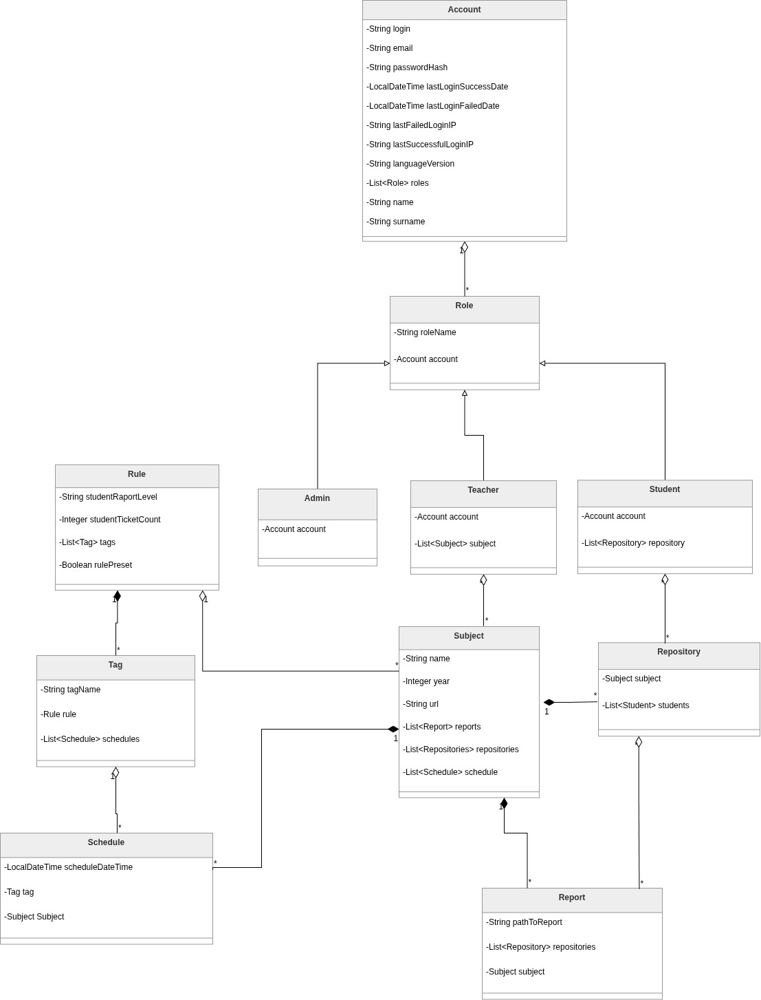

## 1.2. Diagram UML klas modelu dziedzinowego

Diagram uwzględniający klasy modelu dziedzinowego wraz z ich atrybutami oraz powiązaniami (w tym — licznością związków) zaprezentowano na rysunku 1.2.1.

