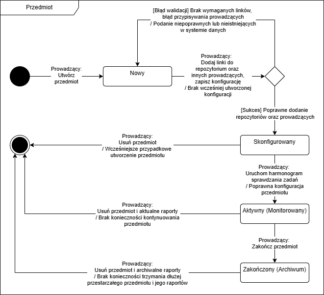
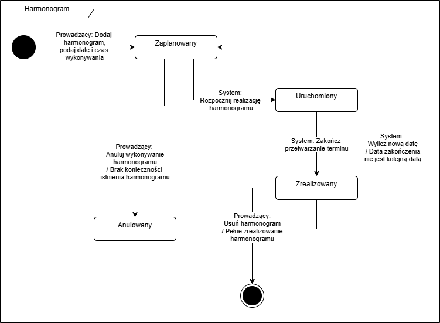
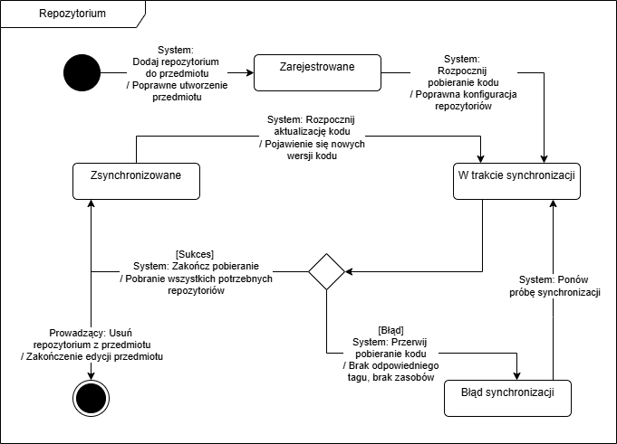
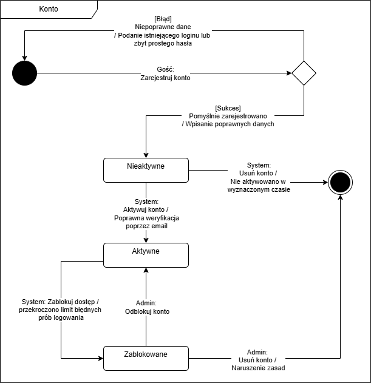

## 1.4. Diagram(y) stanów (przejść)

Rysunek 1.4.1 Diagram stanów dla Raportu.

Proces generowania raportu inicjowany jest ręcznie przez prowadzącego lub automatycznie z poziomu harmonogramu, po czym zadanie trafia do kolejki oczekujących. Następnie system rozpoczyna analizę, próbując pobrać niezbędny kod z repozytorium (GITEA) i przydzielić zasoby. Jeśli operacja się powiedzie, raport zostaje wygenerowany. W przypadku braku zasobów lub błędów pobierania kodu proces kończy się statusem błędu, wymagającym ponowienia.

Rysunek 1.4.2 Diagram stanów dla Przedmiotu.

Nowo utworzony przedmiot wymaga wstępnej konfiguracji, polegającej na poprawnym przypisaniu repozytoriów oraz innych prowadzących. Po udanej walidacji danych i uruchomieniu harmonogramu sprawdzania zadań, przedmiot staje się w pełni aktywny i jest monitorowany przez system. Po zakończeniu okresu prowadzenia zajęć prowadzący może przenieść przedmiot do archiwum, a z czasem całkowicie go usunąć wraz ze wszystkimi historycznymi raportami.

Rysunek 1.4.3 Diagram stanów dla Harmonogramu.

Prowadzący tworzy harmonogram, ustalając datę i czas wykonania konkretnego sprawdzania. Gdy nadchodzi wyznaczony termin, sprawdzanie kodu jest uruchamiane, a po jego zrealizowaniu system automatycznie wylicza kolejną datę, zapętlając proces. Działanie harmonogramu trwa do momentu wyczerpania wszystkich zaplanowanych terminów lub jego ręcznego anulowania przez prowadzącego.

Rysunek 1.4.4 Diagram stanów dla Repozytorium.

Po dodaniu zewnętrznego repozytorium do przedmiotu, system je rejestruje i podejmuje próbę pierwszej synchronizacji. Gdy pobieranie zakończy się sukcesem, repozytorium jest stale monitorowane i automatycznie aktualizowane w momencie wykrycia nowych wersji kodu. Wszelkie problemy z pobieraniem skutkują błędem synchronizacji, co wymusza na systemie ponawianie prób aż do skutku.

Rysunek 1.4.5 Diagram stanów dla Konta.

Cykl życia konta rozpoczyna się od rejestracji, po której pozostaje ono nieaktywne aż do momentu pomyślnej weryfikacji adresu e-mail. Po aktywacji użytkownik zyskuje dostęp do systemu, jednak w przypadku wielokrotnego podania błędnego hasła konto jest automatycznie blokowane. Władzę nad zablokowanymi kontami ma administrator, który może je z powrotem odblokować lub trwale usunąć za naruszenie zasad.