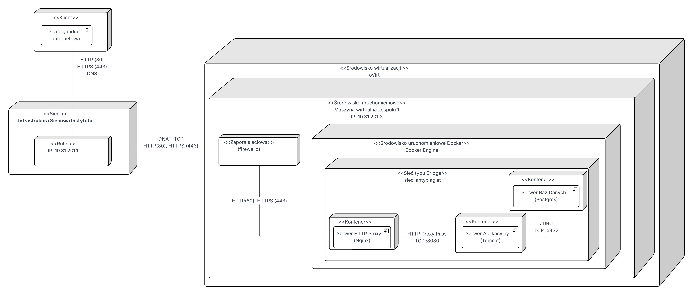
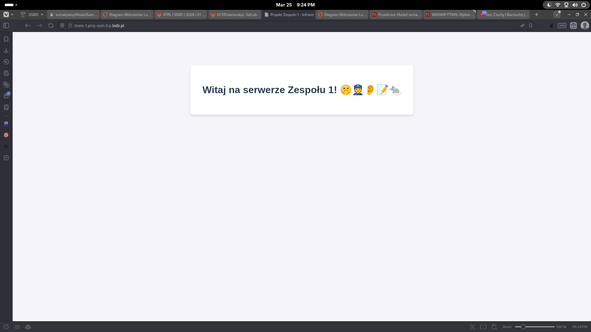
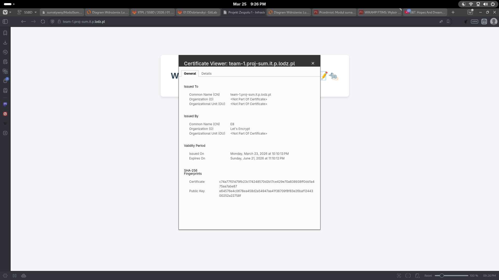

## 1.5. Infrastruktura wdrożeniowa




Rysunek 1.5.1. Diagram perspektywy wdrożenia. 

Na maszynie wirtualnej skonfigurowano usługę firewalld, która dopuszcza ruch z zewnątrz tylko na portach HTTP, HTTPS oraz SSH.

``` bash
[s252929@suma-team-1 ~]$ sudo firewall-cmd --zone public --list-all
[sudo] hasło użytkownika s252929:
public (default, active)
target: DROP
ingress-priority: 0
egress-priority: 0
icmp-block-inversion: no
interfaces: enp3s0
sources:
services: cockpit dhcpv6-client http https ssh
ports:
protocols:
forward: yes
masquerade: no
forward-ports:
source-ports:
icmp-blocks:
rich rules:
[s252929@suma-team-1 ~]$
```
Listing 1.5.1. Wykazanie reguł zapory ogniowej.

Wewnątrz systemu operacyjnego skonfigurowano środowisko konteneryzacji (Docker Engine), w którym uruchomiono odpowiednie usługi, zapewniając ich izolację oraz poprawne działanie aplikacji.

Tabela 1.5.1. Oprogramowania i licencje inne niż wymagane, a które zostały wykorzystane w ramach poprawnego wdrożenia infrastruktury. 

| Oprogramowanie | Wersja | Rola w systemie              | Licencja           |
|----------------|--------|------------------------------|--------------------|
| Certbot        | 4.2.0  | Generowanie certyfikatów TLS | Apache 2.0 License |



Rysunek 1.5.2. Zrzut ekranu z działającej domeny team-1.proj-sum.it.p.lodz.pl

Serwer Nginx został skonfigurowany jako Reverse Proxy. W celu zapewnienia bezpieczeństwa, narzędzie to wymusza połączenie szyfrowane, automatycznie przekierowując wszelkie zapytania HTTP na protokół HTTPS. 


Rysunek 1.5.3. Zrzut ekranu certyfikatu domeny team-1.proj-sum.it.p.lodz.pl.
